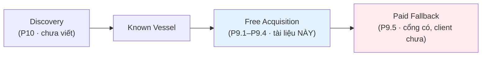
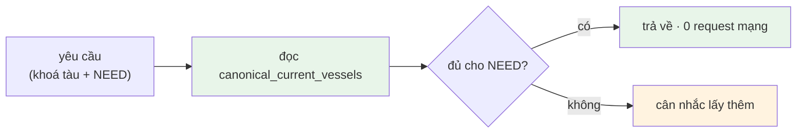
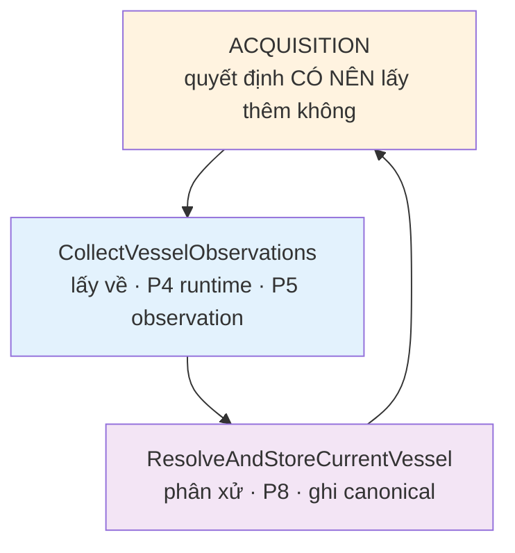
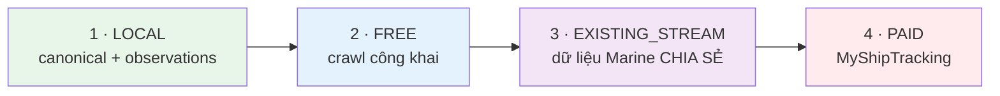
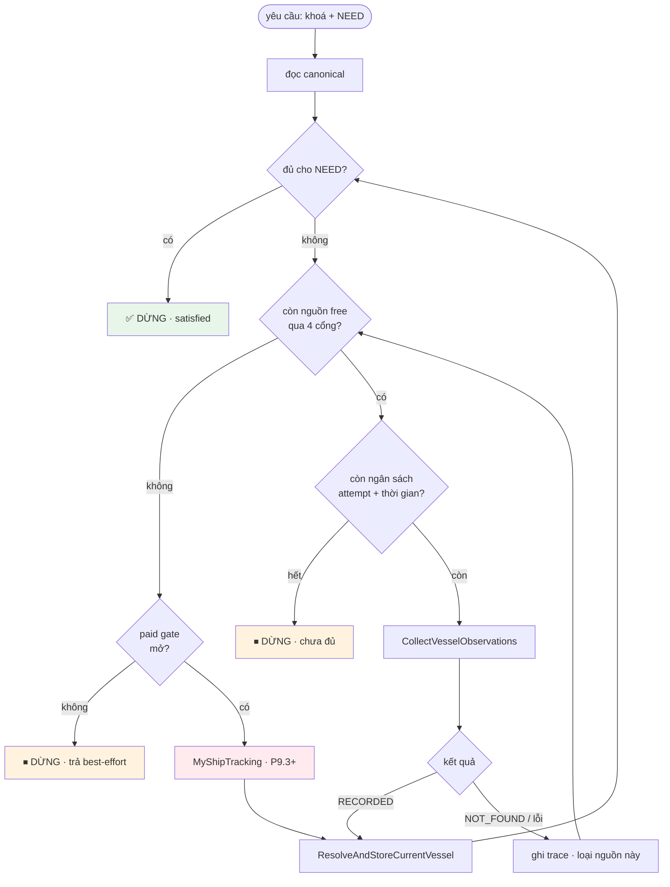
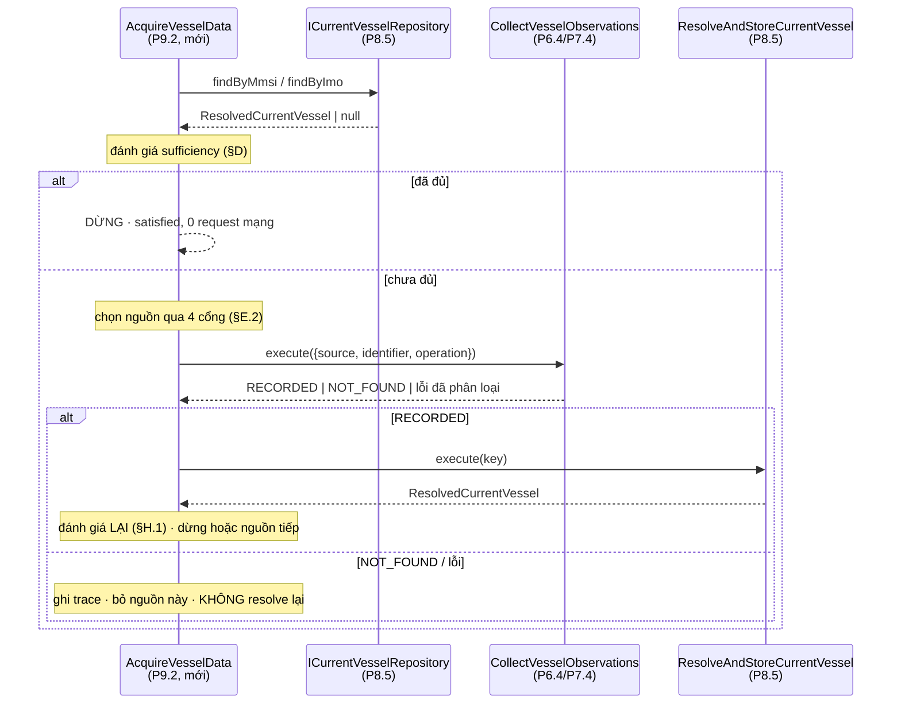
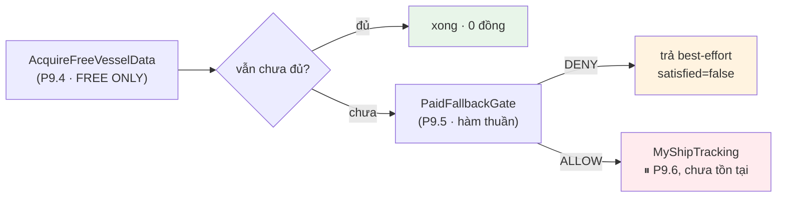

# ACQUISITION_POLICY — Phase 9.1 (thiết kế, KHÔNG implement)

> Trả lời đúng bảy câu hỏi: **khi nào dữ liệu local là đủ · khi nào cần lấy thêm · lấy từ nguồn nào · khi nào dừng · khi nào mới được tiêu tiền · làm sao không gọi mọi nguồn mỗi request · làm sao không trùng AISStream.**
>
> **P9.1 chỉ thiết kế.** Không `AcquisitionOrchestrator.ts`, không `FallbackEngine.ts`, không client MyShipTracking, không gọi mạng, không Redis/queue/event bus/scheduler.

---

## A. Goals / Non-goals

### Goals

| # | Mục tiêu |
|---|---|
| G1 | Định nghĩa **đủ** (sufficiency) theo NHU CẦU, không theo "document có tồn tại" |
| G2 | Bắt buộc **local-first**: mọi luồng bắt đầu từ `canonical_current_vessels` |
| G3 | Chọn nguồn theo **capability matrix**, không theo tên nguồn hardcode |
| G4 | **Điều kiện dừng** rõ sau MỖI nguồn — không quét hết registry |
| G5 | Cổng chặn nguồn trả tiền có **4 điều kiện**, không phải "free lỗi thì gọi paid" |
| G6 | Không mở connection AISStream thứ hai |

### Non-goals (P9.1)

Không implement orchestrator · không client MyShipTracking · không gọi API trả tiền · không Redis · không queue · không event bus · không scheduler/cron · không change stream · không mở AISStream · **không sửa resolver** · **không sửa provider** · không sửa Marine/FE · không bulk crawl · không auto-refresh toàn DB.

---

## A.1 Vị trí của tài liệu này trong bức tranh lớn

Tài liệu này nói về **một con tàu đã biết định danh**. Câu hỏi *"có những tàu nào?"* thuộc tầng khác, đứng phía trước:



Discovery cập nhật danh bạ tàu; chính sách làm giàu quyết định tàu nào **đến hạn**; rồi mới tới `AcquireVesselData`. ⛔ Discovery **không** gọi provider trực tiếp — xem [GLOBAL_DISCOVERY_ARCHITECTURE.md §5](./GLOBAL_DISCOVERY_ARCHITECTURE.md).

Luật của P9 **không đổi** vì có thêm tầng đó: vẫn local-first, vẫn tối đa 2 lần chạm nguồn free, vẫn mặc định từ chối trả tiền.

---

## B. Local-first — nguyên tắc gốc

Acquisition **không bao giờ** bắt đầu bằng network.



Ba tầng đã có, **không tầng nào được nhảy cóc**:



### B.1 Resolution ≠ Acquisition

| | Resolution (P8, ĐÃ CÓ) | Acquisition (P9, CHƯA CÓ) |
|---|---|---|
| Câu hỏi | Trong những gì ĐÃ CÓ, cái nào đúng? | Có nên đi lấy thêm không? Từ đâu? |
| Đầu vào | `vessel_observations` | canonical hiện tại + capability + health |
| Đầu ra | `ResolvedCurrentVessel` | quyết định gọi / không gọi |
| Chạm mạng | **không bao giờ** | có (qua P4) |

⛔ **Resolver TUYỆT ĐỐI không được chứa** `if (position === null) callShipFinder()`. Resolver là hàm thuần; nhét network vào đó là phá bỏ toàn bộ tính tất định mà P8.2–P8.4 xây.

⛔ **Acquisition TUYỆT ĐỐI không được chứa** `shipFinderPosition wins`. Ai thắng là việc của resolver. Acquisition chỉ quyết **gọi ai**, không quyết **tin ai**.

---

## C. Data Need model

Nhu cầu là **đầu vào của người gọi**, không phải thứ suy ra từ dữ liệu.

| Need | Nghĩa | Nhóm canonical liên quan |
|---|---|---|
| `POSITION` | Tàu đang ở đâu **bây giờ** | position |
| `IDENTITY` | Tàu này là tàu nào | identity |
| `PARTICULARS` | Thông số con tàu | particulars |
| `VOYAGE` | Chuyến đi hiện tại | voyage |
| `FULL` | Ảnh tổng hợp để hiển thị | cả bốn |

`DETAILS` (xuất hiện trong spec P9.1 §6) = `IDENTITY` + `PARTICULARS`. Giữ làm **bí danh tiện dụng**, không phải need thứ sáu.

### C.1 Need có thể chỉ đích danh field

Đây là phần **bắt buộc**, không phải tuỳ chọn trang trí. Không có nó thì §43 (cần `builtYear`) không phân biệt được với "cần particulars nói chung", và hệ thống sẽ gọi nhầm nguồn.

```
need: PARTICULARS                      -> "có particulars dùng được là đủ"
need: PARTICULARS + fields[builtYear]  -> "thiếu builtYear là CHƯA đủ"
```

`requiredFields` **thu hẹp** định nghĩa đủ, không mở rộng nó: field không nằm trong `requiredFields` thì thiếu cũng không kích hoạt crawl.

---

## D. Sufficiency rules

### D.0 Nguyên tắc chống đuổi theo sự hoàn hảo

⛔ **Cấm** mọi dạng của:

```
while (canonical có field null) fetch(nguồn tiếp theo)
```

Lý do đo được: trong canonical của AGIA DOXA sau P6.4/P7.4, `grossTonnage`, `eta`, `currentPort`, `nextPort`, `lastPort` đều `null`, và **không nguồn free nào đang có provider cấp được chúng ở mức CONFIRMED**. Vòng lặp trên sẽ gọi hết ba nguồn, mỗi request, mãi mãi, và `null` vẫn là `null`.

**Field thiếu ≠ phải fetch.** Chỉ field **required cho need cụ thể** mới đáng một request.

### D.1 POSITION

Dựa thẳng vào `PositionFreshness` mà `PositionResolver` đã tính ([RESOLVER_POLICY.md §D.4](./RESOLVER_POLICY.md)) — **không định nghĩa lại bậc độ tươi**.

| Bậc | Tuổi theo mốc NGUỒN | Đủ cho `POSITION`? | Quyết định |
|---|---|---|---|
| `LIVE` | ≤ 30 phút | ✅ **ĐỦ** | dừng, 0 request |
| `RECENT` | ≤ 6 giờ | ❌ chưa đủ | refresh |
| `STALE` | ≤ 24 giờ | ❌ chưa đủ | refresh |
| `EXPIRED` | > 24 giờ | ❌ chưa đủ | refresh |
| `NO_SOURCE_TIME` | nguồn không khai mốc | ❌ chưa đủ | refresh |

**Vì sao ngưỡng đúng bằng `LIVE` (30 phút), không phải `RECENT` (6 giờ):**

- POC P7 đo ShipFinder trả vị trí tuổi **1–37 phút**. Tức là ngưỡng `LIVE` chính là *thứ nguồn tốt nhất của ta thực sự đạt được*. Đặt ngưỡng chặt hơn → không nguồn nào thoả → crawl vô hạn. Đặt lỏng hơn (6 giờ) → ShipFinder gần như **không bao giờ** được gọi, và ta trả về vị trí lệch tới 72 hải lý cho một tàu chạy 12 knot.
- Ngưỡng và năng lực nguồn **khớp nhau** là điều kiện để vòng lặp hội tụ sau đúng một lần gọi.

⚠️ `NO_SOURCE_TIME` **không phải** "vừa mới". Không biết tuổi ≠ tuổi bằng 0. Vị trí không rõ tuổi có thể cũ 5 phút hoặc 5 ngày.

⚠️ Với need **khác** `POSITION` (VD `FULL` để hiển thị lý lịch), `RECENT` **được chấp nhận** — xem bảng §O.1. Cùng dữ liệu, hai nhu cầu, hai chuẩn.

### D.2 IDENTITY

| Loại | Field | Thiếu thì sao |
|---|---|---|
| **Required** | `name` | crawl |
| Enrichment | `callsign`, `vesselType`, `flagCode`, `flagName` | **không** crawl |
| Enrichment | `vesselTypeCode` | **không** crawl — không nguồn free nào có provider CONFIRMED |

`mmsi`/`imo` không nằm trong bảng: chúng là **khoá tra**, đã có sẵn từ yêu cầu.

Identity **không có ngưỡng tuổi**. Tàu đổi tên là chuyện thật (`"Queen Of The West"` → `"AMERICAN WEST"`, cùng callsign) nhưng hiếm, và không request nào biết trước nó vừa xảy ra. Refresh identity theo lịch là việc của background job — **không** phải của request tương tác.

### D.3 PARTICULARS

| Trạng thái canonical | Đủ? |
|---|---|
| `particulars === null` | ❌ chưa từng lấy được gì → crawl |
| có ≥ 1 field | ✅ **đủ** cho `PARTICULARS` trần |
| có, nhưng thiếu field trong `requiredFields` | ❌ → crawl **đúng nguồn có field đó** |

**Không có ngưỡng tuổi.** Chiều dài tàu không đổi theo thời gian; refresh vì "dữ liệu cũ 3 ngày" là đốt request để nhận lại đúng con số đó.

⚠️ Ngoại lệ đã biết: `draught` **nửa động** — đổi theo hàng hoá từng chuyến. Canonical hiện xếp nó trong particulars ([RESOLVER_POLICY.md §Q.2](./RESOLVER_POLICY.md)). P9.1 **không** thiết kế lại model; ai cần mớn nước theo chuyến thì phải yêu cầu đích danh `draught` trong `requiredFields`, và khi đó áp ngưỡng tuổi của `VOYAGE` (§D.4).

### D.4 VOYAGE

| Loại | Field | Thiếu thì sao |
|---|---|---|
| **Required** | `destination` | crawl |
| Enrichment | `eta` | ⛔ **KHÔNG BAO GIỜ** crawl vì thiếu nó |
| Enrichment | `currentPort`, `nextPort`, `lastPort`, `lastPortDepartureAt` | **không** crawl |

⛔ **`eta` null không được là lý do gọi bất kỳ nguồn nào — kể cả paid.** Bằng chứng P7: ShipFinder trả `"07-29 07:01"` (**thiếu năm**), canonical `eta` là `Date` nên mapper **cố ý** không map. Crawl lại ShipFinder để tìm `eta` là đi lấy thứ nguồn đó không có. Trong ba nguồn đang có provider, `eta` CONFIRMED: **0**.

**Ngưỡng tuổi:** voyage đủ khi `destination` có **và** `fetchedAt` của nó ≤ **6 giờ**. Rationale: cảng đích đổi khi tàu đổi chuyến — đơn vị giờ, không phải phút. 6 giờ = `SCAN_INTERVAL_MS` mặc định, hằng số nhịp quét mà hệ thống đã dùng; không bịa số mới.

Voyage đo tuổi bằng `fetchedAt` (không phải `sourceReceivedAt`) vì nhóm này **không có mốc nguồn** — cả ba nguồn đều để `observedAt = null`.

### D.5 FULL

`FULL` = hợp của bốn required, **với chuẩn position nới lỏng**:

| Nhóm | Chuẩn trong `FULL` |
|---|---|
| identity | `name` có |
| position | bậc ≤ `RECENT` (**không** đòi `LIVE`) |
| particulars | ≥ 1 field |
| voyage | `destination` có, ≤ 6 giờ |

Vì sao position nới ở `FULL`: `FULL` là nhu cầu **hiển thị hồ sơ tàu**, không phải nhu cầu **theo dõi thời gian thực**. Đòi `LIVE` ở đây biến mọi lần mở trang chi tiết thành một lần crawl.

⚠️ `FULL` **không** có nghĩa "mọi field non-null". Xem §D.0.

---

## E. Source selection rules

### E.1 Thứ tự theo chi phí — bắt buộc



Bậc 3 **không phải** "bot kết nối AISStream" — xem §M.

### E.2 Bốn cổng lọc, theo thứ tự

Một nguồn phải qua **cả bốn** mới được chọn:

| # | Cổng | Nguồn dữ liệu | Loại bỏ khi |
|---|---|---|---|
| 1 | **Có provider thật** | `ProviderRegistry.has(source)` | chưa có implementation |
| 2 | **Capability khớp need** | `getSourcesForFields(requiredFields)` | không CONFIRMED field cần |
| 3 | **Health** | `runtime.getExecutor(source).getHealth()` | `COOLDOWN` / `DISABLED` |
| 4 | **Có khả năng cải thiện** | canonical hiện tại + đặc tính nguồn | kết quả tốt nhất của nguồn vẫn không đủ (§E.4) |

Cổng 1 là cổng thật, không hình thức: matrix có **10** nguồn, registry chỉ có **3** (`vesselfinder`, `shipinfo`, `shipfinder`). `marinetraffic_live` có 28 field CANDIDATE nhưng gọi nó sẽ crash — không có client.

⚠️ **Cấm** `for (const p of registry.getAll())`. Duyệt registry là cách chắc chắn nhất để gọi mọi nguồn mỗi request.

### E.3 Sắp thứ tự sau khi lọc

`defaultPriority` **chỉ là tie-break cuối**, không phải tiêu chí đầu.

| # | Tiêu chí | Vì sao trước `defaultPriority` |
|---|---|---|
| 1 | Số field required nguồn cấp được (nhiều hơn trước) | một request lấy được 2 field hơn hẳn hai request |
| 2 | Hạng capability cho field required (CONFIRMED > CANDIDATE) | CANDIDATE là suy đoán chưa POC |
| 3 | Health (`HEALTHY` > `DEGRADED`) | `DEGRADED` đang có chuỗi hỏng dở |
| 4 | Khả năng cải thiện định lượng (§E.4) | nguồn trễ 14h không nâng nổi vị trí lên `LIVE` |
| 5 | `defaultPriority` | tie-break tất định |

Bằng chứng vì sao `defaultPriority` không được đứng đầu: ShipInfo có `defaultPriority` **45**, tốt hơn ShipFinder **55**. Nhưng cho need `POSITION`, ShipInfo bị khoá trễ **~14 giờ** (`fresh_locked: true`) — nó **không bao giờ** trả về được một vị trí `LIVE`. Sắp theo priority là gọi trước đúng nguồn không giải quyết được vấn đề. Con số 55 được giữ nguyên **có chủ ý** ở P7.4 vì "đổi thứ tự ưu tiên chính là mã hoá *ShipFinder thắng ShipInfo* — đó là việc của resolver".

### E.4 Cổng "khả năng cải thiện" (improvement gate)

Quy tắc quan trọng nhất của tài liệu này:

> **Không gọi nguồn mà kết quả tốt nhất của nó vẫn không thoả mãn need.**

Ba trường hợp đã có bằng chứng, không phải giả thuyết:

| Nguồn | Need | Vì sao bị chặn ở cổng 4 |
|---|---|---|
| `shipinfo` | `POSITION` | vị trí bản free **trễ ~14 giờ có chủ ý** → luôn rơi vào `STALE`/`EXPIRED`, không bao giờ đạt `LIVE` |
| `vesselfinder` | `POSITION` | `getPosition()` lấy từ trang chi tiết: toạ độ **làm tròn ~111 km** (`latLngApproximate = true`) và `positionReceivedAt` chỉ là chuỗi tương đối `"0 min ago"` (CANDIDATE) → mọi vị trí rơi vào `NO_SOURCE_TIME`, **bậc thấp nhất** |
| `shipfinder` | `builtYear`, `deadweight`, `grossTonnage` | nằm sau `/ship/GetIHSData` — **API ký chữ ký**, không đụng → CANDIDATE, không CONFIRMED |

⚠️ **Ngoại lệ có điều kiện:** khi canonical **chưa có vị trí nào** (`position === null`), nguồn bị chặn ở cổng 4 **được phép** gọi một lần — "vị trí trễ 14 giờ" vẫn hơn hẳn "không có vị trí". Nhưng kết quả đó **không** làm need `POSITION` thành `satisfied`; nó chỉ nâng đáy. Trace phải ghi rõ (§P.6).

---

## F. Dùng capability matrix như thế nào

Chọn nguồn = **truy vấn matrix**, không viết `if (source === "shipfinder")`.

```ts
// Đúng — capability quyết định
const candidates = getSourcesForFields(missingRequiredFields);

// Sai — tên nguồn hardcode trong luồng
if (needsPosition) tryShipFinder(); else tryShipInfo();
```

Mặc định an toàn của `capabilityQueries` khớp sẵn với §E.1: `includePaid = false`, `includeDisabled = false`, `includeCandidate = false`. Muốn nguồn trả tiền thì **người gọi phải nói rõ ý định** — đúng tinh thần §L.

⚠️ `enabled = false` của `shipinfo`/`shipfinder` phản ánh "chưa có ingestion tự động", **không** phải "cấm dùng". Acquisition gọi chúng qua đường **thủ công/bounded** nên phải truyền `includeDisabled: true` **có ý thức**, và ghi lý do vào trace. Ngược lại, `vesselfinder.enabled = true` **chỉ** vì legacy crawler đang chạy production — **không** có nghĩa acquisition được mặc định ưu ái nó ([SOURCE_CAPABILITY_MATRIX.md §7](./SOURCE_CAPABILITY_MATRIX.md)).

---

## G. Source health handling

Đọc từ `SourceHealthTracker` đã có (P4) — **không** dựng bộ đếm thứ hai.

| State | Được chọn? | Ghi chú |
|---|---|---|
| `HEALTHY` | ✅ ưu tiên | |
| `DEGRADED` | ⚠️ được, nhưng xếp **sau** `HEALTHY` cùng hạng | có chuỗi hỏng chưa tới ngưỡng |
| `COOLDOWN` | ❌ **loại** | ⛔ không reset, không bypass |
| `DISABLED` | ❌ **loại** | chỉ người vận hành bật lại |

⛔ **Không** gọi `enterCooldown()` / `enable()` / `disable()` từ acquisition. Runtime sở hữu vòng đời health; acquisition chỉ **đọc**.

⛔ **Không** bắt `SourceUnavailableError` rồi thử lại nguồn đó. Đó là cổng chặn phía ta, chưa hề chạm mạng — thử lại chỉ tốn CPU.

### G.1 Lỗi kỹ thuật ≠ tàu không tồn tại

| Kết quả | Nghĩa | Acquisition làm gì |
|---|---|---|
| `NOT_FOUND` | **nguồn này** không tìm được tàu | thử nguồn khác được; ⛔ **không** cache "tàu không tồn tại" toàn cục |
| `PARSE_ERROR` | nguồn đổi form HTML | thử nguồn khác; health tự lo cooldown |
| `BLOCKED` (403) | bị chặn | thử nguồn khác; ⛔ **không** leo paid vì một lần 403 |
| `RATE_LIMITED` (429) | vượt hạn mức | thử nguồn khác; ⛔ **không** leo paid |
| `TIMEOUT` / `NETWORK_ERROR` / `SERVER_ERROR` | sự cố tạm | thử nguồn khác |

`NOT_FOUND` **có bằng chứng cụ thể** cần tôn trọng: ShipFinder trả 404 cho `/ship/detail/imo/{imo}` — nguồn chỉ tra được bằng **MMSI**. Một yêu cầu chỉ có IMO mà gọi ShipFinder là `NOT_FOUND` **được đảm bảo trước**; cổng 2 (§E.2) phải chặn nó bằng `operations.searchByImo = false`, không để nó thành một request thật.

⛔ **Không** đếm `NOT_FOUND` vào chuỗi hỏng — `SourceHealthTracker.recordNotFound()` đã làm đúng. Tra 500 MMSI lạ không được phép khoá một nguồn đang khoẻ.

---

## H. Stop conditions

Sau **MỖI** nguồn, không phải sau khi hết nguồn:



Năm điều kiện dừng, **bất kỳ cái nào** cũng dừng:

| # | Điều kiện | `satisfied` |
|---|---|---|
| S1 | canonical đã đủ cho need | ✅ true |
| S2 | hết nguồn qua được 4 cổng | ❌ false |
| S3 | hết ngân sách attempt (§I) | ❌ false |
| S4 | hết ngân sách thời gian (§I.2) | ❌ false |
| S5 | paid gate đóng (§L) | ❌ false |

⚠️ **`satisfied = false` KHÔNG phải lỗi.** Trả về dữ liệu local tốt nhất kèm cờ. Ném exception vì "dữ liệu chưa đủ" là biến một câu trả lời hợp lệ thành sự cố.

### H.1 Bắt buộc re-resolve sau mỗi lần lấy được

Observation mới mà canonical không refresh = kho canonical nói dối. Sau mỗi `CollectVesselObservations` trả `RECORDED`, **phải** chạy `ResolveAndStoreCurrentVessel` rồi mới đánh giá lại.

Ngược lại: `NOT_FOUND` / lỗi → **0 observation mới** → resolve lại cho ra **đúng kết quả cũ** (`UNCHANGED`). Bỏ qua bước resolve trong nhánh này; đó là tiết kiệm thật, không phải cắt xén.

⚠️ Đánh giá lại phải dùng **kết quả resolve vừa trả về**, không đọc lại DB — tránh một lượt truy vấn thừa mỗi vòng.

---

## I. Free-source attempt budget

### I.1 Số lần gọi

**Tối đa 2 nguồn free cho mỗi (yêu cầu, need).**

Rationale — cả hai đều đo được, không phải số tròn cho đẹp:

1. **Không need nào có nhiều hơn 2 nguồn hữu ích.** Đếm nguồn vừa có provider vừa CONFIRMED field required: `POSITION` → 2 (`shipfinder`, `shipinfo`, sau khi cổng 4 loại `vesselfinder`) · `destination` → **1** (`shipfinder`) · `builtYear`/`deadweight` → **1** (`shipinfo`) · `name` → 3. Ngân sách 2 chỉ thực sự cắt ở need `IDENTITY`, nơi nguồn thứ ba gần như chắc chắn chỉ lặp lại điều hai nguồn đầu đã nói.
2. **Ngân sách thời gian.** `ShipInfo` timeout 20s + nghỉ 3–8s; `ShipFinder` timeout 15s + nghỉ 3–8s. Xấu nhất 2 lần ≈ **56 giây**. Lần thứ ba đẩy quá 60s — vượt ngưỡng chờ của bất kỳ yêu cầu tương tác nào.

⚠️ **Ghi trace khi cắt.** Dừng vì hết ngân sách mà im lặng thì kết quả đọc y hệt "đã thử hết" — trong khi thực tế còn nguồn chưa gọi. `attempts[]` phải có dòng `SKIPPED · reason = ATTEMPT_BUDGET_EXHAUSTED`.

### I.2 Ngân sách thời gian

| Ngữ cảnh | Ngân sách | Ghi chú |
|---|---|---|
| Yêu cầu tương tác | **30 giây** | thường chỉ đủ 1 nguồn — đúng ý đồ |
| Chạy nền / CLI | **90 giây** | đủ cho cả 2 nguồn ở trường hợp xấu nhất |

Kiểm ngân sách **TRƯỚC** khi bắt đầu attempt tiếp theo, **không** huỷ giữa chừng. Timeout từng request đã do P4 quản (`timeoutMs` theo nguồn) — ⛔ **không** dựng timeout engine thứ hai.

---

## J. Recent attempt suppression

### J.1 Vấn đề

```
10:00:00  yêu cầu A · ShipFinder → NOT_FOUND
10:00:05  yêu cầu B · cùng MMSI → gọi lại ShipFinder?
```

Không nên. Nguồn vừa nói "không có tàu này" 5 giây trước.

### J.2 Dữ liệu hiện có KHÔNG đủ — nêu thẳng

| Nguồn dữ liệu | Vì sao không đủ |
|---|---|
| `vessel_observations.fetchedAt` | **chỉ ghi khi THÀNH CÔNG**. `NOT_FOUND` không để lại dấu vết nào → không suppress được đúng ca cần suppress nhất |
| `SourceHealthSnapshot.lastFailureAt` | theo **NGUỒN**, không theo `(nguồn, tàu)`. ShipFinder miss tàu X không nói gì về tàu Y |
| `SourceHealthTracker` cooldown | chỉ bật sau **3 lần hỏng liên tiếp**; `NOT_FOUND` cố ý không tính vào đó |

Đây là **khoảng trống thật**, phải lấp ở P9.2.

### J.3 Đề xuất

Bản ghi nhẹ trong RAM, khoá `(source, vesselKey, operation)`:

```
AcquisitionAttemptMemory
  key      "shipfinder|636018086|GET_POSITION"
  at       Date
  outcome  RECORDED | NOT_FOUND | FAILED
```

| Kết quả lần trước | Cửa sổ chặn | Rationale — dùng lại hằng đã có, không bịa số |
|---|---|---|
| `NOT_FOUND` | **15 phút** | đúng `cooldownMs` đã khai cho cả ShipInfo lẫn ShipFinder |
| `FAILED` | theo health | cooldown của P4 đã lo; ⛔ không chặn chồng |
| `RECORDED` nhưng vẫn chưa đủ | **30 phút** | đúng `liveMaxAgeMs`. Trước mốc đó, kết quả vừa lấy **vẫn còn** `LIVE` — gọi lại không thể đổi bậc |

Dòng cuối là quy tắc chống vòng lặp mạnh nhất: nếu vừa crawl ShipFinder xong mà position **vẫn** không `LIVE`, thì nguồn chỉ có bấy nhiêu. Gọi lại sau 5 giây cho ra đúng dữ liệu đó.

⛔ **Không Redis, không collection mới ở P9.2.** Giới hạn phải ghi rõ: mất khi restart, không chia sẻ giữa process. Chấp nhận được vì P9.2 là orchestration **một tiến trình, chạy tay**. Cần chia sẻ giữa process thì đó là phase khác.

---

## K. Request coalescing

10 yêu cầu đồng thời cùng MMSI **không được** thành 10 lượt crawl giống hệt.

**Đề xuất: single-flight theo `(vesselKey, need)`** — `Map<string, Promise<Result>>` trong tiến trình. Yêu cầu thứ hai trở đi **chờ chung** promise của yêu cầu đầu, không tự gọi.

```
key = `${mmsi ?? imo}|${need}|${requiredFields.sort().join(",")}`
```

`requiredFields` phải nằm trong khoá: hai yêu cầu cùng need nhưng khác field required là **hai công việc khác nhau** (`PARTICULARS` trần đã đủ, `PARTICULARS + builtYear` thì chưa).

⛔ Không distributed lock, không Redis, không hàng đợi. Giới hạn: **chỉ trong một tiến trình**. Hai instance bot vẫn crawl trùng — chấp nhận được, vì P4 đã chặn `maxConcurrency = 1` mỗi nguồn và giữ nhịp nghỉ 3–8s.

---

## L. Paid fallback gate

### L.1 Bốn điều kiện — phải đủ CẢ BỐN

| # | Điều kiện | Kiểm bằng |
|---|---|---|
| **1** | Local **không đủ** cho need cụ thể | §D |
| **2** | Nguồn free **liên quan** đã cạn — nghĩa là mỗi nguồn free rơi vào ít nhất một trong: không CONFIRMED field cần · `NOT_FOUND` · `COOLDOWN`/`DISABLED` · đã thử mà vẫn không đủ | §E.2 + trace |
| **3** | Yêu cầu **cho phép** trả tiền — `allowPaidFallback === true` | §L.2 |
| **4** | **Ngân sách** còn — quota ngày + không bị chặn theo tàu | §L.3 |

⛔ **Cấm tuyệt đối** dạng này:

```
ShipFinder → lỗi → MyShipTracking
```

Bắt buộc:

```
local → mọi nguồn free LIÊN QUAN → re-resolve → đánh giá lại → chỉ khi đó mới paid
```

Điều kiện 2 dùng chữ **"liên quan"** có chủ ý: nguồn free không CONFIRMED field đang cần thì tính là **đã cạn ngay lập tức** — không phải gọi nó một lần cho "đủ thủ tục". Gọi ShipFinder để tìm `builtYear` là đốt một request lấy thứ nằm sau API ký chữ ký.

⛔ Một lần `429`/`403` từ một nguồn free **không** mở cổng paid. Đó là sự cố tạm; nguồn free khác vẫn còn, và cooldown của P4 sẽ tự hết hạn.

### L.2 Opt-in

`allowPaidFallback` **mặc định `false`**.

Mặc định `true` nghĩa là mọi đường gọi tương lai — API mới, CLI mới, job mới — đều tiêu tiền cho tới khi ai đó nhớ ra phải tắt. Chi phí của việc quên `false` là hoá đơn; chi phí của việc quên `true` là một `satisfied: false`. Bất đối xứng, chọn phía an toàn.

### L.3 Ngân sách — tối thiểu, không phải hệ thống billing

| Cơ chế | Đề xuất | Vì sao |
|---|---|---|
| Quota ngày | trần số lần gọi / ngày, đọc từ `.env` | trần cứng, không có nó thì một vòng lặp hỏng có thể quét sạch hạn mức |
| Chặn theo tàu | **24 giờ** mỗi `(vesselKey, need)` | paid trả về mà vẫn không đủ thì gọi lại trong ngày cho ra đúng thế |
| Opt-in | §L.2 | |

⛔ Không sổ cái tài chính, không tính tiền theo request, không hệ thống hoá đơn. Ba cơ chế trên là **trần chi**, không phải kế toán.

### L.4 MyShipTracking — trạng thái audit

Đã kiểm toàn repo:

| Hạng mục | Thực tế |
|---|---|
| API client | ❌ **không có** — không một dòng code |
| Response mẫu / tài liệu API | ❌ không có trong repo |
| Field trong matrix | **28 CANDIDATE, 0 CONFIRMED** |
| Đã xuất hiện ở | `VesselSource.ts` (enum) · `sourceCapabilityMatrix.ts` (entry) · `SourceRuntimeConfig.ts` (override `minDelayMs: 0`) |

⛔ **P9.1 KHÔNG được giả định** endpoint, tên field, format response, mô hình giá. Toàn bộ 28 field là CANDIDATE — nâng lên CONFIRMED phải qua đúng quy trình [SOURCE_CAPABILITY_MATRIX.md §10](./SOURCE_CAPABILITY_MATRIX.md).

**Điều kiện tiên quyết trước khi viết client:** một phase audit riêng (API docs, quota, giá, response mẫu). Không có nó thì paid fallback là code gọi vào chỗ không ai biết hình thù.

---

## M. AISStream rule

> **Bot Phase 9 KHÔNG mở connection AISStream.**

| | |
|---|---|
| Ai sở hữu | **Marine production** |
| Bot làm gì | ❌ không connect · không đăng ký thứ hai · không dùng lại credential |
| Vì sao | Connection thứ hai = hai subscriber cùng tài khoản: trùng dữ liệu, chia đôi hạn mức, và không ai biết bản ghi nào đến từ đâu |

Nếu sau này dữ liệu canonical của Marine được **chia sẻ** cho bot, nó là **LOCAL/EXISTING data** — đọc từ kho chung, đứng ở bậc 3 §E.1 — **không** phải một provider connection của bot. Khi đó đường vào vẫn phải là `vessel_observations` (nguồn `aisstream`), rồi resolver phân xử như mọi nguồn khác. Acquisition **không bao giờ** mở socket.

`aisstream.enabled = false` trong matrix đã mã hoá đúng quyết định vận hành này. Nó ở đó vì capability là thật (17 field CONFIRMED theo đặc tả AIS), nhưng quyền dùng thì không thuộc bot.

---

## N. Proposed orchestration flow

### N.1 API concept — CHỈ thiết kế

```ts
// ⚠️ CHƯA IMPLEMENT. Đây là hình dạng đề xuất cho P9.2.
AcquireVesselData.execute({
  key: VesselObservationKey,          // mmsi và/hoặc imo
  need: DataNeed,                     // POSITION | IDENTITY | PARTICULARS | VOYAGE | FULL
  requiredFields?: VesselField[],     // thu hẹp định nghĩa "đủ" (§C.1)
  allowPaidFallback?: boolean,        // mặc định FALSE
  timeBudgetMs?: number,              // mặc định 30_000 (tương tác)
}): Promise<AcquireVesselDataResult>

interface AcquireVesselDataResult {
  vessel: ResolvedCurrentVessel | null;   // dữ liệu tốt nhất, kể cả khi chưa đủ
  satisfied: boolean;                     // đủ cho need chưa
  attempts: readonly AcquisitionAttempt[];// vì sao gọi / vì sao không
  paidFallbackUsed: boolean;
}
```

### N.2 Compose hai use case đã có — KHÔNG merge



⛔ **Không merge code** của `CollectVesselObservations` và `ResolveAndStoreCurrentVessel`. Hai use case đó tách nhau có chủ ý: crawl hỏng không được kéo theo canonical hỏng, và resolve lại không được sinh request lên nguồn. Acquisition **gọi** chúng, không nuốt chúng.

### N.3 Sync hay background — chốt cho Phase A

**Chọn: đồng bộ, có chặn (synchronous bounded).**

| | |
|---|---|
| Vì sao | Repo **chưa có** queue, event bus, scheduler, change stream. Thêm hạ tầng đó chỉ để orchestrate 2 lần gọi là đổi kiến trúc để giải quyết một bài toán chưa tồn tại |
| Chặn bằng gì | ngân sách attempt (§I.1) + ngân sách thời gian (§I.2) + single-flight (§K) |

**Giới hạn — ghi rõ, không giấu:**

- Người gọi **chờ thật**: xấu nhất ~56 giây với 2 nguồn. Đó là lý do ngân sách tương tác đặt 30s (thường chỉ đủ 1 nguồn).
- Không refresh nền: dữ liệu chỉ mới khi có người hỏi.
- Không chia sẻ giữa các instance.

Thấy chật thì phase sau thêm hàng đợi — **không** thêm trước.

### N.4 Attempt trace

Mỗi lần cân nhắc một nguồn ghi một dòng, **kể cả khi không gọi**:

| Trường | Ví dụ |
|---|---|
| `source` | `SHIPFINDER` |
| `operation` | `GET_POSITION` |
| `decision` | `ATTEMPTED` \| `SKIPPED` |
| `outcome` | `RECORDED` \| `NOT_FOUND` \| `FAILED` \| `—` |
| `reason` | mã đóng, xem dưới |

Mã lý do đề xuất — **mã đóng, không phải câu chữ cho người đọc**, cùng nguyên tắc `ResolutionReason` của P8:

```
NO_PROVIDER                  chưa có implementation           (cổng 1)
FIELD_NOT_SUPPORTED          không CONFIRMED field cần        (cổng 2)
OPERATION_NOT_SUPPORTED      VD tra IMO trên ShipFinder       (cổng 2)
SOURCE_COOLDOWN              đang hạ nhiệt                    (cổng 3)
SOURCE_DISABLED              bị tắt                           (cổng 3)
CANNOT_IMPROVE               kết quả tốt nhất vẫn không đủ    (cổng 4)
RECENTLY_ATTEMPTED           trong cửa sổ chặn                (§J.3)
ATTEMPT_BUDGET_EXHAUSTED     hết ngân sách gọi                (§I.1)
TIME_BUDGET_EXHAUSTED        hết ngân sách thời gian          (§I.2)
PAID_NOT_ALLOWED             allowPaidFallback = false        (§L.2)
PAID_BUDGET_EXHAUSTED        hết quota                        (§L.3)
SELECTED_BEST_FOR_NEED       đã chọn — nguồn tốt nhất cho need
```

Không persist ở P9.1/P9.2. Trace sống trong kết quả trả về, đủ để trả lời "vì sao yêu cầu này gọi mạng / vì sao không".

---

## O. Decision tables

### O.1 Theo need

| Need | Local đủ khi | Nguồn free ưu tiên | Điều kiện dừng | Paid được xét khi |
|---|---|---|---|---|
| `POSITION` | `position.freshness = LIVE` (≤30 phút) | 1 `shipfinder` (MMSI) · 2 `shipinfo` **chỉ khi `position === null`** | đạt `LIVE`, hoặc hết 2 attempt, hoặc hết nguồn | ShipFinder `NOT_FOUND`/cooldown **và** vẫn chưa `LIVE` **và** opt-in |
| `IDENTITY` | `identity.name` có | 1 `shipfinder` · 2 `shipinfo` · 3 `vesselfinder` | có `name` | hiếm — cả 3 nguồn CONFIRMED `name`; chỉ khi cả 3 `NOT_FOUND` |
| `PARTICULARS` | `particulars ≠ null` **và** đủ `requiredFields` | **field-aware** — xem §O.2 | đủ field required | field không nguồn free nào CONFIRMED (VD `grossTonnage`) **và** opt-in |
| `VOYAGE` | `destination` có **và** `fetchedAt` ≤ 6 giờ | 1 `shipfinder` (**nguồn duy nhất** CONFIRMED `destination`) | có `destination` đủ mới | ShipFinder `NOT_FOUND`/cooldown **và** opt-in. ⛔ **không bao giờ** vì `eta` null |
| `FULL` | `name` ✓ · position ≤ `RECENT` · particulars ≥1 field · `destination` ≤ 6 giờ | `shipfinder` (`getDetails` cho **3 nhóm** trong 1 request) | cả bốn đạt chuẩn nới của `FULL` | như từng nhóm; ⛔ không vì "còn field null" |

⚠️ Dòng `FULL` là lý do `GET_DETAILS` được ưu tiên hơn `GET_POSITION` khi cần nhiều nhóm: **một** request ShipFinder cho ra identity + position + particulars + voyage. Hai request cho hai nhóm là lãng phí một lượt nghỉ 3–8 giây.

### O.2 Theo field — nguồn tốt nhất hiện có

Chỉ tính **nguồn đã có provider thật**. ✅ CONFIRMED · 🟡 CANDIDATE · — UNSUPPORTED.

| Field / need | Nguồn free tốt nhất | Dự phòng | Ghi chú bằng chứng |
|---|---|---|---|
| `lat`/`lng` **tươi** | `shipfinder` ✅ | — | ShipInfo trễ ~14h; VesselFinder làm tròn ~111 km |
| `positionReceivedAt` | `shipfinder` ✅ | `shipinfo` ✅ | VesselFinder 🟡 (`"0 min ago"` — tương đối, không map được) |
| `heading` | `shipfinder` ✅ | — | ShipInfo — (0/1073 điểm) · VesselFinder 🟡 |
| `navStatus` | `shipfinder` ✅ | `vesselfinder` ✅ | ShipInfo — (không có khoá) |
| `length` / `beam` | `shipfinder` ✅ | `vesselfinder` ✅ | ShipInfo — **đảo không nhất quán** (Qi Xian Ling 29/180) → mapper cố ý không map |
| `draught` | `shipfinder` ✅ | `vesselfinder` ✅ | ShipInfo — (0/1073) |
| `builtYear` | `shipinfo` ✅ | — | ShipFinder 🟡 (sau `/ship/GetIHSData`, **API ký chữ ký**) |
| `deadweight` | `shipinfo` ✅ | — | như trên |
| `grossTonnage` | ❌ **không nguồn nào** | — | cả ba đều 🟡/— → ứng viên paid **hợp lệ** duy nhất trong particulars |
| `destination` | `shipfinder` ✅ | — | ShipInfo — · VesselFinder 🟡 (mapper không bóc) |
| `eta` | ❌ **không nguồn nào** | — | ShipFinder 🟡 (`"07-29 07:01"` thiếu năm) · ⛔ **không** kích hoạt crawl |
| `name`/`callsign`/`flag` | cả ba ✅ | | chọn theo §E.3, không theo tên |
| `vesselType` | `shipinfo` ✅ | `shipfinder` ✅ | ShipInfo chi tiết hơn (`"Bulk Carrier"` vs `"Cargo ship"`) — nhưng đó là quyết định của **resolver**, không phải acquisition |
| **Tra bằng IMO** | `shipinfo` ✅ | `vesselfinder` ✅ | ⛔ ShipFinder **không** — `/ship/detail/imo/{imo}` trả 404 |
| **Tra bằng MMSI** | cả ba ✅ | | |

Dòng cuối cùng có hệ quả vận hành trực tiếp: **yêu cầu chỉ có IMO thì ShipFinder bị loại ở cổng 2** — dù nó là nguồn vị trí tốt nhất. Cần vị trí tươi mà chỉ có IMO thì phải phân giải IMO → MMSI qua ShipInfo trước. P9.1 **không** thiết kế bước phân giải đó; ghi nhận là khoảng trống cho P9.2+.

---

## P. Real examples

Sáu ca, dùng số liệu thật của AGIA DOXA (MMSI 636018086) sau POC P6.4/P7.4.

### P.1 Vị trí cũ → refresh một nguồn rồi dừng

```
Canonical:  position ← shipinfo · observedAt 2026-08-13T20:11:07Z · tuổi 14.49h → STALE
Yêu cầu:    need = POSITION
```

| Bước | Hành động | Kết quả |
|---|---|---|
| 1 | đọc canonical | `STALE` → **chưa đủ** |
| 2 | lọc 4 cổng | `shipfinder` ✓ · `shipinfo` ✗ CANNOT_IMPROVE (đã có vị trí, trễ 14h không nâng nổi lên `LIVE`) · `vesselfinder` ✗ CANNOT_IMPROVE |
| 3 | `CollectVesselObservations(shipfinder, GET_POSITION)` | `RECORDED` |
| 4 | `ResolveAndStoreCurrentVessel` | position ← shipfinder · `observedAt 16:39:41Z` · `FRESHER_SOURCE_TIMESTAMP` |
| 5 | đánh giá lại | `LIVE` → **đủ** |
| 6 | **DỪNG** | `satisfied: true` · **1** request · `paidFallbackUsed: false` |

⚠️ ShipInfo **không** bị gọi dù `defaultPriority` của nó tốt hơn (45 < 55). Cổng 4 chặn trước khi priority kịp có ý nghĩa.

### P.2 Cần builtYear → đúng một nguồn

```
Canonical:  particulars ← shipfinder · length 179 · beam 29 · draught 5.9
            builtYear null · deadweight null
Yêu cầu:    need = PARTICULARS · requiredFields = [builtYear]
```

| Bước | Hành động | Kết quả |
|---|---|---|
| 1 | đọc canonical | `builtYear` thiếu → **chưa đủ** |
| 2 | `getSourcesForFields([builtYear])` | chỉ `shipinfo` ✅ |
| 3 | lọc | `shipfinder` ✗ FIELD_NOT_SUPPORTED (🟡, sau API ký) · `vesselfinder` ✗ FIELD_NOT_SUPPORTED (🟡, mapper không bóc) |
| 4 | `CollectVesselObservations(shipinfo, GET_DETAILS)` | `RECORDED` |
| 5 | resolve | `builtYear 2010` ← shipinfo · `length 179` **vẫn** ← shipfinder |
| 6 | **DỪNG** | `satisfied: true` · **1** request |

⚠️ ShipFinder **không** bị gọi lại. Nó vừa cấp `length/beam/draught` không có nghĩa nó cấp được `builtYear`.

### P.3 Đã đủ → không request nào

```
Canonical:  name "AGIA DOXA" · callsign "D5OC7" · length 179
Yêu cầu:    need = IDENTITY · requiredFields = [name, callsign, length]
```

| Bước | Kết quả |
|---|---|
| 1 | cả ba field có → **đủ** |
| 2 | **DỪNG** — `satisfied: true` · **0** request · `attempts: []` |

Đây là ca **phổ biến nhất** trong vận hành thật và là lý do §B tồn tại. Một hệ thống bỏ qua local-first sẽ crawl ở đây, mỗi lần, để nhận lại đúng dữ liệu nó đã có.

### P.4 Nguồn đang cooldown

```
ShipFinder: COOLDOWN tới 10:15 (3 lần hỏng liên tiếp)
Canonical:  position null
Yêu cầu:    need = POSITION
```

| Bước | Hành động | Kết quả |
|---|---|---|
| 1 | đọc canonical | `null` → **chưa đủ** |
| 2 | lọc cổng 3 | `shipfinder` ✗ SOURCE_COOLDOWN |
| 3 | cổng 4, ngoại lệ §E.4 | `position === null` → `shipinfo` **được** gọi (đáy còn thấp hơn cả vị trí trễ 14h) |
| 4 | resolve | position ← shipinfo · `STALE` |
| 5 | đánh giá lại | vẫn chưa `LIVE` → **chưa đủ** |
| 6 | nguồn tiếp | không còn ai qua 4 cổng → **S2** |
| 7 | **DỪNG** | `satisfied: false` · trả vị trí `STALE` kèm cờ |

⛔ **Không** reset cooldown của ShipFinder · ⛔ **không** bypass runtime · ⛔ **không** leo paid (cooldown là sự cố tạm, không phải cạn nguồn).

### P.5 Paid bị từ chối

```
Yêu cầu:    need = PARTICULARS · requiredFields = [grossTonnage]
            allowPaidFallback = false
```

| Bước | Kết quả |
|---|---|
| 1 | `grossTonnage` thiếu → chưa đủ |
| 2 | `getSourcesForFields([grossTonnage])` → **rỗng** (cả ba nguồn free đều 🟡/—) |
| 3 | paid gate: đk1 ✓ · đk2 ✓ · **đk3 ✗** `allowPaidFallback = false` |
| 4 | **DỪNG** — `satisfied: false` · `paidFallbackUsed: false` · **0** request mạng |

Trace: `MYSHIPTRACKING · SKIPPED · PAID_NOT_ALLOWED`.

⚠️ **Không ném exception.** "Không có `grossTonnage`" là câu trả lời hợp lệ về thế giới, không phải sự cố hệ thống.

### P.6 Paid được phép — P9.3+, chưa implement

```
Yêu cầu:    need = PARTICULARS · requiredFields = [grossTonnage]
            allowPaidFallback = true · quota còn
```

| Bước | Kết quả |
|---|---|
| 1–2 | như P.5 — free cạn cho **đúng field này** |
| 3 | paid gate: đk1 ✓ · đk2 ✓ · đk3 ✓ · đk4 ✓ → **mở** |
| 4 | ⏸ MyShipTracking **có thể** được gọi — **chưa có client, chưa audit API** (§L.4) |

P9.1 dừng ở đây. Không endpoint, không tên field, không giả định response.

---

## P9.2 · Trạng thái implementation

Hiện thực **mục 1, 2 và 4 (một phần)** của §Q. Chỉ phần **local**: checker dừng **trước** ranh giới mạng.

| Thành phần | File |
|---|---|
| Mô hình nhu cầu + kiểm hình dạng | `src/application/acquisition/DataNeed.ts` |
| Kiểu kết quả, mã đóng | `src/application/acquisition/SufficiencyTypes.ts` |
| Ngưỡng | `src/application/acquisition/SufficiencyPolicy.ts` |
| Bộ kiểm — **hàm thuần** | `src/application/acquisition/LocalDataSufficiencyChecker.ts` |
| Đường đọc | `src/application/use-cases/acquisition/CheckLocalVesselSufficiency.ts` |

Bốn resolver và kho canonical **không bị đụng**. Không dependency mới.

### Ranh giới đã giữ

Checker **không import**: capability matrix · runtime/health · provider registry · repository · `Date.now()`. Nó nhận `(vessel, need, now)` và trả `SufficiencyResult`.

Ranh giới đó là thật, không phải hình thức: nếu checker biết "hiện không nguồn free nào cấp được `eta`", nó sẽ bị cám dỗ trả `satisfied: true` cho một field đang **thiếu** — biến *không lấy được* thành *không cần*. Checker chỉ báo **thiếu**; ai lấy được và có đáng lấy không là câu hỏi của P9.3.

### Điểm khác biệt so với §D — không có

Mọi luật §D được cài đúng nguyên văn. Ba chỗ §D chưa nói rõ, P9.2 chốt như sau:

| Tình huống | Quyết định | Vì sao |
|---|---|---|
| Nhóm particulars **tồn tại nhưng mọi field null** | `MISSING_GROUP` | một `ResolvedParticulars` rỗng không nói được gì về con tàu — như không có |
| `FLAG` được yêu cầu đích danh | có `flagCode` **hoặc** `flagName` là đủ | resolver phân xử hai nửa RIÊNG; đòi cả hai sẽ loại con tàu chỉ mới biết `"LR"` mà chưa biết `"Liberia"` |
| `currentPortArrivalAt` / `nextPortEta` được yêu cầu | luôn `MISSING_REQUIRED_FIELD` | `VesselField` hợp lệ nhưng `ResolvedVoyage` cố ý không phân xử (§R.3 của RESOLVER_POLICY) — báo thiếu là **đúng sự thật**, không phải lỗi cấu hình |

### Báo thiếu một lần

Nhóm đã thiếu nguyên khối thì **không** báo lại từng field của nhóm đó. `POSITION` + `requiredFields: [heading, speed]` với `position === null` cho **một** dòng `MISSING_GROUP`, không phải ba.

### Ngưỡng — không có số rời trong code

`voyageMaxAgeMs` và `draughtMaxAgeMs` **tham chiếu** `DEFAULT_POSITION_RESOLVER_POLICY.recentMaxAgeMs` (6 giờ = `SCAN_INTERVAL_MS` mặc định) thay vì viết lại `6 * 60 * 60 * 1000`. Đổi nhịp quét thì hai chỗ không thể trôi khỏi nhau.

Độ tươi vị trí **không** có ngưỡng ms ở đây — `SufficiencyPolicy` chỉ khai **bậc nào được chấp nhận** (`[LIVE]` cho `POSITION`, `[LIVE, RECENT]` cho `FULL`). Bậc do `PositionResolver` tính và đóng dấu vào `ResolvedPosition.freshness`; tính lại là dựng bộ luật thứ hai cho cùng một câu hỏi.

### Lệch đồng hồ

`ageMs()` kẹp về `0` khi `fetchedAt` ở tương lai. Loại một con tàu vì 5 giây lệch đồng hồ giữa bot và DB là phản ứng sai với một vấn đề không tồn tại.

### Còn thiếu gì

Chọn nguồn · health · ngân sách · chặn theo lần thử gần nhất · single-flight · paid gate · orchestrator. Toàn bộ thuộc §Q mục 3, 4, 5, 6, 7, 8 — **chưa viết**.

---

## P9.3 · Trạng thái implementation

Hiện thực **mục 3** của §Q. Vẫn **chưa chạm mạng**: selector trả về *kế hoạch*, không thực hiện nó.

| Thành phần | File |
|---|---|
| Bản ghi lần thử | `src/application/acquisition/AcquisitionAttempt.ts` |
| Kiểu kế hoạch + mã đóng | `src/application/acquisition/SourceSelectionTypes.ts` |
| Chính sách | `src/application/acquisition/FreeSourceSelectionPolicy.ts` |
| Bộ chọn — **hàm thuần** | `src/application/acquisition/FreeSourceSelector.ts` |

Resolver, kho canonical, provider, runtime, matrix, checker P9.2 — **không bị đụng**. Không dependency mới.

### Ranh giới đã giữ

Không import: provider/client · `CollectVesselObservations` · repository · `Date.now()`. Sức khoẻ vào bằng **hàm `healthOf(source)`** thay vì `SourceRuntimeManager`, nên selector *không thể* gọi `recordFailure`/`enterCooldown` — vòng đời health thuộc P4.

Chỉ trả **một** plan. Sau khi gọi, P9.4 phải resolve lại → hỏi sufficiency lại → hỏi selector lại. Đó chính là cách §H được bảo đảm: mỗi vòng phải *chứng minh vẫn còn thiếu* mới được đi tiếp.

### Năm cổng lọc — thứ tự cố định

| # | Cổng | Loại bỏ khi | Mã |
|---|---|---|---|
| 1 | Chi phí | không phải `FREE` | `UNSUPPORTED_NEED` |
| 2 | **Capability** | không `CONFIRMED` field/operation cần | `NO_REQUIRED_CAPABILITY` |
| 3 | Định danh | không tra được bằng khoá đang có | `UNSUPPORTED_IDENTIFIER` |
| 4 | Đã thử | lượt này / còn trong cửa sổ | `ALREADY_ATTEMPTED_THIS_REQUEST` · `RECENTLY_ATTEMPTED` |
| 5 | Sức khoẻ | `DISABLED` / `COOLDOWN` | `SOURCE_DISABLED` · `SOURCE_COOLDOWN` |

Capability đứng **trước** sức khoẻ: nguồn khoẻ mà không cấp được thứ đang thiếu thì khoẻ cũng vô ích.

Chỉ nhận `CONFIRMED`. `CANDIDATE` là suy đoán chưa POC — dựa vào nó để **tự động** đi crawl là biến phỏng đoán thành hành động.

### Thứ tự sắp xếp

```
1. coverage (giải được nhiều yêu cầu hơn)
2. positionPreference  ← chỉ khi vị trí đang thiếu
3. dynamicGroupOrder   (position > voyage > identity > particulars)
4. sức khoẻ (HEALTHY > DEGRADED)
5. defaultPriority
6. tên nguồn
```

⚠️ **Bảng ưu tiên vị trí đứng TRƯỚC sức khoẻ** — khác thứ tự gợi ý trong spec P9.3 §29. Lý do: preference mã hoá *nguồn nào giải được bài toán*, không phải *nguồn nào đang tiện*. ShipInfo `HEALTHY` vẫn trễ ~14 giờ nên không bao giờ cho vị trí `LIVE`; ShipFinder `DEGRADED` thì còn cơ hội. Chọn nguồn khoẻ hơn ở đây là tiêu một request để chắc chắn vẫn chưa đủ.

`defaultPriority` chỉ là tie-break thứ 5 — nó **không** được phép đảo ngược preference vị trí.

### Nhóm position đòi cả `positionReceivedAt`

Yêu cầu "lấy vị trí" (không chỉ đích danh field) cần **`lat` + `lng` + `positionReceivedAt`** đều `CONFIRMED`.

Hệ quả đo được: **VesselFinder bị loại khỏi mọi need vị trí** — `lrpd` là chuỗi tương đối `"0 min ago"` nên chỉ `CANDIDATE`. Vị trí không có mốc nguồn rơi vào bậc `NO_SOURCE_TIME` của resolver, tức **không bao giờ đủ tươi** — gọi nó không giải quyết gì. Đây là cổng §E.4 xuất hiện **tự nhiên từ capability**, không cần bảng loại trừ riêng.

⚠️ Ngoại lệ §E.4 (`position === null` thì cho gọi nguồn trễ một lần để nâng đáy) **chưa cài**: nó cần biết canonical hiện tại chứ không chỉ `SufficiencyResult`. Hiện `MISSING_GROUP(position)` và `POSITION_NOT_FRESH_ENOUGH` được xử lý như nhau.

### Chặn theo lần đã thử

Phân biệt bằng **cờ `scope`**, không đoán theo thời gian:

| Scope | Outcome | Cửa sổ | Nguồn gốc |
|---|---|---|---|
| `CURRENT_REQUEST` | mọi outcome | chặn vô điều kiện | hàng rào chống vòng lặp |
| `RECENT` | `NOT_FOUND` | **15 phút** | `cooldownMs` của ShipInfo/ShipFinder |
| `RECENT` | `SUCCESS` | **30 phút** | `liveMaxAgeMs` — trước mốc đó thứ vừa lấy vẫn `LIVE` |
| `RECENT` | `FAILED` | **không chặn** | health P4 đã tự bật COOLDOWN; chặn chồng thì không ai biết tầng nào đang khoá |

Attempt của tàu **khác** không chặn tàu này. So khớp bằng định danh canonical, không mờ.

### Kết quả trên matrix thật

| Thiếu | Chọn | Vì sao |
|---|---|---|
| vị trí cũ | `shipfinder` | `BEST_POSITION_SOURCE` — thắng dù `defaultPriority` kém hơn ShipInfo |
| vị trí cũ, chỉ có IMO | `shipinfo` | ShipFinder loại `UNSUPPORTED_IDENTIFIER` (`/ship/detail/imo/` trả 404) |
| vị trí cũ, ShipFinder cooldown | `shipinfo` | ⛔ không reset cooldown |
| `builtYear` · `deadweight` | `shipinfo` | `ONLY_SOURCE_FOR_REQUIRED_FIELD` |
| `destination` | `shipfinder` | `ONLY_SOURCE_FOR_REQUIRED_FIELD` |
| `eta` · `grossTonnage` | **`null`** | không nguồn free nào `CONFIRMED` — ⛔ không rơi sang paid |
| `length` | `vesselfinder` | xem cảnh báo dưới |
| FULL: vị trí + `destination` + `builtYear` | `shipfinder` | coverage 2 vs 1 |
| `NO_CURRENT_VESSEL` + FULL | `shipfinder` | phủ cả bốn nhóm trong **một** request |

⚠️ **`length` cho ra `vesselfinder`, không phải `shipfinder`.** Cả hai đều `CONFIRMED` kích thước (ShipInfo `UNSUPPORTED` vì đảo số không nhất quán), và **không có bằng chứng đo đạc nào** nói bên nào chính xác hơn — nên không tạo bảng ưu tiên riêng và `defaultPriority` (20 < 55) quyết. Khác hẳn vị trí, nơi bằng chứng có thật (trễ 14 giờ vs vài phút) nên **mới** có `positionPreference`. Muốn ShipFinder thắng ở đây thì cần một POC so sánh kích thước giữa hai nguồn trước.

### Chưa làm

Ngân sách attempt/thời gian · single-flight · cổng paid · orchestrator. Toàn bộ thuộc §Q mục 4–8.

---

## P9.4 · Trạng thái implementation

Hiện thực **mục 4** của §Q — vòng orchestration **đồng bộ, có chặn**. Đây là phase đầu tiên của §9 thực sự **chạm mạng**.

| Thành phần | File |
|---|---|
| Ngân sách | `src/application/acquisition/FreeAcquisitionPolicy.ts` |
| Vòng orchestration | `src/application/use-cases/acquisition/AcquireFreeVesselData.ts` |
| CLI chạy tay | `src/interfaces/cli/acquireFreePoc.ts` |

Sửa nhỏ ở hai tầng trước: `SourceAttemptPlan` mang thêm `identifier` (selector là nơi duy nhất biết nguồn tra được bằng khoá nào), `CheckLocalVesselSufficiency` trả kèm `vessel` (tránh đọc canonical hai lần mỗi vòng), `AcquisitionAttempt` mang thêm `failureCode` + `targetFields`.

### Vòng chạy

```
đọc local -> đủ? -> DỪNG (0 request)
          -> chưa -> [ngân sách?] -> chọn nguồn -> gọi -> ghi observation
                  -> có bản ghi mới? -> resolve/store canonical
                  -> đọc lại -> đủ? -> DỪNG : lặp
```

Sufficiency được hỏi lại sau **mỗi** lần chạm nguồn — không phải chỉ đầu và cuối. Đó là điều bảo đảm điều kiện dừng: mỗi vòng phải *chứng minh vẫn còn thiếu* mới được đi tiếp.

### Không nhân bản luật

Orchestrator **không chứa** một dòng nào của bốn tầng nó ghép:

| Luật | Sống ở |
|---|---|
| `position.freshness` bao nhiêu là đủ | P9.2 checker |
| nguồn nào nên gọi | P9.3 selector |
| ai thắng khi hai nguồn bất đồng | P8 resolver |
| cooldown/retry/nhịp nghỉ/ghi observation | P3/P4/P5 qua `CollectVesselObservations` |

Cụ thể: **không** `registry.get()`, **không** `provider.getX()`, **không** `if (need POSITION)`, **không** `if (ShipFinder mới hơn)`.

### Ngân sách

`maxAttemptsPerRequest = 2` (§I.1). Đếm **mọi** lần chạm nguồn, kể cả `NOT_FOUND` và lỗi — chỉ đếm lần thành công thì một nguồn hỏng liên tục sẽ không bao giờ tiêu hết ngân sách.

Ngân sách **thời gian** chưa cài: timeout từng request đã do P4 quản (`timeoutMs` theo nguồn). Giới hạn đã biết — xấu nhất hai lần ≈ 56 giây, và người gọi chờ thật.

### Quy kết quả về ba mã

| Từ `CollectVesselObservations` | Outcome | `failureCode` | Resolve lại? |
|---|---|---|---|
| `RECORDED`, có bản ghi `SAVED` | `SUCCESS` | — | ✅ |
| `RECORDED`, toàn bộ bị dedupe | `SUCCESS` | — | ❌ canonical không thể đổi |
| `NOT_FOUND` | `NOT_FOUND` | — | ❌ không có bản ghi mới |
| `NO_PROVIDER` / `UNSUPPORTED_OPERATION` | `FAILED` | mã tương ứng | ❌ |
| `SourceRequestError` | `FAILED` | `SourceErrorCategory` | ❌ |
| `SourceUnavailableError` | `FAILED` | `SOURCE_COOLDOWN` / `SOURCE_DISABLED` | ❌ |
| lỗi khác | **ném lên** | — | — |

⚠️ Ném với lỗi lạ là có chủ ý: nuốt hết rồi gọi là `FAILED` sẽ biến một cái bug thành "nguồn hôm nay hơi chập".

⚠️ `NO_PROVIDER` là **khoảng trống thật** giữa capability matrix (nguồn *về lý thuyết* làm được gì) và `ProviderRegistry` (code có tồn tại không). Selector chọn theo matrix nên có thể trỏ vào nguồn chưa lắp adapter. Ghi mã rồi đi tiếp thay vì ném — vòng sau selector tự loại nguồn đó.

### Lỗi đã sửa ở P9.3

`NO_CURRENT_VESSEL` từng làm **rơi mất `requiredFields`**: chưa có canonical thì P9.2 chỉ kịp nói "không có gì", không liệt kê từng field. Hệ quả đo được — "cần `builtYear`" trên một con tàu chưa có dữ liệu rơi về yêu cầu particulars **chung** và chọn phải nguồn không cấp được `builtYear`. Đã sửa trong `toRequirements`, có test khoá.

### Điều kiện dừng

| Mã | Nghĩa |
|---|---|
| `LOCAL_DATA_SUFFICIENT` | đủ ngay từ đầu — **0 request** |
| `SATISFIED_AFTER_ACQUISITION` | đủ sau khi lấy thêm |
| `NO_FREE_SOURCE_AVAILABLE` | hết nguồn free đáng thử — ⛔ **không** mở đường cho nguồn trả tiền |
| `ATTEMPT_BUDGET_EXHAUSTED` | hết ngân sách; có thể còn nguồn chưa thử |

`satisfied: false` **không phải lỗi** — trả về dữ liệu local tốt nhất kèm cờ và `sufficiency.missing`.

### POC trên nguồn THẬT

`npm run acquire:free:poc -- --mmsi=636018086 --need=POSITION`

```
📡 1 lần chạm nguồn:  shipfinder GET_POSITION -> SUCCESS
✅ satisfied=true · SATISFIED_AFTER_ACQUISITION
   position  33.74975,-118.20882 [LIVE] ← shipfinder
```

ShipInfo **không** bị gọi dù `defaultPriority` tốt hơn (45 vs 55). Đúng ca §P.1.

`--need=FULL --fields=builtYear`:

```
📡 2 lần chạm nguồn:
   shipfinder GET_DETAILS -> SUCCESS   nhắm: beam,destination,draught,lat,length,lng,name,positionReceivedAt
   shipinfo   GET_DETAILS -> SUCCESS   nhắm: builtYear
✅ satisfied=true

   position     [LIVE] ← shipfinder     length 179 ← shipfinder
   builtYear    2010   ← shipinfo       destination "LONG BEACH, US" ← shipfinder
```

Đúng hai request, và canonical là thứ **không nguồn nào tự mình cho được**.

⚠️ Chạy **không** đặt `SHIPFINDER_SOURCE_UTC_OFFSET_MINUTES` thì ShipFinder trả `NOT_FOUND` cho `GET_POSITION` — provider cố ý không phát nhóm position khi chưa khai múi giờ (P7.1). Vòng lặp khi đó dùng hết ngân sách và dừng ở `ATTEMPT_BUDGET_EXHAUSTED` với vị trí `STALE` của ShipInfo. Hành vi đúng, nhưng mã `NOT_FOUND` ở đây nói *thiếu cấu hình* chứ không phải *nguồn không có tàu* — khoảng mờ đáng thu hẹp ở phase sau.

### Chưa làm

Ngân sách thời gian · single-flight (§K) · chặn theo lần thử **giữa các lượt** (`recentAttempts` đã có tham số nhưng chưa ai lưu — §J.3) · cổng paid (§L) · API · scheduler.

---

## P9.5 · Cổng trả tiền — thiết kế

Audit đầy đủ: [MYSHIPTRACKING_AUDIT.md](./sources/MYSHIPTRACKING_AUDIT.md) → kết luận **🟡 GO WITH LIMITATIONS**.

| Thành phần | File |
|---|---|
| Bảng giá trị trả tiền theo field | `src/application/acquisition/PaidSourceCapability.ts` |
| Ngưỡng + ảnh chụp ngân sách | `src/application/acquisition/PaidFallbackPolicy.ts` |
| Cổng — **hàm thuần** | `src/application/acquisition/PaidFallbackGate.ts` |
| Dịch missing → requirement (dùng chung) | `src/application/acquisition/acquisitionRequirements.ts` |

⛔ **Không** client MyShipTracking · **không** provider · **không** đăng ký registry · **không** runtime config mới · **không** gọi API. `AcquireFreeVesselData` vẫn **FREE-ONLY**; `FreeSourceSelector` vẫn loại mọi nguồn không phải `FREE` ở cổng đầu tiên.

### Chuỗi dự kiến (chưa nối)



Wrapper `AcquireVesselData` ghép hai tầng là việc của phase sau — cố ý **không** nhét paid vào class hiện tại.

### Chín cổng, theo thứ tự cố định

| # | Cổng | DENY khi | Mã |
|---|---|---|---|
| 1 | **Cho phép** | `allowPaidFallback !== true` | `PAID_NOT_ALLOWED` |
| 2 | Local | `sufficiency.satisfied` | `LOCAL_ALREADY_SUFFICIENT` |
| 3 | **Free đã cạn** | `freeOutcome !== NO_FREE_SOURCE_AVAILABLE` | `FREE_OPTIONS_NOT_EXHAUSTED` |
| 4 | Lượt này | đã gọi paid trong request | `PAID_ALREADY_ATTEMPTED` |
| 5 | Cửa sổ chặn | còn trong TTL | `RECENT_PAID_ATTEMPT` |
| 6 | Định danh | khoá rỗng | `NO_PAID_CAPABILITY` |
| 7 | Capability | mọi field thiếu đều `UNSUPPORTED` | `NO_PAID_CAPABILITY` |
| 8 | Giá trị | chỉ còn field free đã có | `ENRICHMENT_ONLY_NEED` |
| 9 | Ngân sách | tắt / `0` / **`null`** | `BUDGET_EXHAUSTED` · `BUDGET_UNKNOWN` |

**Mặc định từ chối.** Mọi đường ra đều là DENY trừ đúng một đường qua cả chín cổng. Chi phí của một `ALLOW` sai là tiền thật; chi phí của một `DENY` sai chỉ là `satisfied: false`.

⚠️ **Cổng 3 là chỗ dễ rò tiền nhất.** Chỉ `NO_FREE_SOURCE_AVAILABLE` mở được cửa. `ATTEMPT_BUDGET_EXHAUSTED` nghĩa là *ta hết lượt*, không phải *hết nguồn* — cho qua ở đó là biến ngân sách free thành đường tắt sang tiền thật: cứ để nó cạn rồi mua.

⚠️ **Cổng 9 đứng CUỐI có chủ ý.** Báo "hết tiền" khi thật ra API không có field đó là chẩn đoán sai, và nó khiến người vận hành đi nạp quota một cách vô ích.

### Đáng tiền hay không

| Mức | Nghĩa | Mở cổng? |
|---|---|---|
| `CRITICAL` | free không giải được **và** nhu cầu chính hỏng nếu thiếu — hiện chỉ nhóm vị trí | ✅ |
| `USEFUL` | 0/3 nguồn free CONFIRMED, nhưng thiếu không chặn gì — `gt`, `eta`, cảng | ✅ |
| `ENRICHMENT_ONLY` | free **đã** cấp được — mua là mua lại | ❌ |
| `UNSUPPORTED` | paid cũng không có — `heading` | ❌ |

Field không được audit khai tường minh → mặc định `UNSUPPORTED`. "Chưa xét" không được phép thành "cứ gọi thử xem".

### Ngân sách

`PaidBudgetSnapshot { enabled, remainingCalls }` — cổng chỉ **đọc**, không đếm, không trừ, không ghi sổ. ⛔ Không `costScore`, không ledger, không billing.

⚠️ **`remainingCalls = null` → DENY, không phải vô hạn.** MyShipTracking **không công bố giá**; "chắc là còn" là một canh bạc bằng tiền thật.

### Chặn theo lần đã gọi

| Nhóm | TTL | Nguồn gốc |
|---|---|---|
| vị trí | **30 phút** | `liveMaxAgeMs` — trước mốc đó thứ vừa mua vẫn `LIVE` |
| còn lại | **24 giờ** | `POSITION_STALE_AFTER_MS` — `builtYear` không đổi trong ngày |

Chặn **bất kể kết quả**, kể cả `NOT_FOUND`: nguồn vừa nói "không có tàu này" thì hỏi lại sau vài giây cho ra đúng câu đó.

`maxPaidAttemptsPerRequest = 1` — `response=extended` trả cả bốn nhóm trong một response, không có endpoint nào để xâu chuỗi.

### Chưa làm

Client/provider/runtime MyShipTracking · wrapper `AcquireVesselData` · nguồn nuôi `PaidBudgetSnapshot` · lưu lần gọi paid giữa các lượt · nâng matrix lên CONFIRMED (**cần POC**, không phải đọc tài liệu).

---

## Q. Đề xuất phạm vi P9.2

| # | Hạng mục | Ghi chú |
|---|---|---|
| 1 | `DataNeed` + `requiredFields` (§C) | enum đóng + bảng required/enrichment tĩnh, đóng băng |
| 2 | `SufficiencyEvaluator` — **hàm thuần** (§D) | `(ResolvedCurrentVessel \| null, need, fields) → {satisfied, missing[]}`. Không I/O, test bằng dữ liệu AGIA DOXA thật |
| 3 | `SourceSelector` — **hàm thuần** (§E) | 4 cổng + 5 tiêu chí sắp xếp. Nhận health làm **tham số**, không tự đọc runtime |
| 4 | `AcquireVesselData` use case (§N) | compose `CollectVesselObservations` + `ResolveAndStoreCurrentVessel`. ⛔ không merge chúng |
| 5 | `AcquisitionAttemptMemory` trong RAM (§J.3) | ⛔ không Redis, không collection |
| 6 | Single-flight theo `(vesselKey, need)` (§K) | ⛔ không distributed lock |
| 7 | `attempts[]` trace, mã đóng (§N.4) | không persist |
| 8 | CLI POC `npm run acquire:poc -- --mmsi=... --need=POSITION` | chạy tay, một tàu; ⛔ không scheduler |
| 9 | Test cho cả 6 ca §P | ca P.3 (**0 request**) là bắt buộc |

**Ngoài phạm vi P9.2:** client MyShipTracking (cần audit API riêng trước) · phân giải IMO → MMSI (§O.2) · refresh nền · API/route · Marine/FE · queue/event bus/scheduler/change stream · mở AISStream.

---

## Phụ lục · Bảng tra nhanh các hằng số

Mọi con số trong tài liệu này **dùng lại hằng đã có trong repo**, không có số nào mới.

| Hằng | Giá trị | Nguồn gốc |
|---|---|---|
| Ngưỡng đủ `POSITION` | 30 phút | `liveMaxAgeMs` — `PositionResolverPolicy` |
| Ngưỡng nới `FULL` | 6 giờ | `recentMaxAgeMs` = `SCAN_INTERVAL_MS` mặc định |
| Ngưỡng đủ `VOYAGE` | 6 giờ | như trên |
| Chặn sau `NOT_FOUND` | 15 phút | `cooldownMs` của ShipInfo/ShipFinder |
| Chặn sau lần lấy chưa đủ | 30 phút | `liveMaxAgeMs` |
| Ngân sách attempt | 2 | số nguồn hữu ích tối đa cho một need + trần thời gian |
| Ngân sách thời gian (tương tác) | 30 giây | `timeoutMs` ShipInfo 20s + nghỉ 3–8s ≈ 1 nguồn |
| Ngân sách thời gian (nền) | 90 giây | 2 nguồn ở trường hợp xấu nhất ≈ 56s, còn biên |
| Chặn paid theo tàu | 24 giờ | `POSITION_STALE_AFTER_MS` |
