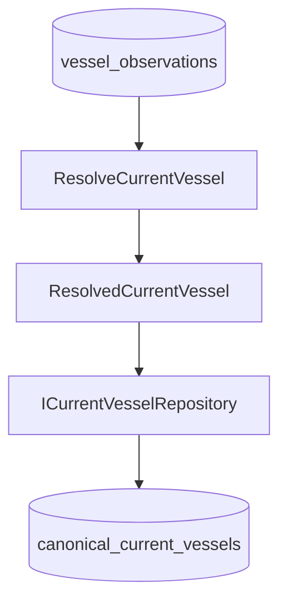

# Canonical Current Storage

## Context

Phase 8.5 persists the best resolved current view of a vessel without changing the
legacy read/write path. It is intentionally separate from observation storage.

## Observation vs Current Storage

`vessel_observations` is append-only evidence: a source said a value at a specific
time. `canonical_current_vessels` is an updatable read model: the current best
resolution over that evidence. Canonical history is not duplicated because the
underlying observations already retain it.

Only `ResolvedCurrentVessel` crosses the current-storage boundary. Provider raw
results never do. The write flow is provider -> observation -> resolver -> current
repository; `ResolveAndStoreCurrentVessel` starts at an existing observation key and
does not call providers or the network.

## Collection and Model

The dedicated Mongo collection is `canonical_current_vessels`; it does not reuse
`vessels`, `latestpositions`, `vesselpositions`, or `vessel_observations`.

Each document stores `mmsi`, `imo`, `identity`, `position`, `particulars`, `voyage`,
`resolvedAt`, a content hash, and Mongoose `createdAt`/`updatedAt`. Persistence
metadata is distinct from resolver time (`resolvedAt`) and source times
(`observedAt`, `fetchedAt`). Groups may be `null`; an identity-only resolved vessel is
valid.

## Provenance and Dates

Identity, particulars, and voyage keep each `ResolvedField` unchanged, including
`value`, `source`, `observationId`, `observedAt`, `fetchedAt`, `reason`, and the small
`rejected` audit list. Position remains one atomic `ResolvedPosition`: its source,
observation id, observed/fetched times, freshness, reason, rejected candidates, and
original position payload are never field-merged by storage.

The schema uses BSON `Date` for resolver and provenance times. Date-valued fields in
resolved-field values (for example ETA and last-port departure) are retained as Dates
at the persistence boundary.

## Keys and Indexes

MMSI is the preferred lookup key and IMO is a secondary exact identifier. Upsert
locates MMSI first, then IMO; it never uses name, callsign, or fuzzy matching.
`ResolveCurrentVessel` preserves the caller's MMSI and may supplement a missing IMO
from resolved identity, but it does not invent a caller-missing MMSI. A later exact
IMO lookup still reaches an existing MMSI document through the repository's IMO key.

Mongo has exactly two indexes:

- unique partial index on `mmsi` when it is a string;
- unique partial index on `imo` when it is a string.

The `$type: "string"` partial predicates allow any number of IMO-only or MMSI-only
documents and avoid treating `null` as one shared unique value. No speculative geo,
source, or freshness indexes are created.

## Upsert and Idempotency

`ICurrentVesselRepository` exposes `upsert`, `findByMmsi`, and `findByImo`.
`upsert` returns `CREATED`, `UPDATED`, or `UNCHANGED`.

The repository hashes the complete resolved canonical content except `resolvedAt`.
All field provenance remains part of the hash: a changed source, observation id, or
reason is a real update even if the displayed value is the same. If the hash matches,
the repository performs no write and preserves `updatedAt`; `resolvedAt` alone cannot
manufacture an update.

`ResolveAndStoreCurrentVessel` returns `NO_DATA` and does not call `upsert` when all
resolver groups are absent. Otherwise it returns the saved vessel and maps the
repository status directly to `CREATED`, `UPDATED`, or `UNCHANGED`.

## Action Items

No API, scheduler, change stream, event bus, bulk resolver, or legacy integration is
part of this phase. A future phase may introduce a deliberately scoped read API or
automation after its query and operational requirements are known.

## Related Notes

- [[OBSERVATION_STORAGE]]
- [[RESOLVER_POLICY]]
- [[CANONICAL_VESSEL_MODEL]]
- [[CURRENT_DATA_FLOW]]
