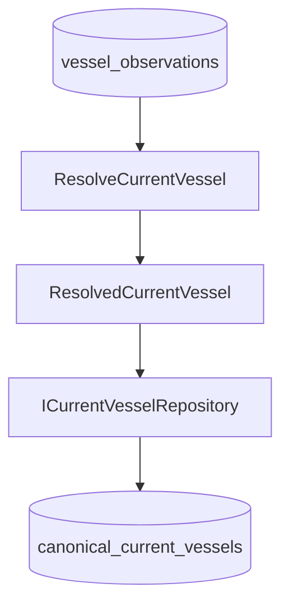

# Kho lưu trạng thái tàu chuẩn hiện tại

## Bối cảnh

Giai đoạn 8.5 lưu lại "bản nhìn tốt nhất hiện tại" của một con tàu sau khi đã giải dữ liệu, mà không đụng gì tới đường đọc/ghi cũ. Kho này tách riêng khỏi kho bản quan sát — đây là chủ ý.

## Khác nhau giữa kho quan sát và kho hiện tại

`vessel_observations` là **bằng chứng, chỉ ghi thêm**: nguồn X đã nói giá trị Y vào lúc Z. Không sửa, không xoá.

`canonical_current_vessels` là **mô hình đọc, được cập nhật**: kết quả giải tốt nhất tính trên đống bằng chứng đó.

Lịch sử của bản chuẩn không cần lưu lại lần nữa, vì các bản quan sát bên dưới đã giữ đầy đủ rồi.

Chỉ duy nhất `ResolvedCurrentVessel` được phép đi qua ranh giới vào kho hiện tại. Dữ liệu thô từ nhà cung cấp thì không bao giờ. Đường ghi là: nhà cung cấp → bản quan sát → resolver → repository hiện tại. `ResolveAndStoreCurrentVessel` bắt đầu từ một khoá quan sát đã có sẵn, nó **không** gọi nhà cung cấp và không chạm vào mạng.

## Collection và model

Collection Mongo riêng là `canonical_current_vessels`. Nó không dùng ké `vessels`, `latestpositions`, `vesselpositions` hay `vessel_observations`.

Mỗi document lưu: `mmsi`, `imo`, `identity`, `position`, `particulars`, `voyage`, `resolvedAt`, một hash nội dung, cùng `createdAt`/`updatedAt` do Mongoose sinh.

Ba loại thời gian này phải phân biệt rõ:

- Thời gian lưu trữ (`createdAt`/`updatedAt`) — lúc ghi vào DB
- Thời gian giải (`resolvedAt`) — lúc resolver chạy
- Thời gian của nguồn (`observedAt`, `fetchedAt`) — lúc nguồn quan sát và lúc ta lấy về

Các nhóm dữ liệu có thể là `null`. Một con tàu chỉ giải ra được danh tính vẫn là hợp lệ.

## Nguồn gốc dữ liệu và kiểu ngày tháng

Nhóm identity, particulars và voyage giữ nguyên từng `ResolvedField`, gồm đủ `value`, `source`, `observationId`, `observedAt`, `fetchedAt`, `reason`, và danh sách nhỏ `rejected` để truy vết những ứng viên bị loại.

Vị trí thì khác: nó là **một khối nguyên vẹn** `ResolvedPosition`. Nguồn, id bản quan sát, thời điểm quan sát/lấy về, độ tươi, lý do chọn, danh sách ứng viên bị loại và payload vị trí gốc — tầng lưu trữ **không bao giờ** trộn lẫn từng trường của khối này với khối khác.

Schema dùng kiểu BSON `Date` cho thời gian của resolver và thời gian nguồn gốc. Những giá trị mang nghĩa ngày tháng nằm trong resolved field (ví dụ ETA hay giờ rời cảng trước) cũng được giữ nguyên dạng Date ở ranh giới lưu trữ.

## Khoá và index

MMSI là khoá tra cứu ưu tiên, IMO là định danh chính xác thứ hai.

Khi upsert, hệ thống tìm theo MMSI trước, sau đó mới tới IMO. Nó **không bao giờ** dùng tên tàu, hô hiệu, hay so khớp mờ.

`ResolveCurrentVessel` giữ nguyên MMSI mà bên gọi đưa vào, và có thể bổ sung IMO còn thiếu từ danh tính đã giải được — nhưng không tự bịa ra MMSI nếu bên gọi không đưa. Một lần tra cứu chính xác bằng IMO sau này vẫn tìm được đúng document có MMSI, thông qua khoá IMO của repository.

Mongo chỉ có đúng hai index:

- unique partial index trên `mmsi` khi nó là chuỗi;
- unique partial index trên `imo` khi nó là chuỗi.

Điều kiện `$type: "string"` cho phép tồn tại bao nhiêu document chỉ-có-IMO hoặc chỉ-có-MMSI cũng được, và tránh việc Mongo coi mọi `null` là cùng một giá trị unique (sẽ chỉ cho phép đúng một bản ghi). Không tạo sẵn index địa lý, index theo nguồn hay theo độ tươi khi chưa có nhu cầu thật.

## Upsert và tính bất biến khi gọi lại

`ICurrentVesselRepository` cung cấp `upsert`, `findByMmsi` và `findByImo`. `upsert` trả về `CREATED`, `UPDATED` hoặc `UNCHANGED`.

Repository băm toàn bộ nội dung chuẩn đã giải, **trừ** `resolvedAt`. Toàn bộ thông tin nguồn gốc vẫn nằm trong hash: đổi nguồn, đổi id bản quan sát, hay đổi lý do chọn đều tính là cập nhật thật, kể cả khi giá trị hiển thị y hệt.

Nếu hash trùng, repository không ghi gì cả và giữ nguyên `updatedAt`. Nói cách khác, riêng `resolvedAt` thay đổi thì không đủ để tạo ra một lần cập nhật giả.

`ResolveAndStoreCurrentVessel` trả `NO_DATA` và không gọi `upsert` khi tất cả nhóm dữ liệu của resolver đều rỗng. Ngược lại nó trả về bản ghi đã lưu và ánh xạ thẳng trạng thái từ repository thành `CREATED`, `UPDATED` hoặc `UNCHANGED`.

## Việc chưa làm

Giai đoạn này **không** bao gồm: API, scheduler, change stream, event bus, resolver theo lô, hay tích hợp với đường code cũ. Giai đoạn sau có thể thêm một API đọc hoặc phần tự động hoá với phạm vi được giới hạn rõ ràng, sau khi biết chính xác nhu cầu truy vấn và vận hành.

## Ghi chú liên quan

- [[OBSERVATION_STORAGE]]
- [[RESOLVER_POLICY]]
- [[CANONICAL_VESSEL_MODEL]]
- [[CURRENT_DATA_FLOW]]
