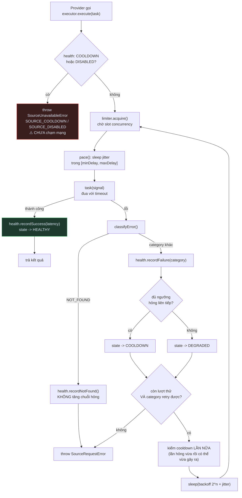

# Runtime cho crawler — giai đoạn A4 / P4

> Runtime dùng chung cho crawler đa nguồn: concurrency, nhịp nghỉ, timeout, retry, backoff, cooldown, health — **theo từng nguồn**.
> P4 **không** implement crawler mới, **không** gọi nguồn nào, **không** đổi một dòng hành vi production.
> Tiền đề: [CURRENT_ARCHITECTURE.md](./CURRENT_ARCHITECTURE.md) · [SOURCE_CAPABILITY_MATRIX.md](./SOURCE_CAPABILITY_MATRIX.md) · [PROVIDER_ARCHITECTURE.md](./PROVIDER_ARCHITECTURE.md)

Code — `src/application/runtime/`:
[SourceRuntimeConfig.ts](../src/application/runtime/SourceRuntimeConfig.ts) · [SourceError.ts](../src/application/runtime/SourceError.ts) · [retryPolicy.ts](../src/application/runtime/retryPolicy.ts) · [SourceHealthTracker.ts](../src/application/runtime/SourceHealthTracker.ts) · [SourceRequestLimiter.ts](../src/application/runtime/SourceRequestLimiter.ts) · [SourceRequestExecutor.ts](../src/application/runtime/SourceRequestExecutor.ts) · [SourceRuntimeManager.ts](../src/application/runtime/SourceRuntimeManager.ts)

---

## 1. P4 giải quyết vấn đề gì

Audit A0 tìm ra 3 khoản nợ chặn multi-source, tất cả đều nằm ở tầng "gọi mạng cho tử tế":

| Nợ | Hiện trạng | P4 |
|---|---|---|
| **D-4** | `HttpClient` không retry, không rate-limit theo host, timeout 10s hardcode ở `container.ts:45` | Retry/backoff/timeout thành policy, cấu hình theo nguồn |
| **D-5** | `sleep`/`jitter` bị **copy 4 bản**: `ScanArea`, `EnrichVesselTypes`, `CrawlFleetPositions`, `detectHtmlDrift`. Nguồn thứ 3 = bản sao thứ 5 | Một limiter, dùng lại cho mọi nguồn |
| **D-6** | `ScanArea`/`EnrichVesselTypes` so `e.code === "E-2001"` bằng **chuỗi thô** — nguồn mới phải "nhớ ném đúng chuỗi" thì backoff mới chạy | `SourceErrorCategory` phân loại một lần |
| **D-11** | Không metric nào. Parse fail bị nuốt, desync chỉ `console.warn` | `SourceHealthSnapshot` đếm theo từng loại lỗi |

Thêm một vấn đề mà kiến trúc cũ **không thể** biểu diễn: cooldown hiện tại là `await sleep(blockCooldownMs)` **giữa vòng lặp** ([ScanArea.ts:121](../src/application/use-cases/ScanArea.ts#L121)). Nó dừng **cả tiến trình**. Với một nguồn thì chấp nhận được; với 8 nguồn thì ShipInfo bị chặn sẽ làm BoatNerd đứng im vô cớ.

## 2. Vì sao mỗi nguồn cần giới hạn RIÊNG

Mỗi nguồn có ngưỡng chịu đựng khác nhau, và **hình phạt là cục bộ** — bị VesselFinder chặn không ảnh hưởng gì tới BoatNerd. Một limiter toàn cục biến hình phạt cục bộ thành sự cố toàn hệ thống.

`SourceRuntimeManager` giữ `Map<VesselSource, {config, limiter, health, executor}>`. Mỗi nguồn:
- hàng đợi riêng, bộ đếm concurrency riêng
- nhịp nghỉ riêng
- chuỗi hỏng và cooldown riêng

Test khoá điều này: *"hai nguồn = hai bộ runtime tách rời"* — đẩy ShipInfo vào cooldown, BoatNerd vẫn chạy xong bình thường.

Hai nguồn **không** đi qua crawl runtime (`usesCrawlRuntime()` trả `false`, `getExecutor()` **ném lỗi**):
- **AISSTREAM** — stream WebSocket dài hạn, không phải chuỗi request rời rạc. "Nghỉ 2s giữa 2 request" vô nghĩa với nó.
- **UNKNOWN** — không phải nguồn thật.

**MYSHIPTRACKING** thì dùng runtime nhưng override `minDelayMs: 0, maxDelayMs: 0`: đó là API **trả tiền**, giới hạn của nó là hạn mức gọi chứ không phải rủi ro bị chặn — áp nhịp nghỉ chống-ban lên nó chỉ làm chậm mà không mua được gì.

## 3. Chính sách thử lại

Nguyên tắc: **chỉ thử lại khi lần sau có cơ hội khác lần trước.**

| Category | Retry? | Lý do |
|---|---|---|
| `TIMEOUT` | ✅ | Sự cố nhất thời |
| `SERVER_ERROR` (5xx) | ✅ | Lỗi phía nguồn, thường qua nhanh |
| `NETWORK_ERROR` | ✅ | DNS/TCP chập chờn |
| `NOT_FOUND` | ❌ | Tàu không tồn tại thì hỏi 3 lần vẫn không tồn tại |
| `PARSE_ERROR` | ❌ | Tải lại **đúng trang đó**, bóc lại bằng **đúng regex đó** → hỏng y hệt. Đây là drift, phải sửa mapper (`npm run check-drift`) |
| `BLOCKED` (403) | ❌ | Nguồn vừa nói "đừng gửi nữa". Gửi tiếp làm tình hình xấu đi |
| `RATE_LIMITED` (429) | ❌ | Cùng lý do |
| `UNKNOWN` | ❌ | Không biết là gì thì không đoán |

403/429 đi đường khác: **health ghi nhận hỏng → đủ ngưỡng → COOLDOWN → dừng hẳn một lúc**. Đó mới là phản ứng đúng, không phải thử lại nhanh hơn.

`RETRY_RATE_LIMITED_POLICY` cho phép retry 429 sau backoff — **không phải mặc định**, chỉ dùng khi nguồn có tài liệu nói rõ hạn mức. 403 thì **không policy nào** cho retry.

**Backoff**: `initialBackoffMs × 2^attempt`, chặn trên `maxBackoffMs`, cộng jitter tối đa **+25%** để nhiều tiến trình cùng hỏng không đồng loạt gọi lại.

```
initial=1000, max=4000 -> 1000, 2000, 4000, 4000, 4000...
```

Không có thuật toán thích nghi, không học theo thời gian. Nhân đôi + trần.

## 4. Chính sách nghỉ sau lỗi

- `consecutiveFailures >= consecutiveFailuresBeforeCooldown` → `COOLDOWN`, `cooldownUntil = now + cooldownMs`
- Đang cooldown: request mới **fail fast** bằng `SourceUnavailableError { code: "SOURCE_COOLDOWN", retryAt }` — **chưa chạm mạng**
- **Không** `sleep` chờ hết cooldown. Không block tiến trình, không block nguồn khác
- Fail-fast **không** được tính thêm một lần hỏng — nếu tính, cooldown sẽ tự gia hạn vô hạn. Test khoá điều này
- Hết hạn → `DEGRADED` (được thử lại, nhưng chưa coi là khoẻ). Một lần thành công thật mới về `HEALTHY`

**Không có background timer.** Cooldown hết hạn được phát hiện **lúc có người hỏi** (`getState()`), không phải bằng `setInterval` chạy nền. Tiến trình không bị giữ sống vô cớ, và test không phải chờ 5 phút — chỉ cần đẩy đồng hồ giả.

## 5. Các trạng thái sức khoẻ nguồn

```
HEALTHY ──hỏng (chưa đủ ngưỡng)──> DEGRADED ──đủ ngưỡng──> COOLDOWN
   ^                                   ^                        │
   └──────── success ──────────────────┴──── hết hạn (lúc hỏi) ─┘

DISABLED  ←── disable() thủ công ──  (mọi state)
          ──> enable() ──> DEGRADED
```

| State | Nghĩa | Được gọi? |
|---|---|---|
| `HEALTHY` | Lần gần nhất thành công, không có chuỗi hỏng | ✅ |
| `DEGRADED` | Có hỏng nhưng chưa đủ ngưỡng, **hoặc** vừa ra khỏi cooldown | ✅ |
| `COOLDOWN` | Hỏng liên tiếp quá ngưỡng | ❌ fail fast |
| `DISABLED` | Tắt thủ công | ❌ — **không** tự thoát bằng thời gian, `recordSuccess` cũng không bật lại |

`SourceHealthSnapshot` đếm: `totalRequests`, `successCount`, `failureCount`, `consecutiveFailures`, bộ đếm riêng cho **từng** category (`notFoundCount`, `timeoutCount`, `blockedCount`, `rateLimitedCount`, `serverErrorCount`, `networkErrorCount`, `parseErrorCount`, `unknownErrorCount`), `lastSuccessAt`, `lastFailureAt`, `cooldownUntil`, `averageLatencyMs`.

**Giữ trong RAM.** P4 không ghi MongoDB — persist hay không là quyết định của phase sau. Health mất khi restart, và với mục đích hiện tại (chặn nguồn đang hỏng) thì đúng: khởi động lại nên bắt đầu bằng một lần thử sạch.

## 6. Phân loại lỗi

| Nguồn tín hiệu | → Category |
|---|---|
| 404 | `NOT_FOUND` |
| 403 | `BLOCKED` |
| 429 | `RATE_LIMITED` |
| 5xx | `SERVER_ERROR` |
| `TimeoutError` / `AbortError` | `TIMEOUT` |
| `TypeError: fetch failed`, `ECONN*`, `ENOTFOUND` | `NETWORK_ERROR` |
| Bóc dữ liệu không ra | `PARSE_ERROR` |
| còn lại | `UNKNOWN` |

Thứ tự ưu tiên khi phân loại (độ tin cậy giảm dần):
1. Đã là `SourceRequestError` → giữ nguyên category
2. `status` / `statusCode` / `response.status` tường minh
3. Mã `AppError` cũ
4. Tên lỗi runtime

### ⚠️ Giới hạn có thật của mã lỗi cũ

`AppError` hiện tại **không** phân loại đủ mịn:
- `E-2001` dùng cho **cả 403 lẫn 429** → không tách được `BLOCKED` / `RATE_LIMITED`
- `E-2002` dùng cho **cả** lỗi mạng, HTTP non-ok, **lẫn** parse fail → phân loại về `UNKNOWN`, và `UNKNOWN` **không được retry**

Đây là hành vi **bảo thủ có chủ ý**: thà không retry còn hơn retry nhầm một `PARSE_ERROR`. Provider **mới** hãy ném lỗi mang `status`, hoặc dùng `parseError()` / `networkError()` / `notFoundError()`. Đừng dựa vào `AppError` để phân loại chính xác.

`NOT_FOUND` **không bao giờ** làm nguồn unhealthy: `recordNotFound()` chỉ tăng `notFoundCount`, không đụng `consecutiveFailures`. Tra 500 MMSI lạ không được phép khoá một nguồn đang khoẻ.

## 7. Luồng chạy của `SourceRequestExecutor`

```ts
await executor.execute((signal) => httpClient.getText(url), { operation: "getDetails" })
```



Ba chi tiết có chủ ý trong sơ đồ:

1. **Retry nằm NGOÀI limiter.** Mỗi lần thử tự xin slot lại → khoảng backoff **không giữ chỗ** của request khác. Nếu để retry bên trong slot, một nguồn `maxConcurrency: 1` đang backoff 10s sẽ chặn mọi request khác cùng nguồn suốt 10s mà không làm gì.
2. **Kiểm cooldown lại trước mỗi lần thử.** Lần hỏng vừa rồi có thể vừa đẩy nguồn vào cooldown → ngủ backoff rồi mới phát hiện là phí.
3. **`pace()` đặt trước mốc cho request kế tiếp**, không đặt sau khi task xong → nhiều slot đồng thời vẫn bị giãn ra, không cùng bắn một lúc.

**Timeout**: executor tạo `AbortController`, đua task với timer, **luôn** `clearTimeout` trong `finally`. Nếu ta đã abort thì lỗi trả về **luôn là `TIMEOUT`**, kể cả khi task tự reject bằng lỗi riêng của nó khi nghe signal — nếu không, một task "lịch sự" sẽ bị xếp nhầm thành `UNKNOWN` và **mất quyền retry**.

Task không tôn trọng `signal` thì vẫn chạy nền, nhưng executor đã đi tiếp. Đó là đánh đổi có ý thức để không phụ thuộc transport cụ thể.

## 8. Cái gì KHÔNG thuộc runtime

Executor **không biết**: `Vessel`, MMSI, IMO, MongoDB, `ProviderRegistry`, resolver, FE, Marine. Nó chạy một callback, không hơn.

Runtime **không** làm: merge policy · chọn nguồn tốt nhất · fallback giữa các nguồn · ghi DB · cache · proxy rotation · xoay user-agent · circuit breaker phân tán · persist health.

Cũng **không** dùng thư viện ngoài (Bottleneck, p-queue): một hàng đợi + một bộ đếm là đủ; thêm dependency chỉ để làm việc này là không đáng.

## 9. VesselFinder đời cũ — CHƯA chuyển sang runtime

`ScanArea`, `EnrichVesselTypes`, `CrawlFleetPositions`, `GetVesselDetails` **chạy nguyên như cũ**: vẫn `sleep`/`jitter`/cooldown tự viết, vẫn so `"E-2001"` bằng chuỗi, vẫn dùng `HttpClient` với timeout 10s hardcode. P4 **không xoá** một dòng nào trong số đó.

`container.ts` chỉ thêm **4 dòng**:

```ts
const crawlRuntime = new SourceRuntimeManager();
```

Tạo **lười**: chưa ai gọi `getExecutor()` thì không có limiter, không có health, không có timer. Chi phí khởi động bằng 0.

### Ranh giới HttpClient ↔ Executor

| | Trách nhiệm |
|---|---|
| `HttpClient` | Transport thuần: fetch, header, timeout của riêng nó, map status → `AppError` |
| `SourceRequestExecutor` | Chính sách: cooldown, hàng đợi, nhịp nghỉ, **retry**, phân loại, health |

**Retry chỉ ở MỘT nơi: executor.** Hai nơi cùng retry sẽ nhân số request lên bội số mà không ai nhìn thấy — `maxRetries: 2` ở cả hai tầng thành 9 request cho một lần gọi. `HttpClient` hiện **không** retry, và không được thêm.

P4 **không** rewrite `HttpClient`. Provider mới muốn timeout riêng thì truyền qua `execute(task, { timeoutMs })`.

## 10. Provider mới sẽ dùng runtime thế nào

```ts
class ShipInfoProvider implements VesselDataProvider {
  readonly source = VesselSource.SHIPINFO;

  constructor(
    private readonly http: HttpClient,
    private readonly executor: SourceRequestExecutor,  // từ SourceRuntimeManager
  ) {}

  async getDetails(identifier: VesselIdentifier): Promise<ProviderDetailsResult | null> {
    try {
      const html = await this.executor.execute(
        () => this.http.getText(`.../${identifier.value}`),
        { operation: "getDetails" },
      );
      return mapToCanonical(html);          // ném parseError(source, ...) nếu bóc không ra
    } catch (err) {
      if (err instanceof SourceRequestError && err.category === SourceErrorCategory.NOT_FOUND) {
        return null;                        // "không có tàu" là câu trả lời, không phải lỗi
      }
      throw err;                            // hỏng thật thì để resolver quyết
    }
  }
}
```

Provider **không** tự sleep, **không** tự retry, **không** tự đếm lỗi. Nó chỉ bọc lời gọi mạng vào `executor.execute()` và dịch kết quả sang canonical.

Ba tầng hiện tại, mỗi tầng một câu hỏi:

| Tầng | Câu hỏi | Phase |
|---|---|---|
| `SOURCE_CAPABILITY_MATRIX` | Nguồn này **về lý thuyết** cấp được field gì | P2 |
| `ProviderRegistry` | Có **code** cho nguồn này chưa | P3 |
| `SourceRuntimeManager` | Lúc này **gọi được** không, và gọi **mạnh tới đâu** | **P4** |
| Resolver | **Nên** gọi nguồn nào, và hợp nhất kết quả ra sao | chưa có |

---

## Phụ lục · Cấu hình mặc định

```ts
maxConcurrency: 1
minDelayMs: 2000      maxDelayMs: 5000
timeoutMs: 10_000
maxRetries: 2
initialBackoffMs: 1000    maxBackoffMs: 10_000
consecutiveFailuresBeforeCooldown: 3
cooldownMs: 5 * 60 * 1000
```

Đây **không** phải cấu hình tối ưu — nó là cấu hình **khó gây hại nhất khi chưa biết gì về nguồn**. `SOURCE_RUNTIME_OVERRIDES` cố ý gần như rỗng: P4 không có crawler nào cho 7 nguồn kia, nên mọi con số "production thật" điền vào lúc này đều là bịa. Điền khi có POC và số liệu đo được.

Validate ném lỗi **ngay lúc dựng** với: `maxConcurrency < 1` hoặc không nguyên · `minDelayMs < 0` · `maxDelayMs < minDelayMs` · `timeoutMs <= 0` · `maxRetries < 0` · `initialBackoffMs < 0` · `maxBackoffMs < initialBackoffMs` · `consecutiveFailuresBeforeCooldown < 1` · `cooldownMs < 0` · bất kỳ giá trị nào không phải số hữu hạn.

Runtime class **không đọc `process.env`**. Config đi vào từ composition root.
