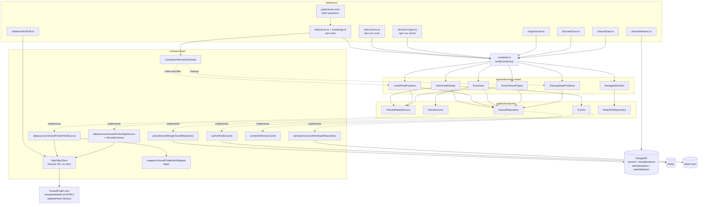
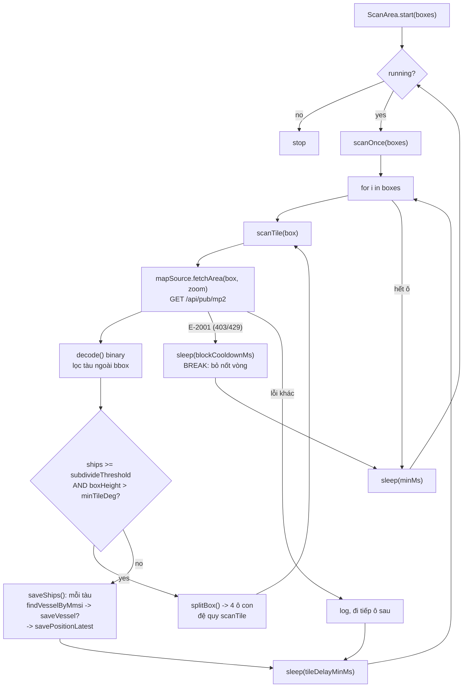
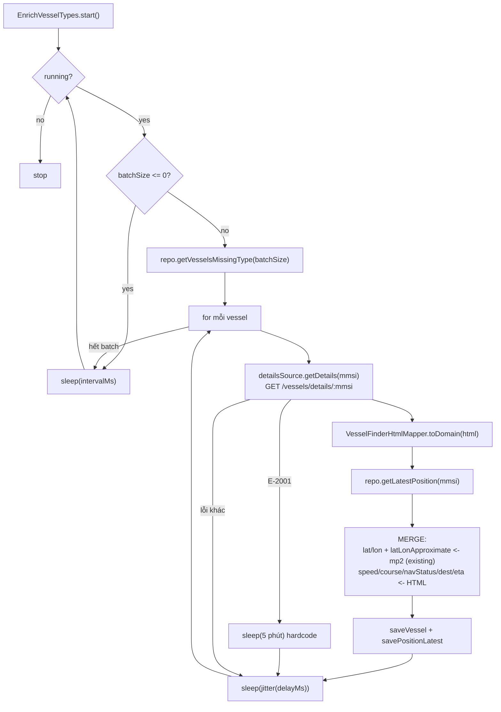

# CURRENT_ARCHITECTURE — Crawl-Marine-Bot

> Audit trạng thái **hiện tại** trước khi refactor crawler multi-source.
> Mọi mục dưới đây bám theo code thật tại commit `937d664` (branch `master`).
> Tài liệu này KHÔNG đề xuất thay đổi production logic — chỉ mô tả + phân loại.

- Package: `crawlbot` v3.0.0 — "VesselFinder regional vessel scanner — TypeScript + Clean Architecture"
- Runtime: Node >= 18, TypeScript 5.6, CommonJS, `outDir: dist`, `rootDir: src`
- Dependencies runtime: `dotenv`, `express@5`, `ioredis`, `mongoose@9`
- Không có framework crawler (không puppeteer/cheerio/axios) — dùng `fetch` global + regex parser

---

## 1. Project entry points

### 1.1 App khởi động từ đâu

| Entry | File | Ghi chú |
|---|---|---|
| HTTP server (main) | [src/interfaces/http/server.ts](../src/interfaces/http/server.ts) | `package.json.main` = `dist/interfaces/http/server.js` |
| Composition root | [src/container.ts](../src/container.ts) | `buildContainer()` — MỌI entry đều gọi hàm này |
| Express app thuần | [src/interfaces/http/createApp.ts](../src/interfaces/http/createApp.ts) | không `listen`, không đọc `process.env` → test được |
| Config | [src/config/index.ts](../src/config/index.ts) | `loadConfig(env)` + singleton `config` export |

`server.ts:start()` làm 4 việc:
1. `buildContainer()` ([server.ts:22](../src/interfaces/http/server.ts#L22))
2. Chặn khởi động nếu `API_KEY` rỗng ([server.ts:32-37](../src/interfaces/http/server.ts#L32-L37))
3. `createApp(...)` + `app.listen(httpPort, httpHost)` — mặc định bind `127.0.0.1:3000`
4. Bật 2 `IntervalScheduler`: **crawl watchlist** và **cleanup stale positions**

⚠️ `ScanArea` và `EnrichVesselTypes` **KHÔNG** chạy trong HTTP server — chỉ chạy qua CLI riêng (chủ ý, ghi rõ ở comment [server.ts:12-13](../src/interfaces/http/server.ts#L12-L13)).

### 1.2 CLI đang tồn tại

Tất cả nằm trong [src/interfaces/cli/](../src/interfaces/cli/), tất cả đều gọi `buildContainer()` (trừ `resetIndexes.ts` — nối mongoose trực tiếp).

| npm script | File | Loop? | Mô tả |
|---|---|---|---|
| `npm start` | `interfaces/http/server.ts` | daemon | HTTP + 2 scheduler |
| `npm run get <id>` | [cli/getVessel.ts](../src/interfaces/cli/getVessel.ts) | one-shot | `GetVesselDetails.execute(id)`, in ra console, `process.exit(0)` |
| `npm run crawl` | [cli/crawlOnce.ts](../src/interfaces/cli/crawlOnce.ts) | one-shot | `CrawlFleetPositions.execute(config.watchlist)` — dùng watchlist từ **.env**, không phải DB |
| `npm run scan` | [cli/scanArea.ts](../src/interfaces/cli/scanArea.ts) | **vô hạn** | `ScanArea.start(config.scanBoundingBoxes)`, exit 1 nếu `SCAN_BBOX` rỗng, SIGINT → `stop()` |
| `npm run enrich` | [cli/enrichTypes.ts](../src/interfaces/cli/enrichTypes.ts) | **vô hạn** | `EnrichVesselTypes.start()`, SIGINT → `stop()` |
| `npm run audit` | [cli/auditData.ts](../src/interfaces/cli/auditData.ts) | one-shot | 4 check data integrity, `exit(0|1)` |
| `npm run check-drift` | [cli/detectHtmlDrift.ts](../src/interfaces/cli/detectHtmlDrift.ts) | one-shot | fetch 2 ID mẫu (`9384198`, `9074729`), rate 1 req/2s, `exit(0|1|2)` |
| `npm run reset-indexes` | [cli/resetIndexes.ts](../src/interfaces/cli/resetIndexes.ts) | one-shot | `syncIndexes()` 3 model; cờ `--drop` XOÁ collection |
| `npm run build` | — | — | `tsc` |
| `npm test` | — | — | `node -r ts-node/register --test "src/**/*.test.ts"` |
| `npm run start:prod` | — | daemon | `node dist/interfaces/http/server.js` |

### 1.3 PM2 / process đang chạy

**Không có file cấu hình process nào trong repo.** Không có `ecosystem.config.js`, không có `Dockerfile`/`docker-compose`, không có unit systemd, không có `pm2` trong dependencies.

Bằng chứng gián tiếp về cách deploy (chỉ là comment/doc, không phải code chạy được):
- [cli/scanArea.ts:5](../src/interfaces/cli/scanArea.ts#L5): *"restart the private worker through the VPS service manager"*
- [server.ts:34](../src/interfaces/http/server.ts#L34) và [.env.example:10](../.env.example#L10): nhắc `systemd EnvironmentFile`

→ Suy ra: 3 process rời nhau phải được quản lý ngoài repo (`npm start`, `npm run scan`, `npm run enrich`). Không có code nào trong repo tự spawn/giám sát chúng.

### 1.4 CI

[.github/workflows/ci.yml](../.github/workflows/ci.yml): on `pull_request` + `push` → Node 22 → `npm ci` → `npm run build` → `npm test`. Không deploy, không lint.

---

## 2. Current crawler architecture

### 2.1 Có ĐÚNG 2 nguồn crawl, cả hai đều là VesselFinder

| Adapter | File | Port implement | Endpoint | Response |
|---|---|---|---|---|
| `VesselFinderHtmlSource` | [infrastructure/datasources/VesselFinderHtmlSource.ts](../src/infrastructure/datasources/VesselFinderHtmlSource.ts) | `IVesselDetailsSource` | `https://www.vesselfinder.com/vessels/details/{id}` | HTML |
| `VesselFinderMapSource` | [infrastructure/datasources/VesselFinderMapSource.ts](../src/infrastructure/datasources/VesselFinderMapSource.ts) | `IAreaScanner` | `https://www.vesselfinder.com/api/pub/mp2?bbox=..&zoom=..&mcbe=1` | **binary** |

Cả hai domain đều hardcode dưới dạng `private readonly BASE` trong class — không qua config.

### 2.2 VesselFinder được gọi ở đâu (call graph)

`VesselFinderHtmlSource.getDetails()` được gọi từ 3 chỗ:
- `GetVesselDetails.execute()` → [GetVesselDetails.ts:46](../src/application/use-cases/GetVesselDetails.ts#L46) (chỉ khi cache miss)
- `CrawlFleetPositions.execute()` → [CrawlFleetPositions.ts:44](../src/application/use-cases/CrawlFleetPositions.ts#L44) (vòng lặp watchlist)
- `EnrichVesselTypes.runOnce()` → [EnrichVesselTypes.ts:63](../src/application/use-cases/EnrichVesselTypes.ts#L63) (batch tàu thiếu `type`)

`VesselFinderMapSource.fetchArea()` được gọi từ 1 chỗ:
- `ScanArea.scanTile()` → [ScanArea.ts:91](../src/application/use-cases/ScanArea.ts#L91)

Ngoài luồng use case, `HttpClient` còn được dựng trực tiếp trong CLI drift: [detectHtmlDrift.ts:47](../src/interfaces/cli/detectHtmlDrift.ts#L47).

### 2.3 Request flow

Một `HttpClient` DUY NHẤT ([infrastructure/http/HttpClient.ts](../src/infrastructure/http/HttpClient.ts)), khởi tạo 1 lần ở [container.ts:45](../src/container.ts#L45) với `timeoutMs: 10000` (**hardcode, không qua config**), inject vào cả 2 datasource.

`HttpClient.doFetch()`:
- Header cố định: `user-agent: SooskyCrawlBot/1.0`, `accept: application/octet-stream,text/html;q=0.9,*/*;q=0.8`
- `signal: AbortSignal.timeout(this.timeoutMs)`
- 3 API public: `getJson<T>()`, `getText()`, `getArrayBuffer()` (`getJson` hiện **không ai gọi**)

Map HTTP status → error nghiệp vụ ([HttpClient.ts:52-54](../src/infrastructure/http/HttpClient.ts#L52-L54)):

| Điều kiện | Error |
|---|---|
| `TimeoutError` | `E-2003 SCRAPE_TIMEOUT` |
| 403 hoặc 429 | `E-2001 SCRAPE_BLOCKED` |
| 404 | `E-1001 SHIP_NOT_FOUND` |
| `!res.ok` khác | `E-2002 SOURCE_ERROR` |
| network throw | `E-2002 SOURCE_ERROR` |

### 2.4 Parser nằm ở đâu

**Hai parser, hai chỗ khác nhau, hai kiểu khác nhau:**

1. **HTML → domain**: [infrastructure/mappers/VesselFinderHtmlMapper.ts](../src/infrastructure/mappers/VesselFinderHtmlMapper.ts), static `toDomain(html)`.
   - Nguồn dữ liệu trong trang: `#djson[data-json]` (JSON: `ship_lat/lon/cog/sog/lrpd`), bảng `td.n3` + `td.v3`, `h1.title`
   - 100% **regex**, không DOM parser
   - Ném `Error` thường → `VesselFinderHtmlSource` bọc lại thành `E-2002 SCRAPE_PARSE_FAIL` ([VesselFinderHtmlSource.ts:20-24](../src/infrastructure/datasources/VesselFinderHtmlSource.ts#L20-L24))
   - ⚠️ lat/lon từ `#djson` bị **làm tròn** → set `latLonApproximate: true`

2. **Binary mp2 → ScannedShip[]**: parser nằm **bên trong** datasource, `private static decode()` ([VesselFinderMapSource.ts:52-116](../src/infrastructure/datasources/VesselFinderMapSource.ts#L52-L116)) — KHÔNG tách ra mapper riêng như HTML.
   - `DataView` đọc tuần tự; `COORD_DIV = 600000`
   - 2 lớp chống desync: `lt !== 0` khi so `isSelected`, và lọc bỏ tàu ngoài bbox đã request + `console.warn`
   - Lỗi giữa chừng → `catch {}` **nuốt lỗi**, trả về phần đã đọc được

3. **Drift checker** (không phải parser dữ liệu): [infrastructure/datasources/htmlDrift.ts](../src/infrastructure/datasources/htmlDrift.ts) — `CHECKS[]` + `LABELS[]` + `analyzeHtml()`, pure, không mạng. Đây là bản sao thủ công các selector của mapper → **phải sửa 2 nơi khi VF đổi HTML**.

### 2.5 Retry logic ở đâu

**KHÔNG CÓ retry ở bất kỳ tầng nào.** Không có backoff theo lần thử, không có exponential backoff, không có max-attempts. Chỉ có **cooldown khi bị chặn**, và ở 2 chỗ khác nhau, giá trị khác nhau:

| Nơi | Điều kiện | Hành vi | Nguồn giá trị |
|---|---|---|---|
| [ScanArea.ts:118-122](../src/application/use-cases/ScanArea.ts#L118-L122) | `err.code === "E-2001"` | `sleep(blockCooldownMs)` rồi **`break`** — bỏ nốt các ô còn lại của vòng | `SCAN_BLOCK_COOLDOWN_MS` |
| [EnrichVesselTypes.ts:93-96](../src/application/use-cases/EnrichVesselTypes.ts#L93-L96) | `err.code === "E-2001"` | `sleep(5 * 60 * 1000)` rồi tiếp tàu kế | **hardcode 5 phút** |
| [ScanArea.ts:155-158](../src/application/use-cases/ScanArea.ts#L155-L158) | lỗi bất kỳ ở `start()` | `sleep(maxMs)` | `SCAN_INTERVAL_MS` |
| `CrawlFleetPositions` | mọi lỗi | ghi vào `errors[]`, đi tiếp, KHÔNG cooldown | — |
| `GetVesselDetails` | mọi lỗi | ném thẳng lên HTTP layer | — |

Chỉ mỗi `ioredis` có retry thật: `maxRetriesPerRequest: 3` ([RedisCache.ts:29](../src/infrastructure/cache/RedisCache.ts#L29)).

### 2.6 Timeout logic ở đâu

Chỉ 1 nơi: `AbortSignal.timeout(this.timeoutMs)` trong `HttpClient.doFetch()`. Giá trị `10000ms` hardcode 2 chỗ (`container.ts:45`, `detectHtmlDrift.ts:47`). **Không có env var timeout**, không có timeout riêng cho mp2 (binary, nặng hơn) so với trang HTML.

Mongoose dùng timeout mặc định của driver — không cấu hình ([connection.ts](../src/infrastructure/persistence/mongoose/connection.ts)).

---

## 3. Current persistence

### 3.1 Lựa chọn backend — quyết định ở container

[container.ts:60-70](../src/container.ts#L60-L70):
```
config.mongoUri  ? connectMongo() + MongoVesselRepository + MongoWatchlistRepository
                 : JsonFileVesselRepository(dataDir) + JsonWatchlistRepository(dataDir)
```
`dataDir` = `path.join(__dirname, "..", "..", "data")` → `<root>/data` ([config/index.ts:108](../src/config/index.ts#L108)).

Sau đó **seed watchlist từ `.env`** nếu DB rỗng ([container.ts:73-77](../src/container.ts#L73-L77)).

### 3.2 MongoDB connection

[infrastructure/persistence/mongoose/connection.ts](../src/infrastructure/persistence/mongoose/connection.ts): `mongoose.connect(uri)` trần, không option; lỗi → bọc thành `E-2002 SOURCE_ERROR`. Có `disconnectMongo()` nhưng **không ai gọi** (CLI thoát bằng `process.exit`).

### 3.3 Collections / models

[infrastructure/persistence/mongoose/models.ts](../src/infrastructure/persistence/mongoose/models.ts) — 4 model:

| Model name | Collection (mongoose tự đặt) | Khoá | Index |
|---|---|---|---|
| `Vessel` | `vessels` | `mmsi` unique | `mmsi` unique, `imo` sparse; `timestamps: true` |
| `VesselPosition` | `vesselpositions` | — (append) | `mmsi`, `imo` sparse, `receivedAt`, compound `{mmsi:1, receivedAt:-1}` |
| `LatestPosition` | `latestpositions` | `mmsi` unique | `mmsi` unique, `imo` sparse, `loc` **2d**, `receivedAt` |
| `WatchlistItem` | `watchlistitems` | `vesselId` unique | `vesselId` unique |

### 3.4 Schema dữ liệu vessel hiện đang lưu

**`vessels`** (lý lịch, ít đổi) — từ `vesselSchema`:
`mmsi` (String, required, unique), `imo`, `name`, `type`, `callsign`, `flagCode`, `country`, `yearBuilt` (Number), `lengthM`, `widthM`, `grossTonnage`, `deadweight`, `draughtM`, `photoUrl`, + `createdAt`/`updatedAt` tự sinh.

⚠️ Field **thực tế không bao giờ được ghi** bởi crawler hiện tại: `flagCode`, `yearBuilt`, `grossTonnage`, `deadweight`, `photoUrl` — mapper HTML không parse chúng ([VesselFinderHtmlMapper.ts:83-93](../src/infrastructure/mappers/VesselFinderHtmlMapper.ts#L83-L93) chỉ set mmsi/imo/name/type/callsign/country/lengthM/widthM/draughtM).

**`vesselpositions`** (history, append-only) và **`latestpositions`** (1 doc/mmsi) dùng gần như cùng field:
`mmsi`, `imo`, `lat`, `lon`, `speedKn`, `courseDeg`, `headingDeg`, `navStatusCode`, `navStatusText`, `destination`, `eta`, `positionTime` (String, raw kiểu `"0 min ago"`), `source` (String), `latLonApproximate` (Boolean), `receivedAt` (**String ISO**, không phải Date).
`latestpositions` có thêm `loc: [lon, lat]` với index `2d` để `$geoWithin $box`.

⚠️ `receivedAt` lưu **string ISO** và so sánh bằng so sánh chuỗi ([MongoVesselRepository.ts:136-138](../src/infrastructure/persistence/MongoVesselRepository.ts#L136-L138)).
⚠️ `headingDeg`, `navStatusCode`, `destination`, `eta` **không bao giờ được crawler hiện tại ghi** (mapper không parse).

**Entity domain tương ứng**: [domain/entities/Vessel.ts](../src/domain/entities/Vessel.ts), [domain/entities/VesselPosition.ts](../src/domain/entities/VesselPosition.ts).
- `Vessel` khoá = `mmsi ?? imo`, throw nếu thiếu cả hai (BR-01)
- `VesselPosition` validate lat/lon phạm vi trái đất (BR-03), default `navStatusText = "Unknown"`, `receivedAt = now()` nếu tạo mới
- `PositionSource = "vesselfinder" | "unknown"` — **union hardcode trong domain**

### 3.5 Fallback JSON file

[JsonFileVesselRepository.ts](../src/infrastructure/persistence/JsonFileVesselRepository.ts): 3 file trong `<root>/data`: `vessels.json` (map theo mmsi), `positions.json` (array), `latest_positions.json` (array). Đọc/ghi **toàn bộ file** mỗi thao tác (`readFileSync`/`writeFileSync`) → không dùng được ở quy mô lớn. Có `migrateLegacyLatestPositions()` chạy trong constructor.

[JsonWatchlistRepository.ts](../src/infrastructure/persistence/JsonWatchlistRepository.ts) — tương tự cho watchlist.

### 3.6 Redis / RAM cache

Port: [application/ports/ICache.ts](../src/application/ports/ICache.ts) — chỉ `get<T>` / `set<T>(key, value, ttlMs)`. **Không có `del`, không có invalidate.**

| Adapter | File | Ghi chú |
|---|---|---|
| `RedisCache` | [infrastructure/cache/RedisCache.ts](../src/infrastructure/cache/RedisCache.ts) | ioredis, `SET ... PX ttlMs`; tự nâng `redis://`→`rediss://` cho host `upstash.io`; lỗi → **silent cache miss** |
| `InMemoryCache` | [infrastructure/cache/InMemoryCache.ts](../src/infrastructure/cache/InMemoryCache.ts) | `Map` + `expireAt`, lazy expire khi `get` |

Chọn bằng `config.redisUrl` ([container.ts:50-56](../src/container.ts#L50-L56)).

**Cache chỉ được dùng ở ĐÚNG 1 chỗ**: `GetVesselDetails` với key `vessel:{id}`, TTL `CACHE_TTL_MS` (mặc định 60s). `ScanArea`, `EnrichVesselTypes`, `CrawlFleetPositions` **không dùng cache**.

---

## 4. Current workers / schedulers

### 4.1 Ba worker, ba cơ chế lặp KHÁC NHAU

| Worker | Chạy bởi | Cơ chế lặp | Chống chạy chồng |
|---|---|---|---|
| crawl watchlist | `server.ts` | `IntervalScheduler` | ✅ cờ `running` bỏ tick |
| cleanup stale positions | `server.ts` | `IntervalScheduler` | ✅ |
| **ScanArea** | `npm run scan` | `while (this.running)` **tự viết** trong use case | n/a (single process) |
| **EnrichVesselTypes** | `npm run enrich` | `while (this.running)` **tự viết** trong use case | n/a |

[IntervalScheduler](../src/infrastructure/scheduler/IntervalScheduler.ts): `setInterval` + `safeRun()` bỏ tick nếu lần trước chưa xong; `runOnStart` mặc định `true`; catch lỗi và log, không crash.

### 4.2 `ScanArea` — vòng quét vùng

[src/application/use-cases/ScanArea.ts](../src/application/use-cases/ScanArea.ts)

- `start(boxes)` → `while(running)`: `scanOnce(boxes)` → `sleep(minMs)` → lặp
- `scanOnce(boxes)`: duyệt **tuần tự** từng box, `scanTile()`, `sleep(tileDelayMinMs)` giữa các ô, log tiến độ mỗi 25 ô
- `scanTile(box)`: `mapSource.fetchArea(box, zoom)`; nếu `ships.length >= subdivideThreshold` **và** `boxHeightDeg(box) > minTileDeg` → `splitBox()` chia 4, đệ quy
- `saveShips()` ([ScanArea.ts:68-84](../src/application/use-cases/ScanArea.ts#L68-L84)): với **mỗi tàu** → `findVesselByMmsi()` → nếu chưa có thì `saveVessel()` → `savePositionLatest()`. **Không bulk, không batch** → N+1 round-trip DB mỗi ô.
- Ghi `latLonApproximate: false` (mp2 cho toạ độ chính xác), `source: "vesselfinder"`
- Chỉ ghi `latestpositions`, **KHÔNG ghi history** (`savePosition` không được gọi)

Config mặc định (constructor) vs `.env`:

| Tham số | Default trong class | Env |
|---|---|---|
| `minMs` / `maxMs` | 2 phút / 15 phút | cả hai đều đọc `SCAN_INTERVAL_MS` (mặc định 6h) |
| `zoom` | 9 | `SCAN_ZOOM` |
| `tileDelayMinMs` / `MaxMs` | 3s / 8s | cả hai đều đọc `SCAN_TILE_DELAY_MS` (mặc định 15s) |
| `subdivideThreshold` | 400 | `SCAN_SUBDIVIDE_THRESHOLD` |
| `minTileDeg` | 1 | `SCAN_MIN_TILE_DEG` |
| `blockCooldownMs` | 15 phút | `SCAN_BLOCK_COOLDOWN_MS` (.env.example: 12h) |

⚠️ **Comment mô tả không khớp code** — xem §6.

### 4.3 `EnrichVesselTypes` — bổ sung metadata

[src/application/use-cases/EnrichVesselTypes.ts](../src/application/use-cases/EnrichVesselTypes.ts)

- `start()` → `while(running)`: `runOnce()` → `sleep(intervalMs)` → lặp
- `runOnce()`: `if (batchSize <= 0) return 0` → `repository.getVesselsMissingType(batchSize)` → với mỗi tàu: `detailsSource.getDetails(mmsi)`, `getLatestPosition(mmsi)`, `saveVessel()`, `savePositionLatest()`
- **Merge rule**: giữ `lat/lon` + `latLonApproximate` từ bản ghi mp2 đã có; lấy `speedKn/courseDeg/navStatusText/destination/eta/positionTime` từ trang chi tiết ([EnrichVesselTypes.ts:70-83](../src/application/use-cases/EnrichVesselTypes.ts#L70-L83)). Đây là **logic merge multi-source duy nhất hiện có**, và nó nằm hardcode trong use case.
- `sleep(jitter(delayMs))` sau **mỗi** tàu, kể cả tàu lỗi. `jitter(ms) = ms * (0.6 + random*0.8)` → 60%–140%
- Batch/delay/interval: `ENRICH_BATCH_SIZE` (15, `.env.example` đặt **0 = tắt**), `ENRICH_DELAY_MS` (2000), `ENRICH_INTERVAL_MS` (5 phút, `.env.example` 6h)
- ⚠️ `batchSize = 0` → `runOnce` return ngay nhưng `start()` **vẫn loop vô hạn**, in log mỗi `intervalMs`

### 4.4 `CrawlFleetPositions` — watchlist

[src/application/use-cases/CrawlFleetPositions.ts](../src/application/use-cases/CrawlFleetPositions.ts)

- `execute(idList)`: tuần tự, mỗi ID → `getDetails()` → `saveVessel()` + `savePosition()` (**history**, không phải latest) → `sleep(delayMs)` cố định, không jitter
- Trả `{ ok, failed, errors[] }`
- Nguồn ID khác nhau tuỳ entry: `server.ts` đọc **từ DB** (`manageWatchlist.list()`, có hiệu lực ngay chu kỳ sau), `crawlOnce.ts` đọc **từ .env** (`config.watchlist`)
- `CRAWL_EVERY_MS` (2h default / 6h trong `.env.example`), `CRAWL_DELAY_MS` (1500 / 3000)

### 4.5 `CleanupStalePositions`

[src/application/use-cases/CleanupStalePositions.ts](../src/application/use-cases/CleanupStalePositions.ts) — `deleteLatestPositionsOlderThan(now - staleAfterMs)`. Chỉ đụng `latestpositions`; `vessels` và `vesselpositions` giữ nguyên. Chu kỳ `POSITION_CLEANUP_EVERY_MS` (1h), ngưỡng `POSITION_STALE_AFTER_MS` (24h).

Cùng ngưỡng đó cũng được HTTP `/positions` dùng để lọc lúc đọc ([createApp.ts:97](../src/interfaces/http/createApp.ts#L97)) → cleanup lỗi cũng không làm data cũ hiện lại.

### 4.6 Bảng tổng hợp batch / delay / cooldown

| | batch | delay trong batch | interval giữa vòng | cooldown khi 403/429 |
|---|---|---|---|---|
| ScanArea | 1 ô/lần, tuần tự | `tileDelayMinMs` (15s) | `minMs` (6h) | `blockCooldownMs` (12h) + **bỏ nốt vòng** |
| EnrichVesselTypes | `batchSize` (0/15) | `jitter(delayMs)` 60–140% | `intervalMs` (6h) | **hardcode 5 phút** |
| CrawlFleetPositions | cả watchlist | `delayMs` (3s), không jitter | `crawlEveryMs` (6h) | không có |
| GetVesselDetails (HTTP) | 1 | — | on-demand | không có (ném 502) |

---

## 5. Component có thể reuse

### KEEP — dùng lại nguyên trạng cho crawler multi-source

| Component | File | Lý do |
|---|---|---|
| `IVesselDetailsSource` | `application/ports/IVesselDetailsSource.ts` | Port đúng hình dạng, không lộ công nghệ. Nguồn mới chỉ cần implement. |
| `IAreaScanner` | `application/ports/IAreaScanner.ts` | Như trên, cho scan theo vùng. |
| `IVesselRepository` / `IWatchlistRepository` / `ICache` | `application/ports/` | Ranh giới đã đúng; 3-4 adapter đã chứng minh interface chạy được. |
| `BoundingBox` | `application/ports/Geo.ts` | Primitive sạch. |
| `Vessel`, `VesselPosition` | `domain/entities/` | Pure, không import framework. Có invariant BR-01/BR-03. (`PositionSource` cần mở — xem REFACTOR.) |
| `AppError` + `Errors` + `errorStatus` | `domain/errors/AppError.ts` | Mã lỗi ổn định, đã map HTTP status. |
| `IntervalScheduler` | `infrastructure/scheduler/` | Có chống chạy chồng, đã có test. |
| `worldTiles.ts` | `application/use-cases/worldTiles.ts` | Pure function, có test, dùng lại cho mọi source scan theo tile. |
| `MongoVesselRepository` | `infrastructure/persistence/` | Đã có 2d index + tách latest/history; đúng hướng. |
| `InMemory*Repository`, `InMemoryCache` | `infrastructure/` | Hạ tầng test, giữ. |
| `createApp` | `interfaces/http/createApp.ts` | App thuần, testable, tách khỏi `listen`. |
| `htmlDrift.ts` | `infrastructure/datasources/` | Pure, có test, phát hiện HTML đổi form. |

### REFACTOR LATER — giữ ý tưởng, đổi hình dạng

| Component | File | Vấn đề cần xử lý khi refactor |
|---|---|---|
| `HttpClient` | `infrastructure/http/HttpClient.ts` | Không retry, không rate-limit per-host, header cố định, timeout hardcode ở container. Multi-source cần policy theo từng nguồn. |
| `VesselFinderMapSource.decode()` | `datasources/VesselFinderMapSource.ts:52` | Parser binary nằm trong datasource → tách thành mapper riêng như bản HTML để test được không cần mạng. |
| `ScanArea` | `use-cases/ScanArea.ts` | Use case đang ôm: vòng lặp vô hạn, `sleep`, cooldown, `saveShips` N+1, state `running`/`boxes`. Tách orchestration ra khỏi business rule. |
| `EnrichVesselTypes` | `use-cases/EnrichVesselTypes.ts` | Cùng vấn đề vòng lặp; ngoài ra chứa **merge rule multi-source** hardcode → cần thành policy tường minh. |
| `container.ts` | `src/container.ts` | Wiring phẳng, mỗi nguồn mới = sửa file này. Cần registry/factory theo source. |
| `PositionSource` union | `domain/entities/VesselPosition.ts:7` | `"vesselfinder" \| "unknown"` — thêm nguồn phải sửa domain. |
| `latestPositionSchema` | `mongoose/models.ts:59` | `mmsi` unique → **1 tàu chỉ giữ được 1 vị trí, không phân biệt nguồn**. Multi-source cần khoá `(mmsi, source)` hoặc field arbitration. |
| `htmlDrift.CHECKS/LABELS` | `datasources/htmlDrift.ts` | Bản sao thủ công selector của mapper → nên sinh từ 1 nguồn sự thật. |
| `JsonFileVesselRepository` | `persistence/` | Đọc/ghi cả file mỗi thao tác. Giữ cho dev/test, không dùng production. |

### DEPRECATE LATER — code chết hoặc trùng vai trò

| Component | File | Bằng chứng |
|---|---|---|
| `navStatus.ts` (`NAV_STATUS`, `navStatusText()`) | `infrastructure/mappers/navStatus.ts` | **Không nơi nào import**. Mapper lấy text thẳng từ bảng HTML. |
| `generateWorldTiles()` | `use-cases/worldTiles.ts:18` | Chỉ được gọi trong `worldTiles.test.ts` — không có đường chạy production (scan luôn dùng `SCAN_BBOX`). |
| `ScanArea.updateArea()` / `getArea()` | `use-cases/ScanArea.ts:162,166` | Không nơi nào gọi. Sinh ra cho admin API đã bị bỏ ([scanArea.ts:4-5](../src/interfaces/cli/scanArea.ts#L4-L5) ghi rõ "no public admin API"). |
| `IVesselRepository.deleteVesselAndPositions()` | port + 3 adapter | Implement đủ 3 nơi nhưng **không use case nào gọi**. |
| `HttpClient.getJson<T>()` | `http/HttpClient.ts:20` | Không nơi nào gọi. |
| `disconnectMongo()` | `mongoose/connection.ts:17` | Không nơi nào gọi. |
| `ScanArea.tileDelayMaxMs`, `maxMs` | `use-cases/ScanArea.ts` | `tileDelayMaxMs` chỉ dùng trong chuỗi log; `maxMs` chỉ dùng ở nhánh catch. Cả hai map về **cùng env** với biến min → khoảng jitter không tồn tại. |
| Field schema không bao giờ ghi | `mongoose/models.ts` | `flagCode`, `yearBuilt`, `grossTonnage`, `deadweight`, `photoUrl`, `headingDeg`, `navStatusCode`, `destination`, `eta` — crawler hiện tại không parse. Giữ hay bỏ là quyết định khi thiết kế schema multi-source. |

---

## 6. Technical debt ảnh hưởng TRỰC TIẾP tới crawler multi-source

Xếp theo mức chặn.

### D-1 · `latestpositions` khoá `mmsi` unique → không lưu được nhiều nguồn cho cùng 1 tàu
[models.ts:60](../src/infrastructure/persistence/mongoose/models.ts#L60) `mmsi: { unique: true }` + [MongoVesselRepository.savePositionLatest()](../src/infrastructure/persistence/MongoVesselRepository.ts#L36-L45) dùng `replaceOne(..., {upsert:true})`.
→ **Last-write-wins tuyệt đối**. Nguồn B ghi đè nguồn A không điều kiện, kể cả khi dữ liệu A mới hơn/chính xác hơn. Không có cách truy vết nguồn nào đã ghi field nào.

### D-2 · Không có tầng arbitration / merge policy
Logic merge duy nhất tồn tại là 4 dòng trong `EnrichVesselTypes` ([:70-83](../src/application/use-cases/EnrichVesselTypes.ts#L70-L83)) — "lat/lon giữ của mp2, course/speed lấy của HTML" — viết cứng trong use case. Không có khái niệm độ tin cậy nguồn, độ tươi, hay ưu tiên theo field.

### D-3 · `PositionSource` là union đóng trong domain
[VesselPosition.ts:7](../src/domain/entities/VesselPosition.ts#L7). Thêm nguồn = sửa entity = sửa lõi. `MongoVesselRepository.toEntity()` còn phải `doc.source as VesselPosition["source"]` ([:174](../src/infrastructure/persistence/MongoVesselRepository.ts#L174)) — ép kiểu, không validate.

### D-4 · `HttpClient` không có retry / rate-limit / policy theo nguồn
Một instance dùng chung cho mọi nguồn ([container.ts:45](../src/container.ts#L45)): cùng UA, cùng timeout 10s, không retry, không giới hạn concurrency theo host. Multi-source đồng nghĩa nhiều host, nhiều giới hạn tốc độ khác nhau → hiện không mô hình hoá được.

### D-5 · Rate-limit nằm rải trong use case, không tập trung
`sleep`/`jitter` được viết lại **riêng** trong `ScanArea` ([:63](../src/application/use-cases/ScanArea.ts#L63)), `EnrichVesselTypes` ([:126,130](../src/application/use-cases/EnrichVesselTypes.ts#L126)), `CrawlFleetPositions` ([:62](../src/application/use-cases/CrawlFleetPositions.ts#L62)), `detectHtmlDrift` ([:24](../src/interfaces/cli/detectHtmlDrift.ts#L24)). 4 bản copy. Thêm nguồn thứ 3 = bản copy thứ 5.

### D-6 · Coupling qua magic string mã lỗi
`ScanArea` và `EnrichVesselTypes` so `e.code === "E-2001"` bằng chuỗi thô. Nguồn mới phải nhớ ném đúng chuỗi này thì backoff mới hoạt động.

### D-7 · Comment mô tả hành vi KHÔNG khớp code trong `ScanArea`
Header file ([:6-11](../src/application/use-cases/ScanArea.ts#L6-L11)) và JSDoc ([:61-62](../src/application/use-cases/ScanArea.ts#L61-L62)) hứa 3 thứ **không có trong code**:
- "Nghỉ jitter ngẫu nhiên GIỮA MỖI Ô" → thực tế `sleep(this.tileDelayMinMs)` cố định, không random ([:99](../src/application/use-cases/ScanArea.ts#L99), [:129](../src/application/use-cases/ScanArea.ts#L129))
- "Xáo trộn thứ tự ô mỗi vòng (Fisher–Yates)" → `const order = boxes;` ([:111](../src/application/use-cases/ScanArea.ts#L111)), không shuffle. `order` chỉ dùng để in log.
- "Bị chặn → hạ nhiệt rồi tiếp, không mất cả vòng" → thực tế `break` sau cooldown ([:122](../src/application/use-cases/ScanArea.ts#L122)) → **mất phần còn lại của vòng**.

Ai đọc code để thiết kế multi-source sẽ giả định sai về hành vi chống ban hiện có.

### D-8 · `ScanArea.saveShips()` ghi từng tàu một (N+1)
[:68-84](../src/application/use-cases/ScanArea.ts#L68-L84): mỗi tàu = 1 `findVesselByMmsi` + (0-1) `saveVessel` + 1 `savePositionLatest`. Một ô 400 tàu = ~800-1200 round-trip. Nhân với số nguồn → không scale.

### D-9 · `ScanArea` không ghi history
Chỉ gọi `savePositionLatest`. `vesselpositions` chỉ nhận dữ liệu từ `CrawlFleetPositions` và `GetVesselDetails` (đường watchlist/HTTP). Nếu multi-source cần so sánh chéo theo thời gian thì hiện không có dữ liệu.

### D-10 · Parser binary nuốt lỗi im lặng
[VesselFinderMapSource.ts:104-106](../src/infrastructure/datasources/VesselFinderMapSource.ts#L104-L106) `catch {}`. Desync chỉ `console.warn` một dòng, không đếm metric, không ném lên. Nguồn hỏng format sẽ trả **ít tàu hơn** một cách âm thầm — nhìn từ ngoài không phân biệt được với "vùng ít tàu".

### D-11 · Không có observability
Toàn bộ là `console.log` tiếng Việt kèm emoji. Không có logger có level, không có metric (số request/nguồn, tỉ lệ 403, tỉ lệ parse fail, số tàu/vòng). Multi-source không so sánh được chất lượng giữa các nguồn.

### D-12 · Hai định nghĩa watchlist song song
`server.ts` dùng watchlist **trong DB**; `crawlOnce.ts` dùng `config.watchlist` **trong .env**; `container.ts` seed .env → DB chỉ khi DB rỗng. Sau lần seed đầu, `.env` và DB có thể lệch nhau vĩnh viễn.

### D-13 · `receivedAt` là String, không phải Date
Toàn hệ thống so sánh ISO string. Đúng về mặt lexicographic nhưng khoá index kém, không dùng được TTL index của Mongo, dễ hỏng nếu một nguồn ghi timestamp khác định dạng/khác timezone.

### D-14 · Config có cặp min/max nhưng map về cùng 1 env
`scanMinMs`/`scanMaxMs` ← `SCAN_INTERVAL_MS`; `scanTileDelayMinMs`/`MaxMs` ← `SCAN_TILE_DELAY_MS` ([config/index.ts:124-128](../src/config/index.ts#L124-L128)). Cấu trúc gợi ý có randomization nhưng thực tế min == max luôn.

### D-15 · Không có deploy/process config trong repo
3 worker phải chạy tay hoặc bằng cấu hình ngoài repo. Thêm worker cho nguồn mới không có chỗ khai báo.

---

## 7. Current flow (Mermaid)

### 7.1 Kiến trúc tổng thể



### 7.2 Vòng quét vùng (`npm run scan`)



### 7.3 Vòng enrich (`npm run enrich`)



---

## 8. Đề xuất folder structure tương lai (CHỈ tài liệu — chưa refactor)

> Không đổi tầng, không đổi Clean Architecture hiện tại. Chỉ mở rộng chỗ đang chật: **nhiều nguồn**.
> Nguyên tắc: mỗi nguồn là 1 thư mục tự chứa (client + mapper + test), lộ ra ngoài đúng qua port đã có.

```
src/
  domain/
    entities/            # Vessel, VesselPosition  (giữ)
    errors/              # AppError               (giữ)
    value-objects/
      SourceId.ts        # thay PositionSource union đóng (D-3)

  application/
    ports/               # giữ nguyên IVesselDetailsSource / IAreaScanner / IVesselRepository / ICache
      ISourceRegistry.ts # tra source theo id/khả năng
    policies/
      PositionMergePolicy.ts   # gom logic đang nằm trong EnrichVesselTypes (D-2)
      RateLimitPolicy.ts       # gom sleep/jitter đang copy 4 nơi (D-5)
    use-cases/           # giữ nguyên tên use case hiện có

  infrastructure/
    http/
      HttpClient.ts            # giữ
      RetryingHttpClient.ts    # retry/backoff bọc ngoài (D-4)
    sources/                   # ← thay cho datasources/ + mappers/ phẳng
      vesselfinder/
        VesselFinderHtmlSource.ts
        VesselFinderHtmlMapper.ts
        VesselFinderMapSource.ts
        VesselFinderMp2Decoder.ts   # tách decode() ra khỏi datasource (D-10)
        htmlDrift.ts
      <source-b>/
        ...
    persistence/         # giữ nguyên
    scheduler/           # giữ nguyên
    observability/
      Logger.ts          # thay console.log (D-11)

  interfaces/
    http/                # giữ nguyên
    cli/                 # giữ nguyên; worker mới thêm file ở đây

  container.ts           # giữ vai trò composition root
docs/
  CURRENT_ARCHITECTURE.md
  CURRENT_DATA_FLOW.md
```

Ghi chú về việc **chưa** làm:
- Chưa quyết khoá mới cho `latestpositions` (D-1) — cần thiết kế schema riêng, ảnh hưởng index và `/positions`.
- Chưa đụng `public/` (FE) và hệ thống Marine.
- Danh sách DEPRECATE ở §5 chỉ là phân loại; **không xoá gì** ở bước audit này.

---

## Phụ lục · Test hiện có

| Test | Phủ |
|---|---|
| `config/index.test.ts` | validate env số |
| `application/use-cases/GetVesselDetails.test.ts` | cache hit/miss, validate id |
| `application/use-cases/CleanupStalePositions.test.ts` | xoá latest, giữ history |
| `application/use-cases/worldTiles.test.ts` | sinh tile, splitBox |
| `infrastructure/datasources/htmlDrift.test.ts` | phát hiện drift |
| `infrastructure/persistence/JsonFileVesselRepository.test.ts` | latest vs history |
| `infrastructure/scheduler/IntervalScheduler.test.ts` | chống chạy chồng |
| `interfaces/http/createApp.test.ts` | route + API key |
| `interfaces/http/publicRendering.test.ts` | `public/render.js` — escape XSS, format, icon (require thẳng file browser) |

**Không có test nào cho**: `ScanArea`, `EnrichVesselTypes`, `CrawlFleetPositions`, `VesselFinderMapSource.decode()`, `VesselFinderHtmlMapper`, `HttpClient`, `MongoVesselRepository`.
Đây là rủi ro trực tiếp khi refactor crawler — 4 file quan trọng nhất của luồng crawl đều không có lưới an toàn.

## Audit Conclusions / Constraints for Phase A

1. Current VesselFinder pipeline must remain operational during migration.
2. Do not change FE/API contracts during Phase A.
3. Do not introduce a second AISStream connection in bot during Phase A.
4. Current latestpositions model is not suitable as multi-source raw storage.
5. Existing Vessel/VesselPosition entities may be reused but extended through a canonical model.
6. Multi-source ingestion must preserve source provenance before any merge.
7. Paid API integration is explicitly out of scope until fallback phase.
