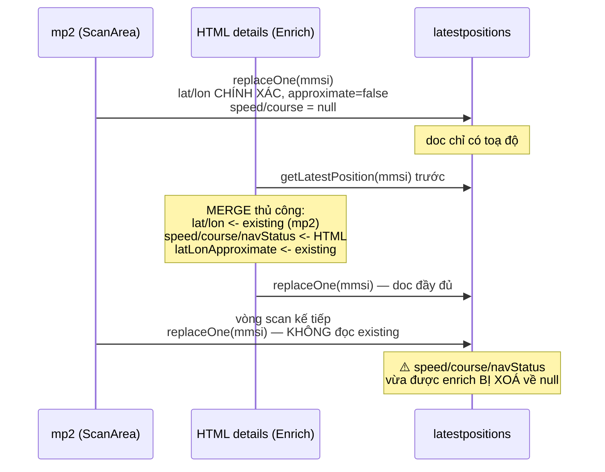
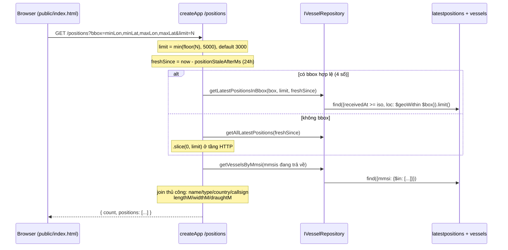
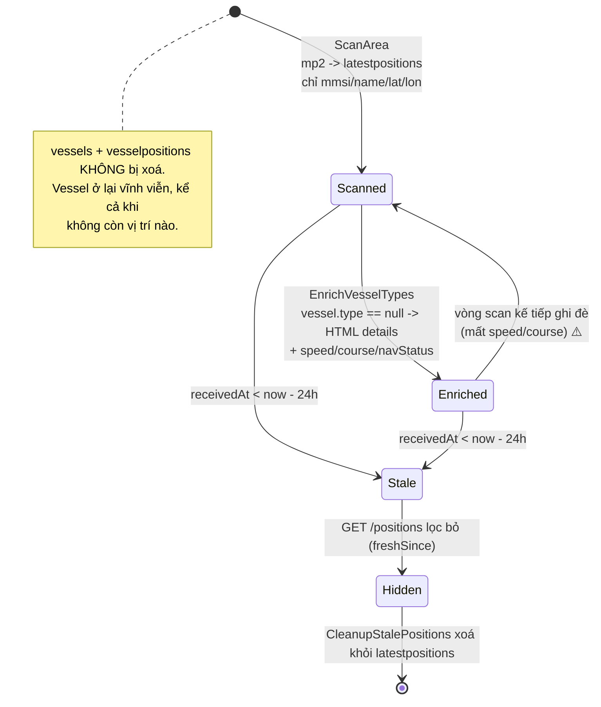
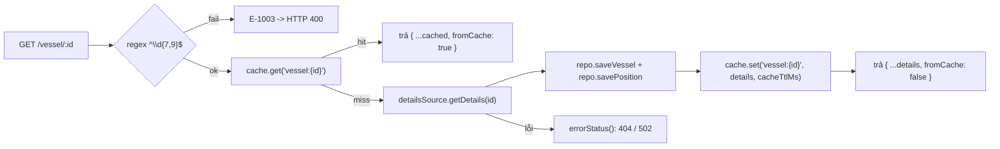

# CURRENT_DATA_FLOW — Crawl-Marine-Bot

> Bổ trợ cho [CURRENT_ARCHITECTURE.md](./CURRENT_ARCHITECTURE.md).
> Tập trung: **dữ liệu đi từ đâu tới đâu, field nào do ai ghi, ai ghi đè ai.**
> Dựa trên code thật tại commit `937d664`. Không đề xuất thay đổi.

---

## 1. Bốn đường ghi dữ liệu (write paths)

| # | Đường | Trigger | Nguồn upstream | Ghi vào `vessels` | Ghi vào `vesselpositions` (history) | Ghi vào `latestpositions` |
|---|---|---|---|---|---|---|
| W1 | `ScanArea.saveShips()` | `npm run scan` (loop) | mp2 binary | ✅ chỉ khi **chưa tồn tại** mmsi | ❌ | ✅ `savePositionLatest` |
| W2 | `EnrichVesselTypes.runOnce()` | `npm run enrich` (loop) | HTML details | ✅ luôn (upsert đè) | ❌ | ✅ `savePositionLatest` |
| W3 | `CrawlFleetPositions.execute()` | `npm start` scheduler / `npm run crawl` | HTML details | ✅ luôn | ✅ `savePosition` | ⚠️ **Mongo: KHÔNG**; JSON: có (gián tiếp) |
| W4 | `GetVesselDetails.execute()` | `GET /vessel/:id` (cache miss) | HTML details | ✅ luôn | ✅ `savePosition` | ⚠️ như W3 |

⚠️ **Khác biệt hành vi giữa 2 adapter repository** (không do use case điều khiển):
- `MongoVesselRepository.savePosition()` → chỉ `PositionModel.create()`, **không** đụng `latestpositions` ([MongoVesselRepository.ts:31-34](../src/infrastructure/persistence/MongoVesselRepository.ts#L31-L34))
- `JsonFileVesselRepository.savePosition()` → push history **rồi gọi** `upsertLatest()` ([JsonFileVesselRepository.ts:34-39](../src/infrastructure/persistence/JsonFileVesselRepository.ts#L34-L39))
- `InMemoryVesselRepository.savePosition()` → chỉ push history ([InMemoryVesselRepository.ts:23-25](../src/infrastructure/persistence/InMemoryVesselRepository.ts#L23-L25))

→ Hệ quả thật: chạy Mongo thì tàu trong watchlist (W3/W4) **không hiện lên bản đồ** trừ khi cũng được `ScanArea` hoặc `EnrichVesselTypes` chạm tới. Chạy JSON thì có. Đây là chênh lệch ngữ nghĩa giữa các adapter của cùng một port.

Có 1 đường **xoá**:
| W5 | `CleanupStalePositions.execute()` | scheduler trong `npm start` | — | ❌ giữ | ❌ giữ | 🗑️ `deleteMany(receivedAt < now - staleAfterMs)` |

---

## 2. Field nào đến từ nguồn nào

### 2.1 Từ mp2 binary (`/api/pub/mp2`) — `ScannedShip`
Chỉ **4 field**: `mmsi`, `name`, `lat`, `lon` ([IAreaScanner.ts:9-14](../src/application/ports/IAreaScanner.ts#L9-L14)).
`decode()` có đọc thêm 1 int16 cờ và 1 int8 status nhưng **bỏ qua cả hai** ([VesselFinderMapSource.ts:70,83](../src/infrastructure/datasources/VesselFinderMapSource.ts#L70)).
`name` rỗng → fallback `String(mmsi)` ([:92](../src/infrastructure/datasources/VesselFinderMapSource.ts#L92)).
Toạ độ: `int32 / 600000`, **chính xác** → `latLonApproximate: false`.

### 2.2 Từ trang HTML chi tiết (`/vessels/details/:id`)

| Field domain | Nguồn trong HTML | Vị trí code |
|---|---|---|
| `name` | `<h1 class="title">` | [Mapper:63-64](../src/infrastructure/mappers/VesselFinderHtmlMapper.ts#L63-L64) |
| `imo`, `mmsi` | ô bảng `"IMO / MMSI"`, fallback `#djson.imo/.mmsi` | [Mapper:66-68](../src/infrastructure/mappers/VesselFinderHtmlMapper.ts#L66-L68) |
| `type` | ô `"AIS Type"` | Mapper:87 |
| `callsign` | ô `"Callsign"` | Mapper:88 |
| `country` | ô `"AIS Flag"` | Mapper:89 |
| `lengthM`, `widthM` | ô `"Length / Beam"` regex `([\d.]+)/([\d.]+)` | Mapper:70-72 |
| `draughtM` | ô `"Current draught"` | Mapper:74-75 |
| `lat`, `lon` | `#djson.ship_lat/ship_lon` — **làm tròn** → `latLonApproximate: true` | Mapper:95-101,108 |
| `speedKn` | `#djson.ship_sog` | Mapper:103 |
| `courseDeg` | `#djson.ship_cog` | Mapper:104 |
| `navStatusText` | ô `"Navigation Status"`, default `"Unknown"` | Mapper:105 |
| `positionTime` | `#djson.lrpd` — **chuỗi thô** kiểu `"0 min ago"`, không parse thành thời gian | Mapper:106 |
| `source` | hardcode `"vesselfinder"` | Mapper:107 |

Không có nguồn nào ném `imo` lẫn `mmsi` → mapper **throw** `"Không tìm thấy IMO/MMSI trong trang"` ([Mapper:77-80](../src/infrastructure/mappers/VesselFinderHtmlMapper.ts#L77-L80)) → bọc thành `E-2002`.

### 2.3 Field CÓ trong schema nhưng KHÔNG nguồn nào ghi

`flagCode`, `yearBuilt`, `grossTonnage`, `deadweight`, `photoUrl` (vessels);
`headingDeg`, `navStatusCode`, `destination`, `eta` (positions).

`destination`/`eta` được `EnrichVesselTypes` **đọc và chuyển tiếp** ([EnrichVesselTypes.ts:78-79](../src/application/use-cases/EnrichVesselTypes.ts#L78-L79)) nhưng mapper không bao giờ set → luôn `null`.

---

## 3. Ai ghi đè ai (conflict matrix)

Chỉ có **một** cơ chế: `savePositionLatest` = `replaceOne(..., upsert:true)` theo `mmsi` → **thay toàn bộ document**, không merge field.

Đây là hành vi thật của code hiện tại:
- `EnrichVesselTypes` **có** đọc `existing` trước khi ghi ([:67](../src/application/use-cases/EnrichVesselTypes.ts#L67)) → bảo toàn toạ độ mp2.
- `ScanArea.saveShips()` **không** đọc `existing`, dựng `VesselPosition` mới chỉ với `mmsi/lat/lon/source/latLonApproximate` ([ScanArea.ts:74-82](../src/application/use-cases/ScanArea.ts#L74-L82)) → mọi field enrich bị mất ở vòng scan kế tiếp.

Với `vessels` thì ngược lại, không mất dữ liệu: `ScanArea` chỉ `saveVessel` khi `findVesselByMmsi()` trả `null` ([ScanArea.ts:70-73](../src/application/use-cases/ScanArea.ts#L70-L73)) → không đè lý lịch đã enrich. Nhưng `MongoVesselRepository.saveVessel()` dùng `$set: {...vessel}` với entity đã normalize mọi field thiếu thành `null` → khi W2/W3/W4 chạy, **mọi field entity đều được set**, kể cả `null`.

---

## 4. Đường đọc (read path) — `GET /positions`

Chi tiết đáng lưu ý:
- Thứ tự bbox **trong query string là `lon,lat`** (`minLon,minLat,maxLon,maxLat` — [createApp.ts:89,101](../src/interfaces/http/createApp.ts#L89)), còn `BoundingBox` entity là `{minLat, minLon, maxLat, maxLon}`. Hai quy ước khác nhau, đổi chỗ ngay tại [createApp.ts:102-106](../src/interfaces/http/createApp.ts#L102-L106).
- Cùng thứ đó: `SCAN_BBOX` trong `.env` dùng thứ tự **`minLat,minLon,maxLat,maxLon`** ([config/index.ts:103](../src/config/index.ts#L103)) — **ngược** với query string của API. Còn `loc` trong Mongo lưu `[lon, lat]`. Ba quy ước toạ độ cùng tồn tại.
- `/positions` **không cần API key**; `/vessel/:id` và `/watchlist*` cần header `X-API-Key`, so sánh bằng `timingSafeEqual` ([createApp.ts:43-59](../src/interfaces/http/createApp.ts#L43-L59)).
- Lọc "còn tươi" áp dụng **cả lúc đọc** (`freshSince`) lẫn lúc dọn (`CleanupStalePositions`) → hai lớp độc lập.

---

## 5. Vòng đời một bản ghi vị trí

Điều kiện để một tàu được enrich: `getVesselsMissingType(limit)` → `vessels` có `type` là `null` / không tồn tại / chuỗi rỗng ([MongoVesselRepository.ts:108-116](../src/infrastructure/persistence/MongoVesselRepository.ts#L108-L116)).
→ Tàu đã có `type` **không bao giờ được enrich lại**, kể cả khi vị trí/speed/course đã cũ hoặc bị vòng scan ghi đè về `null`.

---

## 6. Cache flow (chỉ 1 đường duy nhất)

- Key: `vessel:{id}` — **id nguyên văn người gọi truyền vào**. Cùng một tàu tra bằng IMO và bằng MMSI tạo **2 entry cache khác nhau**.
- TTL: `CACHE_TTL_MS` (60s mặc định).
- **Không có invalidate**: `ICache` không có `del`. Ghi DB ở W1–W3 không làm cache cũ hết hiệu lực.
- Redis lỗi → `catch` trả `null` = coi như cache miss, request vẫn chạy ([RedisCache.ts:42-45](../src/infrastructure/cache/RedisCache.ts#L42-L45)).

---

## 7. Bảng nguồn sự thật của từng field (state hiện tại)

| Field | Nguồn ghi cuối thường gặp | Ghi đè bởi | Ổn định? |
|---|---|---|---|
| `vessels.mmsi` | W1 (scan) | không (khoá) | ✅ |
| `vessels.name` | W1 rồi W2 | W2/W3/W4 | ✅ |
| `vessels.type/callsign/country/length/width/draught` | W2 (enrich) | W3/W4 | ✅ (không bị scan đè) |
| `vessels.imo` | W2 | W3/W4 | ✅ |
| `latestpositions.lat/lon` | W1 (mp2, chính xác) | W2 giữ nguyên; W1 ghi lại | ✅ |
| `latestpositions.latLonApproximate` | W1 = `false` | W2 giữ nguyên | ✅ |
| `latestpositions.speedKn/courseDeg/navStatusText` | W2 (HTML) | ⚠️ **W1 xoá về null mỗi vòng scan** | ❌ |
| `latestpositions.destination/eta/headingDeg/navStatusCode` | không ai ghi | — | luôn `null` |
| `latestpositions.receivedAt` | mọi write, ISO string `now()` | — | ✅ |
| `vesselpositions.*` | chỉ W3/W4 (watchlist + HTTP) | append-only | ✅ nhưng thưa |

---

## 8. Tóm tắt cho bước refactor multi-source

Ba điều luồng dữ liệu hiện tại **chưa** trả lời được, và mọi thiết kế multi-source phải trả lời:

1. **Field nào của bản ghi đến từ nguồn nào?** Hiện `source` là 1 field String cho cả document, không phải per-field. Không truy vết được.
2. **Khi 2 nguồn bất đồng, ai thắng?** Hiện: ai ghi sau thắng, trừ đúng một exception hardcode trong `EnrichVesselTypes` (lat/lon giữ của mp2).
3. **Làm sao biết một nguồn đang xuống cấp?** Hiện không có metric nào — parse fail bị nuốt, desync chỉ warn, không đếm.

Chi tiết technical debt: xem [CURRENT_ARCHITECTURE.md §6](./CURRENT_ARCHITECTURE.md#6-technical-debt-ảnh-hưởng-trực-tiếp-tới-crawler-multi-source).
