# Luồng dữ liệu hiện tại — Crawl-Marine-Bot

> **Dữ liệu đi từ đâu tới đâu, field nào do ai ghi, ai ghi đè ai.**
> Bổ trợ cho [CURRENT_ARCHITECTURE.md](./CURRENT_ARCHITECTURE.md).
>
> §1–§8 là **ảnh chụp audit A0** (commit `937d664`) — mô tả đường **legacy** vẫn đang chạy production. Số mục giữ nguyên vì nhiều tài liệu và comment trong code đang trỏ tới (`§2.3`, `§3`, `§8`).
> §9 là **cập nhật** sau khi Phase 6/7 thêm đường observation đa nguồn.

---

## 0. Bản đồ một trang

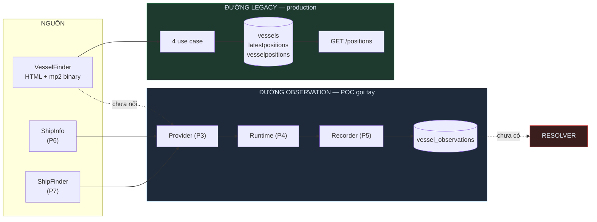

**Hai đường không giao nhau.** Legacy ghi đè theo `mmsi`; observation append-only, giữ mọi nguồn. Không dòng code nào so sánh chúng — đó là việc của resolver, **chưa tồn tại**.

---

## 1. Bốn đường ghi dữ liệu (đường cũ)

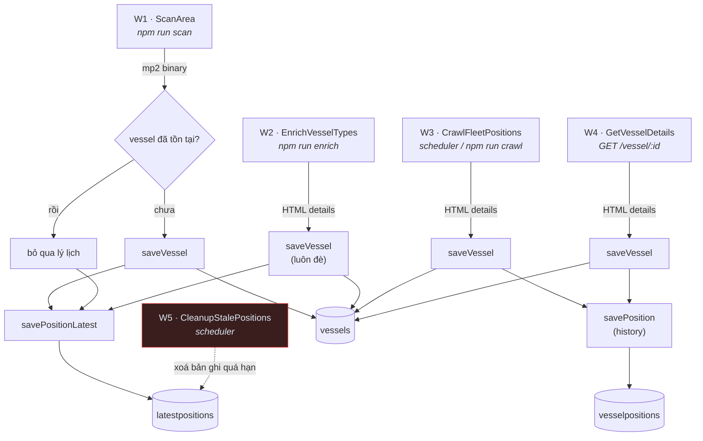

| # | Đường | Trigger | `vessels` | `vesselpositions` | `latestpositions` |
|---|---|---|---|---|---|
| W1 | `ScanArea.saveShips()` | `npm run scan` (loop) | ✅ chỉ khi **chưa tồn tại** | ❌ | ✅ |
| W2 | `EnrichVesselTypes.runOnce()` | `npm run enrich` (loop) | ✅ luôn đè | ❌ | ✅ |
| W3 | `CrawlFleetPositions.execute()` | scheduler / `npm run crawl` | ✅ luôn | ✅ | ⚠️ xem dưới |
| W4 | `GetVesselDetails.execute()` | `GET /vessel/:id` (cache miss) | ✅ luôn | ✅ | ⚠️ xem dưới |
| W5 | `CleanupStalePositions.execute()` | scheduler | ❌ giữ | ❌ giữ | 🗑️ xoá quá hạn |

### ⚠️ Hai adapter của cùng một port hành xử KHÁC NHAU

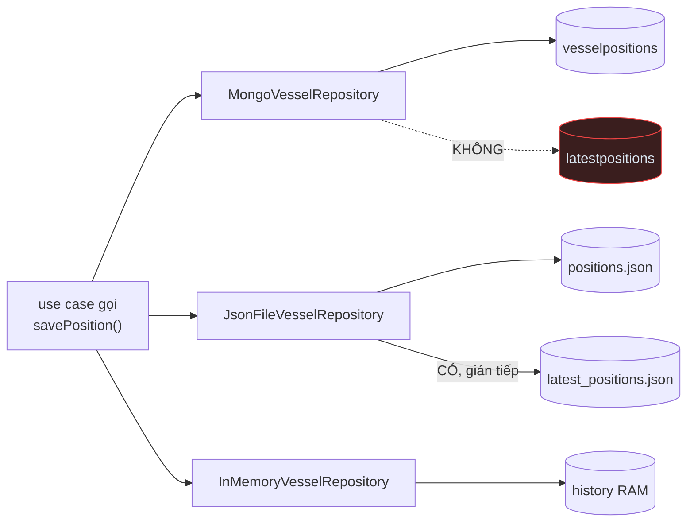

Hệ quả thật: **chạy Mongo thì tàu trong watchlist (W3/W4) không hiện lên bản đồ** trừ khi cũng được `ScanArea`/`EnrichVesselTypes` chạm tới. Chạy JSON thì có. Chênh lệch ngữ nghĩa giữa các adapter của cùng một port.

---

## 2. Trường nào đến từ nguồn nào

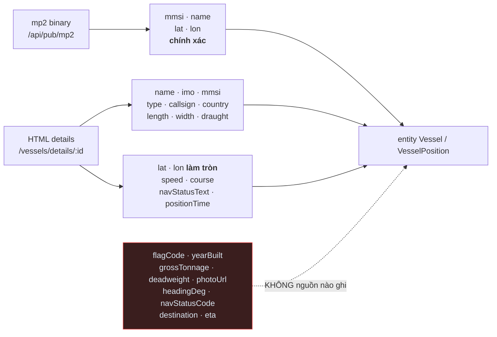

### 2.1 mp2 binary — đúng **4** field
`mmsi`, `name`, `lat`, `lon` ([IAreaScanner.ts:9-14](../src/application/ports/IAreaScanner.ts#L9-L14)).
Decoder đọc thêm 1 int16 cờ và 1 int8 status nhưng **bỏ qua cả hai**. `name` rỗng → fallback `String(mmsi)`. Toạ độ `int32 / 600000`, **chính xác** → `latLonApproximate: false`.

### 2.2 Trang HTML chi tiết

| Field domain | Nguồn trong HTML |
|---|---|
| `name` | `<h1 class="title">` |
| `imo`, `mmsi` | ô bảng `"IMO / MMSI"`, fallback `#djson.imo/.mmsi` |
| `type` · `callsign` · `country` | ô `"AIS Type"` · `"Callsign"` · `"AIS Flag"` |
| `lengthM`, `widthM` | ô `"Length / Beam"` regex `([\d.]+)/([\d.]+)` |
| `draughtM` | ô `"Current draught"` |
| `lat`, `lon` | `#djson.ship_lat/ship_lon` — **làm tròn** → `latLonApproximate: true` |
| `speedKn` · `courseDeg` | `#djson.ship_sog` · `#djson.ship_cog` |
| `navStatusText` | ô `"Navigation Status"`, default `"Unknown"` |
| `positionTime` | `#djson.lrpd` — **chuỗi thô** `"0 min ago"`, không parse thành thời gian |
| `source` | hardcode `"vesselfinder"` |

Không có cả `imo` lẫn `mmsi` → mapper **throw** → bọc thành `E-2002`.

### 2.3 Trường CÓ trong schema nhưng KHÔNG nguồn nào ghi

`flagCode`, `yearBuilt`, `grossTonnage`, `deadweight`, `photoUrl` (vessels);
`headingDeg`, `navStatusCode`, `destination`, `eta` (positions).

`destination`/`eta` được `EnrichVesselTypes` **đọc và chuyển tiếp** nhưng mapper không bao giờ set → luôn `null`.

---

## 3. Ai ghi đè ai

Chỉ có **một** cơ chế: `savePositionLatest` = `replaceOne(..., upsert:true)` theo `mmsi` → **thay toàn bộ document**, không merge field.

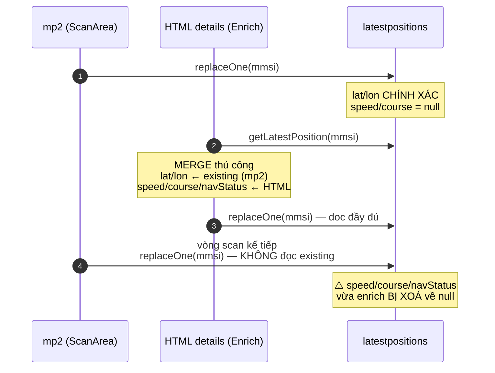

| | Đọc bản cũ trước khi ghi? | Hệ quả |
|---|---|---|
| `EnrichVesselTypes` | ✅ có ([:67](../src/application/use-cases/EnrichVesselTypes.ts#L67)) | Bảo toàn toạ độ mp2 |
| `ScanArea.saveShips()` | ❌ **không** ([:74-82](../src/application/use-cases/ScanArea.ts#L74-L82)) | **Mọi field enrich bị mất** ở vòng scan kế tiếp |

Với `vessels` thì ngược lại, không mất dữ liệu: `ScanArea` chỉ `saveVessel` khi `findVesselByMmsi()` trả `null`. Nhưng `MongoVesselRepository.saveVessel()` dùng `$set: {...vessel}` với entity đã normalize mọi field thiếu thành `null` → khi W2/W3/W4 chạy, **mọi field entity đều được set**, kể cả `null`.

---

## 4. Đường đọc — `GET /positions`

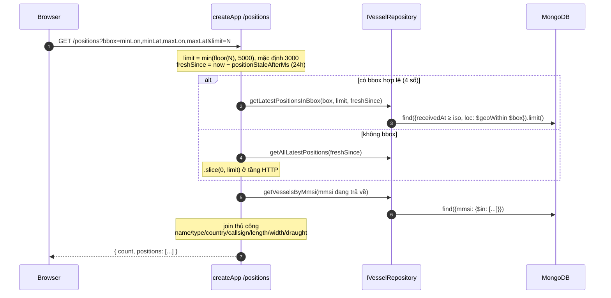

### ⚠️ Ba quy ước toạ độ cùng tồn tại

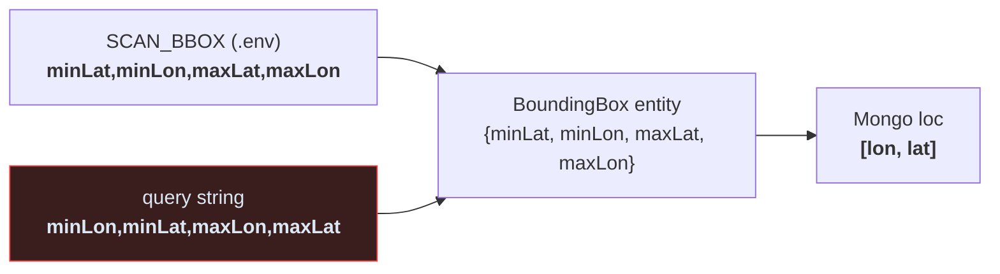

`.env` và query string **ngược thứ tự nhau**; Mongo `loc` lại là `[lon, lat]`. Đổi chỗ ngay tại [createApp.ts:102-106](../src/interfaces/http/createApp.ts#L102-L106).

`/positions` **không cần API key**; `/vessel/:id` và `/watchlist*` cần `X-API-Key`, so bằng `timingSafeEqual`.
Lọc "còn tươi" áp dụng **cả lúc đọc** (`freshSince`) lẫn lúc dọn (`CleanupStalePositions`) → hai lớp độc lập.

---

## 5. Vòng đời một bản ghi vị trí

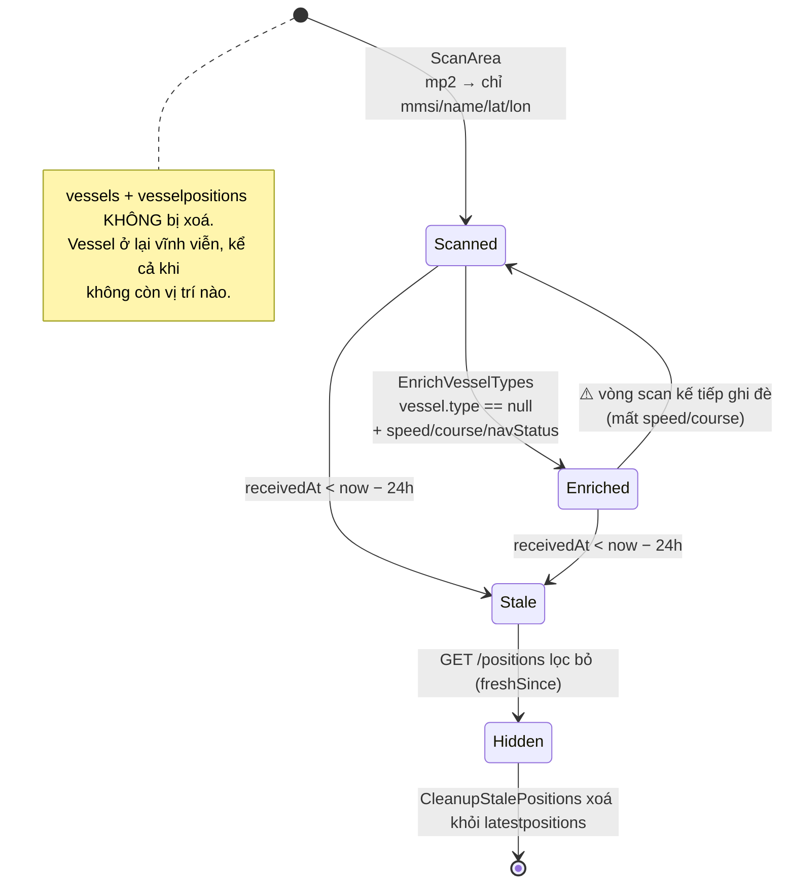

Điều kiện để một tàu được enrich: `getVesselsMissingType(limit)` → `vessels` có `type` là `null` / không tồn tại / chuỗi rỗng.
→ **Tàu đã có `type` không bao giờ được enrich lại**, kể cả khi speed/course đã bị vòng scan xoá về `null`.

---

## 6. Luồng cache — chỉ một đường duy nhất

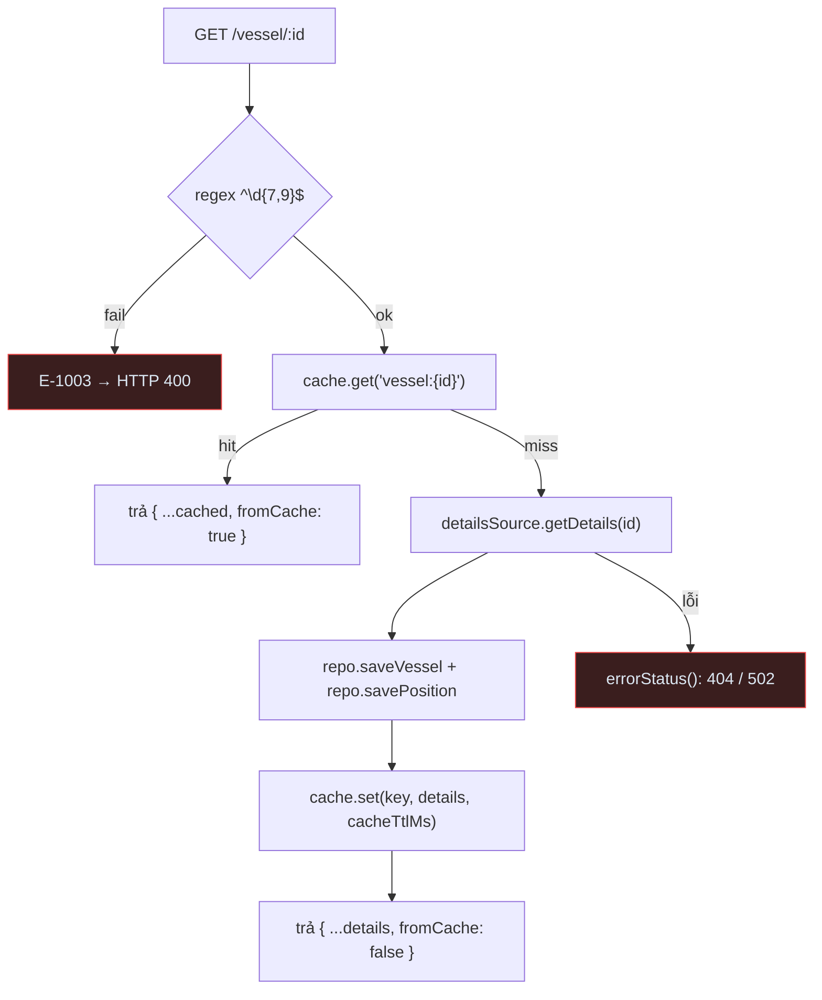

- Key: `vessel:{id}` — **id nguyên văn người gọi truyền vào**. Cùng một tàu tra bằng IMO và bằng MMSI tạo **2 entry cache khác nhau**.
- TTL: `CACHE_TTL_MS` (60s mặc định).
- **Không có invalidate**: `ICache` không có `del`. Ghi DB ở W1–W3 không làm cache cũ hết hiệu lực.
- Redis lỗi → `catch` trả `null` = cache miss, request vẫn chạy.

---

## 7. Nguồn sự thật của từng trường (đường cũ)

| Field | Nguồn ghi cuối thường gặp | Ghi đè bởi | Ổn định? |
|---|---|---|---|
| `vessels.mmsi` | W1 (scan) | không (khoá) | ✅ |
| `vessels.name` | W1 rồi W2 | W2/W3/W4 | ✅ |
| `vessels.type/callsign/country/length/width/draught` | W2 (enrich) | W3/W4 | ✅ không bị scan đè |
| `vessels.imo` | W2 | W3/W4 | ✅ |
| `latestpositions.lat/lon` | W1 (mp2, chính xác) | W2 giữ nguyên | ✅ |
| `latestpositions.latLonApproximate` | W1 = `false` | W2 giữ nguyên | ✅ |
| `latestpositions.speedKn/courseDeg/navStatusText` | W2 (HTML) | ⚠️ **W1 xoá về null mỗi vòng scan** | ❌ |
| `latestpositions.destination/eta/headingDeg/navStatusCode` | không ai ghi | — | luôn `null` |
| `latestpositions.receivedAt` | mọi write, ISO string `now()` | — | ✅ |
| `vesselpositions.*` | chỉ W3/W4 | append-only | ✅ nhưng thưa |

---

## 8. Ba câu hỏi mà luồng cũ KHÔNG trả lời được

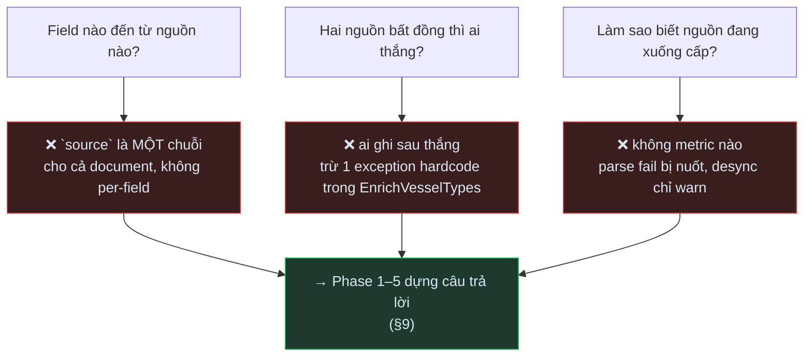

Chi tiết technical debt: [CURRENT_ARCHITECTURE.md §6](./CURRENT_ARCHITECTURE.md).

---

## 9. Cập nhật sau giai đoạn 6/7 — đường observation

> §1–§8 vẫn **đúng nguyên** cho đường legacy. Phần này mô tả đường **song song** đã thêm.

### 9.1 Đường đi đầy đủ

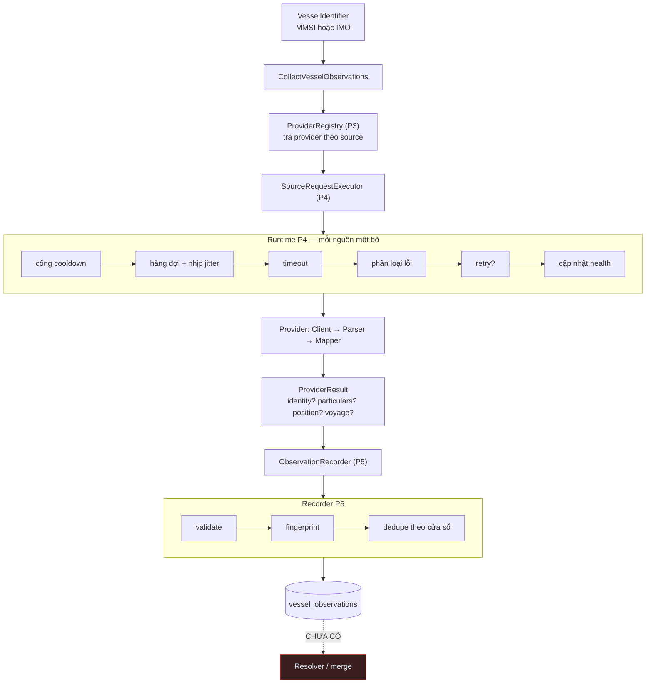

### 9.2 Khác biệt cốt lõi so với đường cũ

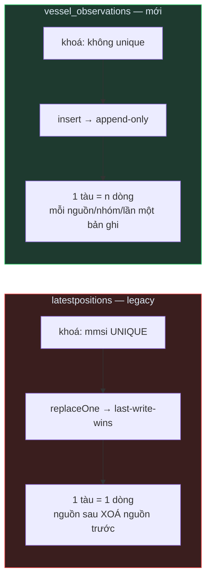

| | legacy | observation |
|---|---|---|
| Ngữ nghĩa | "hệ thống tin là vậy" | "nguồn nói vậy" |
| Xung đột | bị xoá | **cùng tồn tại** |
| Provenance | `source` 1 chuỗi/document | `SourceMetadata` mỗi nhóm |
| Mốc thời gian | `receivedAt` chuỗi ISO | `fetchedAt` (bot) **tách khỏi** `sourceReceivedAt` (nguồn) |
| Ghi | ghi đè | bất biến |

### 9.3 Ba nguồn hiện có — đo thật

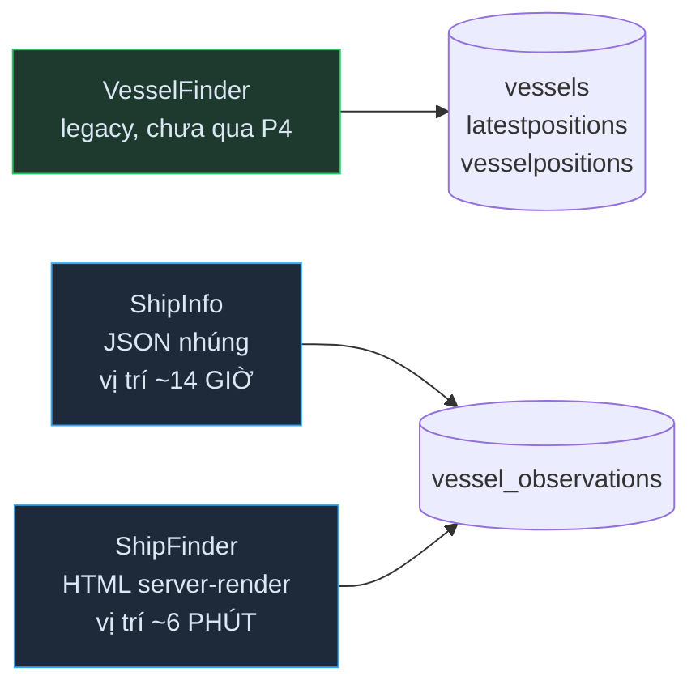

| | ShipInfo | ShipFinder |
|---|---|---|
| Tuổi vị trí (đo thật) | **~14 giờ** (khoá có chủ ý) | **~6 phút** |
| `heading` / `navStatus` / `draught` | ❌ | ✅ |
| `destination` | ❌ | ✅ |
| `length` / `beam` | ⛔ đảo không nhất quán → không map | ✅ đúng chiều |
| `builtYear` / `deadweight` | ✅ | ❌ (sau API ký chữ ký) |
| Lookup | MMSI + IMO | **chỉ MMSI** |
| Mốc thời gian | tự suy offset từ `updated_utc` | ⚠️ **giả định vận hành** phải khai qua env |

Chi tiết: [SHIPINFO_POC.md](./sources/SHIPINFO_POC.md) · [SHIPFINDER_POC.md](./sources/SHIPFINDER_POC.md)

### 9.4 Ba câu hỏi ở §8 — giờ trả lời được

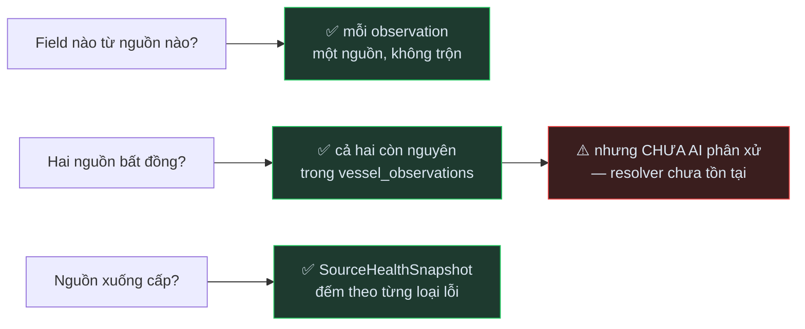

### 9.5 Điều gì CHƯA thay đổi

- Legacy crawler VesselFinder **chạy y nguyên** — chưa migrate sang P4, `latestpositions` vẫn last-write-wins, `ScanArea` vẫn xoá field enrich mỗi vòng (§3).
- ShipInfo/ShipFinder **không ghi một byte nào** vào `vessels`/`latestpositions`/`vesselpositions` — đã kiểm sau POC live.
- `GET /positions` vẫn đọc **duy nhất** từ `latestpositions` legacy; observation chưa phục vụ API nào.
- **Không có resolver, không merge, không source scoring, không fallback.**
