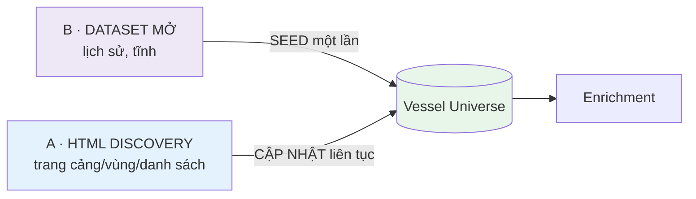
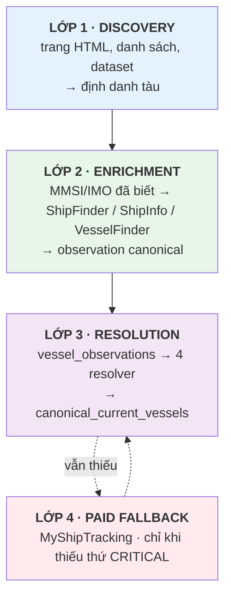
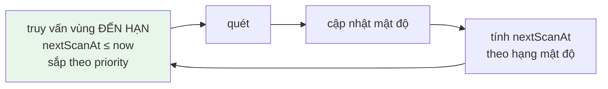
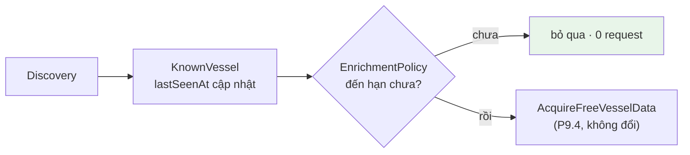
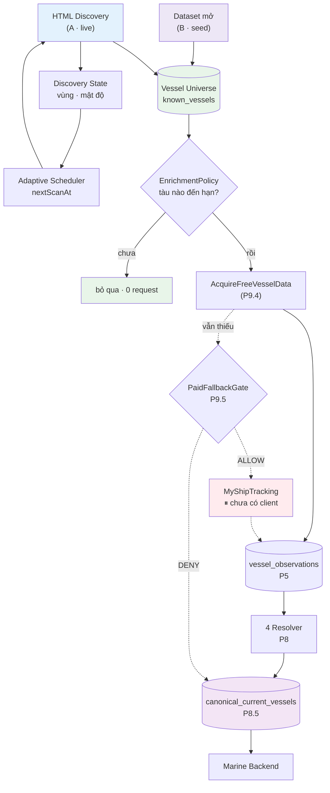

# GLOBAL_DISCOVERY_ARCHITECTURE — Phase 10.1 (thiết kế, KHÔNG implement)

> Trả lời một câu: **làm sao phủ gần hết đội tàu thế giới mà không quét mù cả bản đồ và không tiêu tiền?**
>
> Tiền đề: [ACQUISITION_POLICY.md](./ACQUISITION_POLICY.md) · [SOURCE_CAPABILITY_MATRIX.md](./SOURCE_CAPABILITY_MATRIX.md) · [PROVIDER_ARCHITECTURE.md](./PROVIDER_ARCHITECTURE.md) · [CRAWL_RUNTIME.md](./CRAWL_RUNTIME.md) · [OBSERVATION_STORAGE.md](./OBSERVATION_STORAGE.md) · [CANONICAL_CURRENT_STORAGE.md](./CANONICAL_CURRENT_STORAGE.md)
>
> **P10.1 chỉ thiết kế.** Không crawler, không scheduler, không collection, không repository, không proxy, không queue, không Redis, không MyShipTracking.

---

## 1. Vấn đề

Hệ thống hiện tại lấy dữ liệu **theo tàu, khi có người hỏi** (P9.4: local-first, tối đa 2 lần chạm nguồn). Nó trả lời tốt câu *"tàu X thế nào?"* nhưng **không** trả lời được câu *"có những tàu nào?"*.

Đường quét vùng duy nhất đang có là `ScanArea` + `worldTiles`, và nó có ba vấn đề đo được:

| # | Vấn đề | Số liệu |
|---|---|---|
| 1 | **Quét lưới mù** | `generateWorldTiles(1)` sinh **60.480 ô**. Với nhịp nghỉ 3–8s hiện tại (~5,5s/ô) → **~92 giờ một vòng**, chưa tính chia nhỏ ô dày |
| 2 | **Ghi N+1** | `ScanArea.saveShips()` chạy `findVesselByMmsi` rồi `savePositionLatest` **cho từng tàu**. Một ô 400 tàu ≈ **800+ round-trip DB** |
| 3 | **Dựa trên API nội bộ** | `VesselFinderMapSource` gọi `/api/pub/mp2` — đó là API của website, không phải trang HTML công khai |

92 giờ một vòng nghĩa là vị trí "mới nhất" của một tàu bất kỳ có thể cũ gần **4 ngày**. Không ngưỡng nào trong [ACQUISITION_POLICY.md §D.1](./ACQUISITION_POLICY.md) chấp nhận được điều đó — `LIVE` là 30 phút.

**Kết luận: không thể mở rộng lưới. Phải đổi cách nghĩ.**

---

## 2. Mục tiêu

| # | Mục tiêu |
|---|---|
| G1 | Biết **tàu nào tồn tại** — một "vessel universe" bền, không phải kết quả của lần quét gần nhất |
| G2 | Tách hẳn **phát hiện** khỏi **làm giàu** — hai câu hỏi khác nhau, hai nhịp khác nhau |
| G3 | Phân bổ request theo **mật độ thật**, không theo hình học bản đồ |
| G4 | Làm giàu theo **trạng thái tàu**, không theo lịch đều |
| G5 | Chỉ crawl **trang HTML công khai** cho nguồn miễn phí |
| G6 | Giữ nguyên P1–P9 — lớp mới đứng **phía trước**, không thay thế |

## 3. Không làm

Không implement gì trong P10.1 · không quét toàn lưới thế giới · không API/XHR/WebSocket nội bộ của website miễn phí · không proxy xoay vòng · không Redis/queue/Kafka · không microservice · không scheduler · không tải dataset lớn · không MyShipTracking · không AISStream · không đụng Marine Backend/FE · **không viết lại P1–P9**.

---

## 4. Chiến lược A + B

Hai nguồn gốc dữ liệu, hai vai trò **không thay thế nhau được**.



| | **A · HTML Discovery** | **B · Dataset mở** |
|---|---|---|
| Vai trò | **LIVE / TĂNG DẦN** | **KHỞI TẠO / GIEO MẦM** |
| Nhịp | liên tục | một lần, thỉnh thoảng làm mới |
| Cho biết | tàu nào đang xuất hiện ở đâu **bây giờ** | tàu nào **từng** tồn tại, tuyến nào đông |
| Dùng để | cập nhật `lastSeenAt`, phát hiện tàu mới | gieo MMSI/IMO, xếp hạng vùng ban đầu |

⛔ **Dữ liệu lịch sử KHÔNG BAO GIỜ được coi là vị trí hiện tại.** Nó không được ghi vào `canonical_current_vessels`, không được ghi đè vị trí nào, và nếu có sinh observation thì `sourceReceivedAt` phải là mốc **thật của bản ghi lịch sử** — không phải lúc ta đọc file.

Vì sao cần cả hai: A một mình phải chờ tàu tình cờ xuất hiện trên một trang ta biết; B một mình thì không bao giờ biết hôm nay tàu ở đâu. B cho **bề rộng** ngay lập tức, A cho **độ tươi** lâu dài.

---

## 5. Discovery ≠ Enrichment

Đây là ranh giới quan trọng nhất của toàn phase.

| | **Discovery** | **Enrichment** |
|---|---|---|
| Câu hỏi | "tàu nào tồn tại / đang ở đâu?" | "tàu MMSI X có gì?" |
| Đầu vào | trang cảng, vùng, danh sách, dataset | một định danh đã biết |
| Đầu ra | định danh + dấu vết mỏng | observation canonical đầy đủ |
| Đơn vị | **một request → hàng chục/trăm tàu** | **một request → một tàu** |
| Nhịp | theo mật độ vùng | theo trạng thái tàu |

⛔ **Cấm tuyệt đối phản xạ này:**

```
trang cảng → 200 MMSI  →  gọi ShipFinder 200 lần
                        →  gọi ShipInfo 200 lần
```

200 tàu × 2 nguồn × nhịp nghỉ 3–8s ≈ **37 phút** cho **một** trang cảng, và phần lớn trong số đó là tàu đang neo, dữ liệu không đổi. Discovery **chỉ ghi trạng thái phát hiện**. Việc có gọi nguồn hay không là quyết định **riêng**, muộn hơn, của chính sách làm giàu (§13).

Đây cũng chính là lý do P9 tồn tại: [§D.0](./ACQUISITION_POLICY.md) đã cấm đuổi theo field null, và §5 này là cùng một nguyên tắc ở quy mô đội tàu.

---

## 6. Bốn lớp



| Lớp | Trạng thái | Ghi ở đâu |
|---|---|---|
| 1 · Discovery | ⏳ **MỚI** — P10.2+ | `known_vessels`, `discovery_zones` (chưa tạo) |
| 2 · Enrichment | ✅ **ĐÃ CÓ** — P6.4/P7.4 (`CollectVesselObservations`) | `vessel_observations` |
| 3 · Resolution | ✅ **ĐÃ CÓ** — P8 (4 resolver + `ResolveAndStoreCurrentVessel`) | `canonical_current_vessels` |
| 4 · Paid | 🟡 **CỔNG ĐÃ CÓ**, client chưa — P9.5 | — |

**Chỉ lớp 1 là mới.** Lớp 2–4 không bị đụng tới.

### Tái sử dụng được gì

| Thành phần | Dùng cho discovery? | Lý do |
|---|---|---|
| `SourceRuntimeManager` (P4) | ✅ **có** | nhịp nghỉ / cooldown / phân loại lỗi / health là như nhau cho mọi request HTML |
| `SourceErrorCategory` (P4) | ✅ **có** | 403/429/parse-error không đổi nghĩa vì đang quét vùng |
| `SOURCE_CAPABILITY_MATRIX` | ⚠️ **cần mở rộng** | matrix hiện mô tả *field lấy được từ một tàu*, chưa mô tả *khả năng phát hiện* |
| `ObservationRecorder` (P5) | ⚠️ **chỉ khi có vị trí thật** | xem §21 |
| `VesselDataProvider` (P3) | ❌ **không** | xem dưới |
| `ScanArea` / `worldTiles` / mp2 | ❌ **không** | xem §20 |

⚠️ **`VesselDataProvider` KHÔNG dùng cho discovery**, và đây là quyết định có chủ ý. Hợp đồng của nó là `(một định danh) → (một tàu)`. Discovery là `(một vùng/trang) → (nhiều tàu, mỗi tàu mỏng)`. Ép chung một interface sẽ tạo ra một `getDetails` trả về mảng, hoặc một `scanArea` trả về canonical đầy đủ — cả hai đều là nói dối về thứ nguồn thật sự cho.

---

## 7. Hợp đồng nguồn discovery

Khái niệm, **không implement**:

```ts
// ⚠️ CHƯA VIẾT. Hình dạng đề xuất cho P10.2+.
interface DiscoverySource {
  readonly source: VesselSource;
  readonly inputKinds: readonly DiscoveryInputKind[];
  discover(input: DiscoveryInput): Promise<DiscoveryResult>;
}
```

### Loại đầu vào

| Loại | Nghĩa | Ví dụ |
|---|---|---|
| `PORT` | trang một cảng | "tàu đang ở cảng Singapore" |
| `REGION` | trang một vùng biển | "tàu ở Vịnh Bắc Bộ" |
| `LIST_PAGE` | danh sách có phân trang | "trang 3 của danh sách tàu hàng rời" |
| `DATASET` | tệp lịch sử/mở | seed một lần |

Bốn loại, không hơn. Trừu tượng hoá thêm khi chưa có nguồn thứ hai để so là thiết kế cho tưởng tượng.

### Luật nguồn — HTML công khai

Nguồn miễn phí được crawl **CHỈ** qua trang HTML công khai.

⛔ **Cấm**: API riêng · API công khai của website · endpoint XHR không tài liệu · API ký chữ ký · WebSocket feed riêng — kể cả khi chúng dễ parse hơn HTML.

⚠️ Ngoại lệ **legacy, đóng băng**: `VesselFinderMapSource` đang gọi `/api/pub/mp2`. Nó ở lại vì đang chạy production (§20), nhưng **không được** dùng làm nền cho discovery mới.

API trả tiền được phép duy nhất: **MyShipTracking** `GET /api/v2/vessel` — và đó là lớp 4, không phải discovery. MyShipTracking **không bao giờ** là nguồn discovery: nó tính tiền theo tàu, đúng thứ discovery cần làm hàng loạt.

---

## 8. Kết quả discovery

```ts
// ⚠️ CHƯA VIẾT.
interface DiscoveredVessel {
  readonly source: VesselSource;
  readonly mmsi?: string;
  readonly imo?: string;
  readonly name?: string;
  readonly lat?: number;
  readonly lng?: number;
  /** Mốc NGUỒN khai. Nguồn không nói -> null, KHÔNG mượn. */
  readonly sourceSeenAt?: Date | null;
  /** Đồng hồ của ta lúc đọc trang. Luôn có. */
  readonly discoveredAt: Date;
  readonly zoneId?: string;
  readonly portId?: string;
}
```

⛔ **Không** `length`, `beam`, `builtYear`, `destination`, `flag`… Discovery **không phải** `VesselParticulars`. Trang danh sách có tiện thể hiện `Type: Bulk Carrier` cũng không đổi điều đó — thứ đó là việc của enrichment, nơi có resolver phân xử khi hai nguồn bất đồng.

### Yêu cầu định danh

Một bản ghi discovery **dùng được** phải có **MMSI hoặc IMO**.

⚠️ **Chỉ có tên tàu thì KHÔNG đủ.** Tên trùng nhau, tên đổi (P8.3 đo được: `"Queen Of The West"` → `"AMERICAN WEST"`, cùng callsign), tên viết khác nhau giữa các nguồn. Ghép theo tên là làm entity resolution mờ — đúng thứ [P8.5 §11](./CANONICAL_CURRENT_STORAGE.md) cấm.

Bản ghi chỉ có tên: **được phép ghi làm chẩn đoán** (biết trang đó có gì mà ta chưa dùng được), ⛔ **không được** đưa vào hàng đợi enrichment.

### Ngữ nghĩa vị trí

| Mốc | Nghĩa |
|---|---|
| `sourceSeenAt` | nguồn nói nó thấy tàu lúc nào |
| `discoveredAt` | ta đọc trang lúc nào |

⛔ **`discoveredAt` KHÔNG BAO GIỜ được gán cho `sourceSeenAt`.** Đây đúng là lỗi đã sửa ở P5 (`observationFingerprint` từng nuốt `receivedAt` là đồng hồ của bot) và luật đã có ở [OBSERVATION_STORAGE.md](./OBSERVATION_STORAGE.md).

Nguồn không cho mốc thời gian → độ tươi của vị trí đó là **`UNKNOWN`**, và ở resolver nó rơi vào bậc `NO_SOURCE_TIME` — thấp hơn cả `EXPIRED`. Không biết tuổi ≠ tuổi bằng 0.

---

## 9. Vessel universe

```ts
// ⚠️ CHƯA VIẾT. Collection đề xuất: `known_vessels`.
interface KnownVessel {
  readonly mmsi?: string;
  readonly imo?: string;
  readonly firstSeenAt: Date;
  readonly lastSeenAt: Date;
  readonly sources: readonly VesselSource[];
}
```

Đây là **danh bạ**, không phải trạng thái. Nó trả lời "tàu này có tồn tại và ta gặp lần cuối khi nào", **không** trả lời "tàu này đang ở đâu" — câu đó thuộc `canonical_current_vessels` (P8.5).

Ba kho, ba ngữ nghĩa, không kho nào thay được kho nào:

| Kho | Nói gì | Nhịp ghi |
|---|---|---|
| `known_vessels` | tàu nào tồn tại | mỗi lần discovery |
| `vessel_observations` | nguồn X nói Y lúc T | append-only, mỗi lần enrichment |
| `canonical_current_vessels` | ảnh hợp nhất tốt nhất | upsert, sau mỗi lần resolve |

---

## 10. Mô hình vùng

```ts
// ⚠️ CHƯA VIẾT. Collection đề xuất: `discovery_zones`.
interface DiscoveryZone {
  readonly id: string;
  readonly type: "PORT" | "REGION" | "SHIPPING_AREA";
  readonly source: VesselSource;
  /** Khoá của nguồn: UN/LOCODE, slug cảng, id vùng… */
  readonly externalRef?: string;
  readonly priority: number;
  readonly lastScanAt?: Date;
  readonly nextScanAt?: Date;
  readonly enabled: boolean;
}
```

⚠️ **Vùng gắn với TRANG, không với hình học.** Một `DiscoveryZone` là "trang cảng Rotterdam của ShipInfo", không phải một đa giác toạ độ. Nhờ vậy không cần geometry engine, không cần thư viện không gian, và số vùng bị chặn bởi **số trang nguồn có** — không phải bởi diện tích Trái Đất.

Đó chính là điểm thoát khỏi bài toán 60.480 ô: thế giới có vài nghìn cảng thương mại, không phải 60 nghìn ô vuông trong đó phần lớn là nước trống.

---

## 11. Mô hình mật độ

```ts
interface ZoneDensity {
  readonly lastVesselCount: number;
  readonly avgVesselCount: number;
  readonly consecutiveEmptyScans: number;
  readonly lastNonEmptyAt?: Date;
}
```

Bốn con số. ⛔ Không học máy, không mô hình dự báo, không trọng số tự điều chỉnh.

| Hạng | Ý nghĩa | Ngưỡng **đề xuất ban đầu** |
|---|---|---|
| `HOT` | cảng lớn, eo biển đông | `avgVesselCount ≥ 200` |
| `WARM` | cảng vừa | `50 ≤ avg < 200` |
| `LOW` | thưa | `5 ≤ avg < 50` |
| `COLD` | gần như trống | `avg < 5` hoặc `consecutiveEmptyScans ≥ 3` |

⚠️ Đây là **số khởi điểm để đo**, không phải bất biến nghiệp vụ. Chúng phải nằm trong config và phải được chỉnh sau khi có dữ liệu thật từ P10.2+. Ai chốt cứng chúng vào code là đang đoán.

---

## 12. Mô hình xoay vòng

⛔ **Không** `for (const zone of allZones)`. Vòng lặp đó chính là cái tạo ra 92 giờ.



Nhịp **đề xuất ban đầu**:

| Hạng | Chu kỳ |
|---|---|
| `HOT` | 5–15 phút |
| `WARM` | 30–120 phút |
| `LOW` | 2–6 giờ |
| `COLD` | 6–24 giờ |

Hệ quả số học đáng chú ý: 50 vùng `HOT` @ 10 phút = **7.200 request/ngày**; cộng 200 vùng `WARM` @ 60 phút = 4.800; cộng 1.000 vùng `COLD` @ 12 giờ = 2.000. Tổng ~14.000 — cao hơn ngân sách khởi điểm ở §17, nên **số vùng `HOT` là thứ phải giữ kỷ luật**, không phải tổng số vùng.

⚠️ Cũng là config, không phải bất biến.

---

## 13. Chính sách làm mới theo trạng thái tàu

Nhịp làm giàu bám vào **tàu đang làm gì**, không vào lịch đều.

| Trạng thái | Vị trí | Vì sao |
|---|---|---|
| `USER_TRACKED` | 5–10 phút | có người đang nhìn |
| `MOVING` | 10–30 phút | vị trí đổi thật |
| `NEAR_PORT` | 15–30 phút | sắp có sự kiện cập cảng |
| `MOORED` | 1–3 giờ | tàu neo không đi đâu |
| `STALE` / `OFFLINE` | 6–24 giờ | hỏi nữa cũng thế |

| Nhóm tĩnh | Chu kỳ |
|---|---|
| `PARTICULARS` (length/beam/builtYear/DWT/GT) | **30–90 ngày** |

⚠️ **Làm mới VỊ TRÍ khác hẳn làm mới LÝ LỊCH.** Chiều dài tàu không đổi; hỏi lại `builtYear` mỗi giờ là đốt request để nhận đúng con số cũ. Luật này đã có trong [ACQUISITION_POLICY.md §D.3](./ACQUISITION_POLICY.md) ở mức một tàu — ở đây nó thành lịch của cả đội.

⚠️ Ngoại lệ đã biết: `draught` **nửa động** (đổi theo hàng hoá từng chuyến) tuy nằm trong nhóm particulars. Xử lý như [§D.3](./ACQUISITION_POLICY.md) đã chốt: chỉ làm mới khi có ai yêu cầu đích danh.

### Nối vào P9



Discovery **không** gọi provider. Nó cập nhật `KnownVessel`, và chính sách làm giàu — chạy độc lập — quyết định tàu nào đến hạn. `AcquireFreeVesselData` giữ nguyên: local-first, tối đa 2 lần chạm nguồn, không nguồn trả tiền.

---

## 14. Ghi hàng loạt — bắt buộc

Kết quả discovery **phải** ghi theo mẻ.

⛔ **Cấm** khuôn hiện có trong `ScanArea.saveShips()`:

```ts
for (const s of ships) {
  const known = await repo.findVesselByMmsi(s.mmsi);   // 1 đọc / tàu
  if (!known) await repo.saveVessel(...);              // 1 ghi / tàu
  await repo.savePositionLatest(...);                  // 1 ghi / tàu
}
```

Một ô 400 tàu ≈ **800+ round-trip**. Đây là debt **D-8** của audit A0, và nó là lý do trực tiếp khiến quét diện rộng không mở rộng được.

✅ Yêu cầu: **một `bulkWrite` cho cả mẻ**, upsert theo khoá canonical. Một request HTML cho 200 tàu phải tương ứng **một** thao tác ghi, không phải 400.

---

## 15. Mongo là nguồn sự thật

| Ở đâu | Cái gì |
|---|---|
| **MongoDB** | `known_vessels` · trạng thái vùng · `vessel_observations` · `canonical_current_vessels` |
| **RAM** | limiter/health của P4 · khoá single-flight · dedupe ngắn hạn trong một mẻ |

⛔ **Không cache toàn bản đồ trong RAM.** Vài trăm nghìn tàu × trạng thái đầy đủ là hàng trăm MB, mất sạch khi restart, và sai ngay khi có tiến trình thứ hai. Trạng thái vùng và danh bạ tàu **phải** đọc/ghi thẳng DB.

Đây cũng là lý do §14 quan trọng: nếu DB là nguồn sự thật thì đường ghi phải rẻ.

---

## 16. Chống bị chặn

Dùng lại nguyên `SourceRuntimeManager` (P4). Không dựng bộ thứ hai.

| Nguyên tắc | |
|---|---|
| Đồng thời | **bắt đầu từ 1** mỗi nguồn |
| Nhịp nghỉ | có jitter, không đều như máy |
| Timeout | theo nguồn |
| Retry | có chặn (hiện `maxRetries: 1` cho ShipInfo/ShipFinder) |
| 403 | cooldown dài |
| 429 | cooldown dài |
| Xuống cấp | giảm nhịp khi lỗi tăng |

⛔ **Không** xoay IP sau 403/429 · **không** bypass CAPTCHA · **không** giả mạo fingerprint trình duyệt · **không** browser automation. 403 nghĩa là nguồn nói *đừng*. Câu trả lời đúng là chậm lại, không phải đổi mặt nạ.

---

## 17. Proxy

> **Mặc định: 0 proxy.**

Chỉ cân nhắc khi có **lý do vận hành hợp lệ**: nhiều worker cần tách egress theo nguồn, hoặc độ tin cậy đường ra.

⛔ **Không bao giờ** dùng proxy để: lách 403 · lách 429 · lách rate limit · bypass CAPTCHA.

| Giai đoạn | Proxy |
|---|---|
| 1 (hiện tại → P10.x) | **0** |
| 2 (chỉ khi đo được nhu cầu thật) | **2–4 IP tĩnh** |

⛔ Không thiết kế cho 100 proxy dân cư xoay vòng. Kiến trúc cần proxy để hoạt động là kiến trúc đang crawl quá nhanh.

---

## 18. Đo lường

### Theo nguồn
`requests` · `2xx` · `403` · `429` · `timeout` · `parseError` · `medianLatency` · `cooldownCount`

Phần lớn đã có trong `SourceHealthSnapshot` (P4) — thiếu **median latency** (hiện chỉ có trung bình cộng, dễ bị một request 20s kéo lệch).

### Theo request discovery — **quan trọng nhất**
`vesselsPerRequest` · `uniqueMmsiPerRequest` · `uniqueImoPerRequest` · `newVesselsPerRequest` · `requestDuration` · `duplicateRatio`

⚠️ **`newVesselsPerRequest` là con số quyết định chọn nguồn.** Một trang cho 300 tàu nhưng 295 tàu đã biết thì giá trị thật của nó là **5**. `vesselsPerRequest` một mình sẽ chọn nhầm nguồn.

### Theo vùng
`scanCount` · `lastVesselCount` · `avgVesselCount` · `emptyScanCount` · `lastScanDuration` · `lastScanAt`

### Chi phí
`htmlRequests/day` · `enrichmentRequests/day` · `paidRequests/day` · `dbWrites/day`. Bốn con số, ⛔ không hệ thống tính tiền.

### Ngân sách khởi điểm

| | Mục tiêu/ngày |
|---|---|
| Discovery | **3.000–8.000** request, cộng dồn mọi nguồn |
| Enrichment | **1.000–3.000** request |
| Paid | theo cổng P9.5 — mặc định **0** |

⚠️ Đây là **ngân sách để đo**, không phải trần hệ thống. Mục đích là buộc phải biết mình đang tiêu bao nhiêu trước khi tăng.

---

## 19. Ma trận vai trò nguồn

✅ có bằng chứng · 🟡 ứng viên, **chưa audit** · ❌ không

| Nguồn | Discovery | Position | Details | Cách | Trạng thái hiện tại |
|---|---|---|---|---|---|
| **VesselFinder** | 🟡 trang cảng | ⚠️ legacy qua mp2 | ✅ | HTML **ưu tiên** | provider có; mp2 là legacy (§20) |
| **ShipInfo** | 🟡 trang danh sách | ✅ (trễ ~14h) | ✅ | HTML | provider có, POC live rồi |
| **ShipFinder** | 🟡 chưa rõ | ✅ (tươi theo phút) | ✅ | HTML | provider có, POC live rồi |
| **VesselTracker** | 🟡 cảng/danh sách | 🟡 | 🟡 | HTML | **chưa có provider** |
| **BoatNerd** | 🟡 theo vùng | 🟡 | 🟡 | HTML | **chưa có provider** |
| **ShipTraffic** | 🟡 | ❌ | 🟡 | HTML | **chưa có provider** |
| **MarineTraffic.live** | 🟡 | 🟡 | 🟡 | HTML | **chưa có provider** |
| **MyShipTracking** | ❌ **không bao giờ** | ✅ (trả tiền) | ✅ (trả tiền) | API | cổng có, client chưa |
| **AISStream** | ❌ | — | — | stream | Marine sở hữu; bot **không** mở |

⚠️ Mọi ô 🟡 là **chưa có bằng chứng**. Luật của [SOURCE_CAPABILITY_MATRIX.md §3](./SOURCE_CAPABILITY_MATRIX.md) vẫn áp dụng nguyên: **không nâng lên ✅ nếu chưa audit/POC thật**. Bảng này là danh sách việc cần làm, không phải danh sách năng lực.

⚠️ MyShipTracking **không bao giờ** làm discovery: nó tính credit theo tàu, còn discovery cần hàng loạt. Dùng nó ở đây là cách nhanh nhất để đốt hết hạn mức.

---

## 20. `ScanArea` — LEGACY

| | |
|---|---|
| Trạng thái | **LEGACY, ĐÓNG BĂNG** |
| Gồm | `ScanArea` · `worldTiles` · `VesselFinderMapSource` · `/api/pub/mp2` |
| Xoá? | ❌ **không** — đang chạy production |
| Chuyển đổi? | ❌ **không** trong P10 |
| Làm nền cho discovery mới? | ❌ **KHÔNG** |

Ba lý do, đều đo được (§1): quét lưới mù 60.480 ô ≈ 92 giờ/vòng · ghi N+1 · dựa trên API nội bộ của website thay vì HTML công khai.

Nó tiếp tục chạy như cũ. Discovery mới đứng **song song**, không thay thế, không kế thừa.

---

## 21. Ranh giới observation

> **Trạng thái discovery ≠ observation canonical.**

| Nguồn discovery cho | Ghi gì |
|---|---|
| chỉ "MMSI này có ở cảng X" | **chỉ** trạng thái discovery — ⛔ không dựng observation |
| MMSI + lat/lng + mốc nguồn thật | **có thể** dựng observation `POSITION` — phase sau quyết định |
| chỉ tên tàu | chỉ chẩn đoán (§8) |

⛔ **Không ép mọi thứ discovery thành observation.** Một bản ghi "thấy MMSI ở cảng X" mà bị dựng thành `VesselObservation` sẽ có `lat/lng` bịa hoặc `sourceReceivedAt` mượn từ đồng hồ bot — cả hai đều đầu độc resolver, vì [PositionResolver](./RESOLVER_POLICY.md) tin vào `sourceReceivedAt` để xếp bậc độ tươi.

Quyết định "có ghi observation không" thuộc từng nguồn, sau khi audit nguồn đó cho gì. P10.1 chỉ dựng ranh giới.

---

## 22. Sơ đồ tổng



Nguồn trả tiền nằm **sau** local và free — đúng thứ tự chi phí của [ACQUISITION_POLICY.md §E.1](./ACQUISITION_POLICY.md).

---

## 23. Quyết định

| # | Quyết định | Vì sao |
|---|---|---|
| **D1** | Discovery ≠ Enrichment | 200 MMSI từ một trang không được thành 400 request |
| **D2** | Kết hợp A + B | B cho bề rộng ngay, A cho độ tươi lâu dài |
| **D3** | DB là nguồn sự thật | trạng thái đội tàu không sống trong RAM |
| **D4** | Không cache toàn bản đồ trong RAM | mất khi restart, sai khi có tiến trình thứ hai |
| **D5** | Ghi hàng loạt là bắt buộc | debt D-8: 400 tàu = 800+ round-trip |
| **D6** | Xoay vòng thích ứng, không quét lưới tuần tự | 60.480 ô ≈ 92 giờ/vòng |
| **D7** | Lập lịch theo mật độ | request đi tới nơi có tàu |
| **D8** | Làm giàu theo trạng thái tàu | tàu neo không cần hỏi mỗi 10 phút |
| **D9** | Proxy không phải mặc định | 403 nghĩa là chậm lại, không phải đổi IP |
| **D10** | MyShipTracking là API trả tiền **duy nhất** | và nó **không bao giờ** làm discovery |
| **D11** | mp2 của VesselFinder là legacy | API nội bộ, không phải HTML công khai |
| **D12** | Không nguồn nào lên CONFIRMED nếu chưa audit/POC | luật đã có từ P2, không nới cho discovery |

---

## 24. Phase tiếp theo

| Phase | Việc | Ghi chú |
|---|---|---|
| **P10.2** | Audit trang danh sách **ShipInfo** | đã có provider + kinh nghiệm parse |
| **P10.3** | Audit trang cảng/danh sách **VesselTracker** | chưa có provider |
| **P10.4** | Audit trang cảng **VesselFinder** (HTML, **không** mp2) | thay đường legacy bằng đường công khai |
| **P10.5** | Audit **BoatNerd / ShipTraffic / MarineTraffic.live** | ba nguồn còn lại |
| **P10.6** | Audit **dataset mở/lịch sử** | ⛔ không tải bộ lớn trước khi audit |

### Tiêu chí audit — giống nhau cho mọi nguồn

Chỉ HTML? · có phân trang? · có MMSI? · có IMO? · có lat/lng? · **có mốc thời gian nguồn?** · bao nhiêu tàu/request? · request có ổn định không? · hành vi khi bị chặn?

⚠️ Câu **"có mốc thời gian nguồn?"** là câu quan trọng nhất. Nguồn không khai mốc thì vị trí của nó rơi vào bậc `NO_SOURCE_TIME` và [không bao giờ đủ tươi](./ACQUISITION_POLICY.md) cho need `POSITION` — tức là nó chỉ dùng được để **phát hiện**, không để **theo dõi**. Bài học đã trả giá ở VesselFinder: `lrpd` là chuỗi tương đối `"0 min ago"` nên `positionReceivedAt` mãi là CANDIDATE.

### Với dataset mở, audit thêm
phạm vi phủ · **giấy phép** · ngày dữ liệu · định dạng · dung lượng · có MMSI không · có vị trí không · vùng nào.

---

## Phụ lục · Giả định cần kiểm chứng ở P10.2+

Không giả định nào dưới đây có bằng chứng ở P10.1. Mỗi cái đều có thể làm đổi thiết kế.

| # | Giả định | Sai thì sao |
|---|---|---|
| 1 | ShipInfo/VesselTracker **có** trang danh sách HTML công khai theo cảng | mất chiến lược A cho nguồn đó |
| 2 | Trang danh sách hiện **MMSI**, không chỉ tên + link | không enqueue enrichment được (§8) |
| 3 | Một trang cho **hàng chục–trăm** tàu | tỷ lệ khuếch đại không đủ để hơn cách hỏi từng tàu |
| 4 | Trang danh sách có **mốc thời gian** | discovery chỉ phát hiện được, không theo dõi được |
| 5 | Phân trang có **giới hạn hợp lý** | một cảng lớn có thể nuốt hết ngân sách ngày |
| 6 | Số cảng thương mại là **vài nghìn**, không vài chục nghìn | mô hình vùng phải xét lại |
| 7 | Dataset mở có **giấy phép cho phép** dùng thương mại | mất toàn bộ chiến lược B |
| 8 | Nhịp nghỉ 3–8s **đủ lịch sự** cho crawl diện rộng dài ngày | phải giảm tốc, ngân sách ngày phải hạ |
| 9 | `newVesselsPerRequest` hội tụ về thấp sau vài vòng | nếu không, universe chưa bão hoà và nhịp phải khác |
