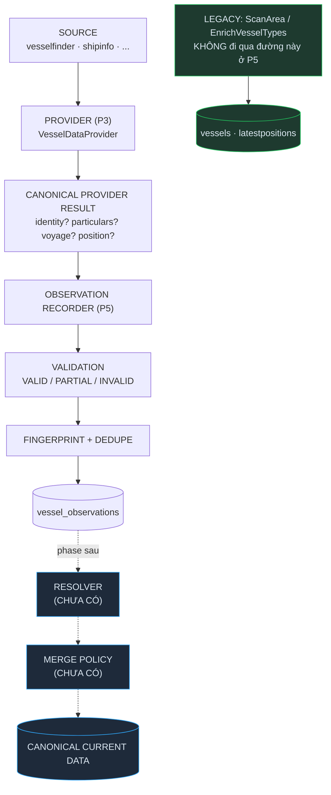

# OBSERVATION_STORAGE — Phase A5 / P5

> Kho lời khai của các nguồn. Nguồn nói gì thì lưu nguyên như thế, **không hợp nhất, không phân xử, không ai đè ai**.
> P5 **không** implement crawler mới, **không** gọi nguồn nào, **không** đổi một dòng hành vi production.
> Tiền đề: [CURRENT_DATA_FLOW.md](./CURRENT_DATA_FLOW.md) · [CANONICAL_VESSEL_MODEL.md](./CANONICAL_VESSEL_MODEL.md) · [PROVIDER_ARCHITECTURE.md](./PROVIDER_ARCHITECTURE.md) · [CRAWL_RUNTIME.md](./CRAWL_RUNTIME.md)

Code:
- Domain — [VesselObservation.ts](../src/domain/observations/VesselObservation.ts) · [ObservationValidation.ts](../src/domain/observations/ObservationValidation.ts) · [observationValidators.ts](../src/domain/observations/observationValidators.ts)
- Application — [IVesselObservationRepository.ts](../src/application/observations/IVesselObservationRepository.ts) · [ObservationPolicy.ts](../src/application/observations/ObservationPolicy.ts) · [observationFingerprint.ts](../src/application/observations/observationFingerprint.ts) · [providerResultToObservation.ts](../src/application/observations/providerResultToObservation.ts) · [ObservationRecorder.ts](../src/application/observations/ObservationRecorder.ts)
- Infrastructure — [observationModels.ts](../src/infrastructure/persistence/mongoose/observationModels.ts) · [MongoVesselObservationRepository.ts](../src/infrastructure/persistence/MongoVesselObservationRepository.ts) · [InMemoryVesselObservationRepository.ts](../src/infrastructure/persistence/InMemoryVesselObservationRepository.ts)

---

## 1. Observation là gì

> "Nguồn X đã cung cấp dữ liệu Y cho tàu Z tại thời điểm T."

Không hơn. Không phải trạng thái hiện tại của con tàu, không phải kết luận, không phải sự thật — là **lời khai**.

ShipInfo bảo `speed = 12`, VesselFinder bảo `speed = 13`. P5 **lưu cả hai**, mỗi cái một observation, và **không hỏi ai đúng**:

| # | source | type | speed | course |
|---|---|---|---|---|
| 1 | `shipinfo` | POSITION | 12 | 80 |
| 2 | `vesselfinder` | POSITION | 13 | 82 |

Việc phân xử là của resolver — **chưa tồn tại** (§11).

## 2. Tại sao không ghi thẳng vào latestpositions

Vì `latestpositions` **về mặt cấu trúc** không chứa nổi hai câu trả lời.

Audit A0 đã đo đúng chỗ này ([CURRENT_DATA_FLOW.md §3](./CURRENT_DATA_FLOW.md)):
- `latestpositions.mmsi` là **unique** → một tàu = một document (debt **D-1**)
- `savePositionLatest()` dùng `replaceOne(..., {upsert:true})` → **thay toàn bộ document**, không merge field

Hệ quả có thật đang chạy production: `ScanArea` ghi đè không đọc bản cũ, nên **mỗi vòng quét xoá sạch** `speed`/`course`/`navStatus` mà `EnrichVesselTypes` vừa điền. Một nguồn tự đè chính nó. Thêm nguồn thứ hai vào cùng collection đó chỉ làm hỏng nhanh hơn.

Ba câu hỏi mà kiến trúc hiện tại **không trả lời được** ([CURRENT_DATA_FLOW.md §8](./CURRENT_DATA_FLOW.md)), và observation trả lời được cả ba:

| Câu hỏi | Trước | Với observation |
|---|---|---|
| Field này từ nguồn nào? | `source` là **một chuỗi cho cả document** | Mỗi bản ghi một nguồn, không trộn |
| Hai nguồn bất đồng thì sao? | Ai ghi sau thắng | Cả hai còn nguyên, chờ resolver |
| Nguồn đang xuống cấp? | Không metric nào | `validationStatus` + `parserVersion` + đếm được theo nguồn |

## 3. Observation khác Canonical Current Data thế nào

| | Observation | Canonical current (chưa có) |
|---|---|---|
| Ngữ nghĩa | "nguồn nói vậy" | "hệ thống tin là vậy" |
| Số bản ghi / tàu | Nhiều — mỗi nguồn, mỗi lần, mỗi nhóm | Một |
| Ghi | Append-only, **bất biến** | Cập nhật |
| Xung đột | Cùng tồn tại | Đã phân xử |
| Collection | `vessel_observations` | `latestpositions` (legacy) / sau này khác |
| Ai tạo | `ObservationRecorder` | Resolver (chưa có) |

**Bất biến là ràng buộc cứng.** Không có `update()` trong port. Nguồn nói khác đi → **observation mới**. Sửa một lời khai cũ là làm sai lệch bằng chứng.

## 4. Vòng đời

```
SOURCE
  ↓  (P4 SourceRequestExecutor: cooldown/limiter/retry)
RAW RESPONSE
  ↓  (P3 Provider: parser/mapper riêng của nguồn)
CANONICAL PROVIDER RESULT   ── identity? particulars? voyage? position?
  ↓  (P5 providerResultToObservation: tách nhóm, KHÔNG gộp)
0..4 OBSERVATION            ── mỗi nhóm một bản ghi
  ↓  (validateObservation)
VALID / PARTIAL / INVALID
  ↓  (RawPayloadPolicy: sanitize + cắt)
  ↓  (fingerprint + cửa sổ dedupe)
vessel_observations
```

Một `ProviderDetailsResult` sinh **tối đa 4** observation — đúng bằng số nhóm provider thực sự trả về. Chỉ có `identity` + `particulars` thì đúng 2 bản ghi.

**Không gộp 4 nhóm thành một bản ghi khổng lồ**: mỗi nhóm có độ tươi riêng (`draught` đổi theo chuyến, `builtYear` không bao giờ đổi). Gộp lại là mất khả năng phân xử theo nhóm.

`source` / `fetchedAt` / `sourceReceivedAt` lấy từ `metadata` của **chính nhóm đó** (canonical A1 đã mang sẵn) — mapper không bịa gì.

## 5. Raw payload policy

| Policy | Khi nào giữ |
|---|---|
| `NONE` | Không bao giờ |
| **`ON_ERROR`** (mặc định) | Chỉ khi observation **không** VALID hoàn toàn |
| `ALWAYS` | Mọi observation — chỉ dùng khi đang soi một nguồn cụ thể |

Lý do `ON_ERROR` là mặc định: bản ghi sạch thì payload thô chẳng nói thêm gì; bản ghi hỏng thì đó là **bằng chứng duy nhất** để biết nguồn đã đổi HTML hay parser sai.

**Sanitize bắt buộc.** Khoá khớp `cookie|authorization|auth|api-key|token|secret|password|credential|session` bị thay bằng `[REDACTED]` — **xoá hẳn**, không che một phần (che một phần vẫn rò độ dài và tiền tố). Đây không phải security framework, chỉ là cái chặn để header xác thực không rơi vào MongoDB.

**Giới hạn kích thước**: `DEFAULT_MAX_RAW_PAYLOAD_BYTES = 64 KiB`. Vượt → giữ phần đầu và bật `rawPayloadTruncated = true`. Mất dữ liệu im lặng còn tệ hơn mất dữ liệu có ghi chú. Không nén, không lưu ra ngoài.

## 6. Validation

Ba mức, ranh giới là điều quan trọng nhất:

| Status | Nghĩa | Vào resolver? |
|---|---|---|
| `VALID` | Không phát hiện vấn đề | ✅ |
| `PARTIAL` | **Lõi dùng được**, vài field phụ hỏng | ✅ |
| `INVALID` | **Lõi hỏng**, cả bản ghi vô dụng | ❌ mặc định bị loại |

Ví dụ `PARTIAL`: toạ độ đúng nhưng `speed = 999` knots. Vẫn giữ được vị trí. Ném lỗi ở đây = mất luôn phần dữ liệu tốt **và** mất luôn bằng chứng debug.

Quy tắc theo nhóm:

| Nhóm | INVALID khi | PARTIAL khi |
|---|---|---|
| Chung | Không định danh nào **đúng định dạng** | Định danh phụ sai (VD `imo` hỏng nhưng `mmsi` đúng) |
| POSITION | `lat`/`lng` không hợp lệ, `receivedAt` không phải Date | `speed`/`course`/`heading` ngoài ngưỡng AIS |
| PARTICULARS | Không có field nào (bản ghi rỗng) | Số âm, `builtYear` vô lý |
| VOYAGE | — | Timestamp không phải Date hợp lệ |
| IDENTITY | (chỉ luật chung) | (chỉ luật chung) |

**Không viết lại một dòng logic kiểm tra nào.** `isValidMmsi`/`isValidImo` từ `validators/identifiers`, `isValidCoordinates` từ `validators/geo`, `isValidSpeed`/`isValidCourse`/`isValidHeading` từ `validators/motion` — tất cả có từ P1.

`builtYear` hợp lý = `[1800, năm hiện tại + 5]`. Cận trên tính từ `now` **được tiêm vào** — không hardcode năm hiện tại ở bất kỳ đâu. Biên +5 năm vì tàu đặt đóng trước có thể khai năm giao trong tương lai.

Validator **không ném lỗi**. Luôn trả kết quả, để bản ghi hỏng vẫn lưu được làm bằng chứng.

## 7. Fingerprint & deduplication

Crawler chạy 4 vòng trong 4 phút, tàu đang neo, nguồn trả y hệt → 4 bản ghi không thêm một chút thông tin nào.

**Vân tay** = SHA-256 của `(source, type, khoá tàu, sourceReceivedAt, dữ liệu đã chuẩn hoá)`. Dùng `node:crypto` có sẵn — không thêm package chỉ để băm.

**Bị loại khỏi vân tay** — và mỗi cái đều có lý do bắt buộc:

| Bị loại | Vì sao |
|---|---|
| `fetchedAt` | Mỗi lần lấy một khác → đưa vào là dedupe chết hẳn |
| `data.metadata` | Bên trong **có** `fetchedAt` (SourceMetadata) |
| `data.receivedAt` | **Cùng lý do.** Nguồn không kèm timestamp (mp2 của VesselFinder) thì `receivedAt` **chính là đồng hồ của bot** lúc quét. Mốc thật của nguồn nằm ở `sourceReceivedAt` và nó **có** trong vân tay |
| `validation`, `rawPayload`, `parserVersion`, `id` | Không phải điều nguồn nói |

**Serialize ổn định**: khoá object được **sắp xếp**, `Date` → ISO, giá trị rỗng **bị loại bỏ**. Nhờ vậy `{a:1,b:2}` và `{b:2,a:1}` cho cùng chuỗi, và `{speed: null}` bằng `{}` — cả hai đều nghĩa là "không có tốc độ".

### Cửa sổ dedupe

Trong cửa sổ, vân tay trùng → **bỏ qua**. Chọn theo tốc độ dữ liệu **đổi**:

| Type | Window | Vì sao |
|---|---|---|
| POSITION | 5 phút | Đổi liên tục — cửa sổ ngắn để không bỏ sót chuyển động |
| VOYAGE | 30 phút | Đổi theo chuyến |
| IDENTITY | 24 giờ | Gần như bất biến |
| PARTICULARS | 24 giờ | Gần như bất biến |

⚠️ **Đây là cửa sổ dedupe, KHÔNG phải TTL retention.** Nó không xoá gì cả — chỉ quyết định có ghi thêm bản giống hệt hay không.

### Không dedupe sai cách

**Không làm tròn toạ độ trước khi băm.** `lat 10` và `lat 10.001` (~111m) là **hai quan sát khác nhau** — tàu đã đi. `speed`/`course` đổi cũng tạo observation mới. Dedupe theo vùng gần đúng là bài toán khác, **không làm ở P5**. Chỉ so khớp **chính xác sau chuẩn hoá**.

`saveMany` chạy **tuần tự có chủ ý**: hai observation trùng nhau trong **cùng một mẻ** phải ăn dedupe của nhau. Ghi song song thì cái thứ hai không thấy cái thứ nhất.

## 8. Mongo collection

`vessel_observations` — **collection riêng**, tách hẳn `vessels` / `latestpositions` / `vesselpositions`. Ba cái kia là **trạng thái hiện tại** (ghi đè theo mmsi); đây là **nhật ký** (append-only, nhiều nguồn cùng tồn tại).

Model đặt ở **file riêng** `observationModels.ts`, **không** thêm vào `models.ts` — giữ đường legacy không bị đụng (`models.ts` đang được `MongoVesselRepository` và CLI `reset-indexes` dùng).

Document:

```
source · type
mmsi? · imo?
data                    (nhóm canonical nguyên vẹn, Mixed)
fetchedAt · sourceReceivedAt?
validationStatus · validationErrors[]
parserVersion?
rawPayload? · rawPayloadTruncated
fingerprint
createdAt
```

`timestamps: { createdAt: true, updatedAt: false }` — **không có `updatedAt`**, vì observation bất biến.

## 9. Indexes

Bốn cái, mỗi cái phục vụ một truy vấn có thật:

| Index | Dùng cho |
|---|---|
| `{ mmsi: 1, type: 1, fetchedAt: -1 }` | "observation gần đây của tàu X, nhóm Y" |
| `{ imo: 1, type: 1, fetchedAt: -1 }` | Như trên, khi chỉ biết IMO |
| `{ source: 1, fetchedAt: -1 }` | "nguồn Z gần đây trả về những gì" — soi sức khoẻ nguồn |
| `{ fingerprint: 1, fetchedAt: -1 }` | **Dedupe.** Không có nó thì mỗi lần ghi là một lần quét toàn collection |

Không wildcard, không text, không geospatial. Truy vấn theo vùng là việc của `latestpositions` (đã có index `2d`), không phải của nhật ký.

## 10. Legacy compatibility

**Không migrate, không backfill, không đổi đường ghi production.**

| | Trạng thái |
|---|---|
| `vessels` / `latestpositions` / `vesselpositions` | ✅ nguyên vẹn, không đọc, không ghi, không migrate |
| `ScanArea` / `EnrichVesselTypes` / `CrawlFleetPositions` / `GetVesselDetails` | ✅ chạy như cũ, vẫn ghi thẳng vào repository legacy |
| `/positions`, `/vessel/:id` | ✅ không đổi |
| FE, Marine | ✅ không đụng |
| `VesselFinderProvider` | ✅ **không** bị ép ghi observation ở P5 |

`container.ts` chỉ thêm hai dòng lắp ráp. Không có MongoDB → dùng `InMemoryVesselObservationRepository`: đường JSON file là để chạy thử, nhật ký nhiều nguồn ghi ra file phẳng thì vừa chậm vừa vô dụng.

**Provider không được gọi thẳng repository.** Parser HTML mà biết tới MongoDB là đúng thứ kiến trúc này tồn tại để ngăn. Đường duy nhất là `ObservationRecorder`.

## 11. Resolver tương lai



Cái đã sẵn cho resolver:
- `findRecentByVessel(key, {type, since, limit})` — mọi lời khai về một tàu
- `findLatestByVesselAndType(key, type)` — bản mới nhất một nhóm (⚠️ có thể từ **bất kỳ** nguồn nào — hàm này **không** phân xử)
- `includeInvalid` mặc định **false**: truy vấn phục vụ dữ liệu dùng được thì không kéo theo bản ghi hỏng. `INVALID` chỉ vào resolver nếu resolver **nói rõ** là muốn

**P5 không có**: merge field, chọn nguồn tốt nhất, chấm điểm nguồn, fallback, collection canonical current.

## 12. Retention — đề xuất, CHƯA làm

P5 **không tự xoá dữ liệu production**. Không TTL index, không job dọn. Thêm cơ chế xoá khi chưa có yêu cầu nghiệp vụ về thời gian lưu là tự tạo ra mất mát dữ liệu.

Nhưng kho này **sẽ** phình. Đề xuất cho phase sau, khi có số liệu thật:

| Loại | Đề xuất | Lý do |
|---|---|---|
| POSITION | Giữ **ngắn** (VD 30–90 ngày) | Số lượng áp đảo; giá trị giảm nhanh theo thời gian |
| IDENTITY / PARTICULARS | Giữ **lâu** | Ít bản ghi, gần như bất biến, hữu ích cho audit lâu dài |
| VOYAGE | Trung bình | Theo nhu cầu phân tích chuyến |
| `INVALID` + có `rawPayload` | Giữ **rất ngắn** (VD 7–14 ngày) | Chỉ để debug parser; nặng nhất, hết giá trị nhanh nhất |

Cửa sổ dedupe (§7) đã cắt phần lớn rác trước khi nó vào DB — đó là tuyến phòng thủ **đầu tiên**, không phải retention.

---

## Phụ lục · API

```ts
// Port
save(observation)                                   -> { status, fingerprint, id? }
saveMany(observations)                              -> results theo ĐÚNG thứ tự đầu vào
findRecentByVessel(key, options?)                   -> mới nhất trước
findRecentBySource(source, options?)                -> mới nhất trước
findLatestByVesselAndType(key, type, options?)      -> bản mới nhất | null

// options: { limit?, type?, since?, includeInvalid? }   includeInvalid mặc định FALSE

// Recorder
recordDetails(providerDetailsResult, { parserVersion?, rawPayload? })
recordPosition(providerPositionResult, ...)
recordPositions(providerPositionResult[], ...)      // cả mẻ quét vùng, một lần ghi
recordSearch(providerSearchResult, ...)
record(observations, ...)
```

`VesselObservationKey` cần **ít nhất một** trong `mmsi`/`imo`. Cố ý **không** bắt buộc MMSI: nguồn tra lý lịch (ShipInfo, ShipTraffic) tìm theo IMO và có thể chưa biết MMSI. Bắt buộc MMSI ở đây sẽ khiến những nguồn đó không lưu được gì.
