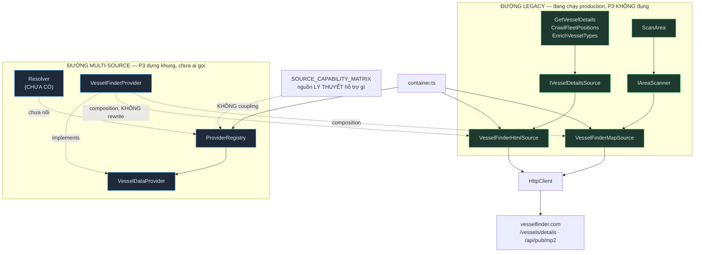
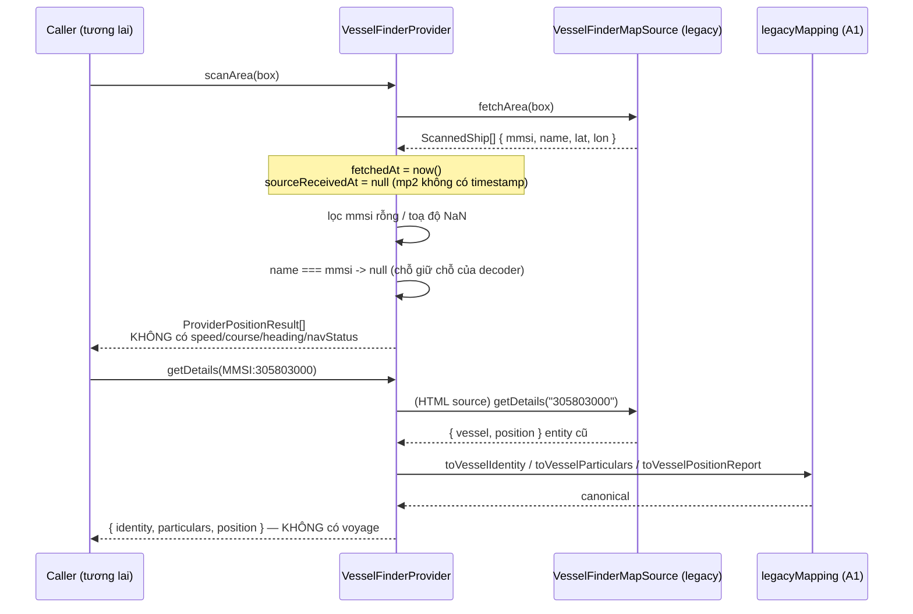

# Kiến trúc provider nguồn dữ liệu — giai đoạn A3 / P3

> Abstraction chung cho mọi nguồn dữ liệu tàu. P3 **chưa** implement crawler mới, **chưa** có resolver, **chưa** đổi một dòng code path production nào.
> Tiền đề: [CURRENT_ARCHITECTURE.md](./CURRENT_ARCHITECTURE.md) · [CURRENT_DATA_FLOW.md](./CURRENT_DATA_FLOW.md) · [CANONICAL_VESSEL_MODEL.md](./CANONICAL_VESSEL_MODEL.md) · [SOURCE_CAPABILITY_MATRIX.md](./SOURCE_CAPABILITY_MATRIX.md)

Code:
- [src/domain/value-objects/VesselIdentifier.ts](../src/domain/value-objects/VesselIdentifier.ts)
- [src/application/providers/ProviderResults.ts](../src/application/providers/ProviderResults.ts)
- [src/application/providers/VesselDataProvider.ts](../src/application/providers/VesselDataProvider.ts)
- [src/application/providers/ProviderRegistry.ts](../src/application/providers/ProviderRegistry.ts)
- [src/infrastructure/providers/VesselFinderProvider.ts](../src/infrastructure/providers/VesselFinderProvider.ts)

---

## 1. Provider là gì

**Adapter của MỘT nguồn dữ liệu.** Nó nuốt HTML/binary/JSON của nguồn đó và nhả ra canonical model (A1) kèm `SourceMetadata`.

```ts
interface VesselDataProvider {
  readonly source: VesselSource;
  searchByName?(name: string): Promise<readonly ProviderSearchResult[]>;
  getPosition?(identifier: VesselIdentifier): Promise<ProviderPositionResult | null>;
  getDetails?(identifier: VesselIdentifier): Promise<ProviderDetailsResult | null>;
  scanArea?(box: BoundingBox): Promise<readonly ProviderPositionResult[]>;
}
```

Ba khác biệt so với port cũ (`IVesselDetailsSource` / `IAreaScanner` — vẫn đang chạy production):

| | Port cũ | Provider |
|---|---|---|
| Biết mình là nguồn nào | ❌ | ✅ `readonly source` |
| Định danh đầu vào | `id: string` mơ hồ | `VesselIdentifier` có discriminant `MMSI`/`IMO` |
| Kiểu trả về | entity cũ `{vessel, position}` | canonical + `SourceMetadata` |

**Mọi method là optional.** Nguồn chỉ có vị trí thì chỉ implement `getPosition`. Không có method nào ném `"not implemented"` — **method vắng mặt CHÍNH LÀ câu trả lời**, và registry đọc được điều đó qua `providerSupportsOperation()`.

Provider **không** chịu trách nhiệm: fallback, merge, retry, rate limit, cache, ghi DB. Nó chỉ biết một nguồn và cách đọc nguồn đó.

### VesselIdentifier

Code hiện tại truyền `id: string` khắp nơi rồi để VesselFinder tự đoán IMO hay MMSI qua redirect 301. Nguồn khác **không có** redirect đó.

```ts
type VesselIdentifier =
  | { readonly type: "MMSI"; readonly value: string }
  | { readonly type: "IMO";  readonly value: string };

mmsiIdentifier("305803000")   // validate 9 chữ số, đầu khác 0 -> throw nếu sai
imoIdentifier("9074729")      // validate checksum ISO 8713   -> throw nếu sai
parseVesselIdentifier(raw)    // đoán trục từ id kiểu cũ, trả null (không throw)
```

Không có biến thể `NAME`: tìm theo tên là **operation riêng** (`searchByName`), trả nhiều ứng viên, khác hẳn tra theo định danh duy nhất.

⚠️ Validator siết hơn API hiện tại (`^\d{7,9}$` cho cả hai trục). Đó là lý do value object này **chỉ dùng ở tầng provider mới** — `GetVesselDetails` không đổi. Xem §6.

## 2. Ba khái niệm khác nhau: năng lực, đã lập trình, và đủ điều kiện chạy

Ba khái niệm khác nhau, **không được dùng thay cho nhau**:

| Khái niệm | Ở đâu | Trả lời câu hỏi |
|---|---|---|
| **CAPABILITY** | `SOURCE_CAPABILITY_MATRIX` (P2) | Nguồn **về lý thuyết** cấp được field/operation gì |
| **IMPLEMENTATION** | `ProviderRegistry` (P3) | Có **code** cho nguồn đó chưa |
| **RUNTIME ELIGIBILITY** | resolver (**chưa tồn tại**) | Lúc này có **nên gọi** nguồn đó không |

Đối chiếu thực tế hôm nay:

| Source | Capability | Provider registered | Ghi chú |
|---|---|---|---|
| `vesselfinder` | ✅ 14 field CONFIRMED | ✅ `VesselFinderProvider` | Đường legacy vẫn chạy song song |
| `aisstream` | ✅ 17 field CONFIRMED | ❌ | Marine sở hữu connection; bot chưa nối |
| `shipinfo` | ✅ 19 field CANDIDATE | ❌ | Chưa có client |
| `myshiptracking` | ✅ 28 field CANDIDATE | ❌ | Chưa có API client |
| 5 nguồn còn lại | CANDIDATE | ❌ | Chưa có implementation |

**`SourceCapability.enabled` KHÔNG phải synonym của "provider registered".** AISStream `enabled=false` nhưng capability đầy đủ; ShipInfo có capability nhưng không có một dòng code nào. Ngược lại, một provider được register vẫn có thể bị resolver từ chối gọi vì lý do vận hành.

`providerSupportsOperation()` hỏi **chính implementation** (`typeof provider.getDetails === "function"`), **không** hỏi matrix. Cố ý: hai nguồn sự thật khác nhau, không tạo coupling vòng.

## 3. ProviderRegistry làm gì

Trả lời đúng một câu: *"hiện có provider implementation nào, cho nguồn nào"*.

```ts
register(provider)              // throw nếu trùng source hoặc source = UNKNOWN
get(source)                     // VesselDataProvider | undefined
has(source)                     // boolean
getAll()                        // readonly[] đóng băng, theo thứ tự đăng ký
getRegisteredSources()          // readonly VesselSource[]
getForOperation(operation)      // chỉ provider THỰC SỰ implement method đó
size                            // number
```

`ProviderOperation`: `SEARCH_BY_NAME` · `GET_POSITION` · `GET_DETAILS` · `SCAN_AREA`.

**An toàn:**
- `getAll()`/`getForOperation()` trả **bản sao đóng băng** — caller `push()` vào là `TypeError`, sổ đăng ký không đổi.
- Đăng ký trùng source → **throw**, không ghi đè im lặng. Hai implementation cùng một nguồn là lỗi lắp ráp, phải nổ ở composition root chứ không phải sai lệch dữ liệu lúc chạy.
- `UNKNOWN` bị từ chối: đó là giá trị canh biên cho dữ liệu cũ không nhận dạng được, không phải nguồn thật.

## 4. ProviderRegistry KHÔNG làm gì

Cố ý bỏ trống — **đừng thêm vào**:

fallback · retry · rate limit · merge policy · chấm điểm/scoring · chọn nguồn tốt nhất · truy cập DB · gọi HTTP · đọc capability matrix · cache · circuit breaker

Tất cả thuộc **resolver**, chưa tồn tại. Registry là một `Map`, không hơn.

Cũng **không** dùng: NestJS DI, Inversify, tsyringe, decorator, plugin framework, dynamic module loader, service discovery, reflection, event bus.

## 5. Adapter VesselFinder đời cũ

Phần quan trọng nhất của P3. **Không viết lại** `VesselFinderHtmlSource` / `VesselFinderMapSource` — `VesselFinderProvider` dùng **composition**:

```
VesselFinderProvider
  ├── IVesselDetailsSource  ← VesselFinderHtmlSource (trang chi tiết HTML)
  └── IAreaScanner          ← VesselFinderMapSource  (mp2 binary)
```

Nhận vào **port**, không phải class cụ thể: container tiêm đúng 2 instance thật, test tiêm giả lập được mà không đụng mạng.

| Method | Đường đi | Ghi chú |
|---|---|---|
| `getDetails()` | HTML source → `legacyMapping` A1 → `{identity, particulars, position?}` | Toạ độ **làm tròn** → `latLngApproximate: true` |
| `getPosition()` | HTML source → chỉ lấy nhóm position + identity | Cùng cảnh báo làm tròn |
| `scanArea()` | mp2 → `ProviderPositionResult[]` | Toạ độ **chính xác** → `latLngApproximate: false` |
| `searchByName()` | **không implement** | Repo không có đường tra theo tên; khớp matrix `searchByName: false` |

### Trung thực dữ liệu — ràng buộc chính

1. **mp2 chỉ có `mmsi`/`name`/`lat`/`lon`** → provider **KHÔNG** đặt `speed`/`course`/`heading`/`navStatus` vào object. Các field đó **vắng mặt hoàn toàn**, không phải `null` cho đủ bộ. Test khoá bằng `assert.equal("speed" in position, false)`.
2. **`sourceReceivedAt` luôn `null`** cho VesselFinder. mp2 không kèm timestamp; trang chi tiết có `lrpd` nhưng là chuỗi **tương đối** (`"0 min ago"`) — parse ra sẽ sai. **Tuyệt đối không** lấy `fetchedAt` (đồng hồ của bot) gán sang. Đây đúng là lý do tồn tại của `SourceMetadata` (A1).
3. **Không trả nhóm `voyage`.** Mapper hiện không bóc `destination`/`eta`; trả một khối toàn `null` là tự nhận có phủ sóng mà thực tế không có. Khớp matrix `vesselfinder.voyage = false`.
4. **`name === String(mmsi)` → `null`.** Decoder mp2 đặt tên = mmsi khi bản ghi không có tên; đó là chỗ giữ chỗ, không phải tên tàu.
5. **`E-1001` → `null`; lỗi khác → ném tiếp.** "Không có tàu này" khác "nguồn hỏng". Nuốt `E-2001` (bị chặn) thành `null` sẽ khiến resolver tưởng nguồn trả lời hợp lệ.

## 6. Đường chạy cũ hiện tại — KHÔNG đổi

```
GetVesselDetails / CrawlFleetPositions / EnrichVesselTypes
    → IVesselDetailsSource → VesselFinderHtmlSource → HttpClient → vesselfinder.com

ScanArea
    → IAreaScanner → VesselFinderMapSource → HttpClient → vesselfinder.com/api/pub/mp2
```

Bốn use case **vẫn tiêm thẳng port cũ**, không biết `ProviderRegistry` tồn tại. Không xoá `IVesselDetailsSource`, `IAreaScanner`, `VesselFinderHtmlSource`, `VesselFinderMapSource`.

Trong `container.ts`, provider được lắp **sau** wiring cũ và **bọc lại đúng 2 instance đã tạo** — không phát sinh thêm một request nào lên upstream:

```ts
const providerRegistry = new ProviderRegistry();
providerRegistry.register(new VesselFinderProvider({ detailsSource, areaScanner: mapSource }));
```

Chỉ đăng ký provider **có thật**. Không có fake provider cho ShipInfo/ShipFinder/BoatNerd/… — capability tồn tại không có nghĩa là có implementation (§2).

## 7. Đường đa nguồn trong tương lai

```
Resolver (CHƯA CÓ)
    → ProviderRegistry.getForOperation(GET_DETAILS)
    → VesselDataProvider[]
    → nguồn tương ứng
    → canonical + SourceMetadata
    → Merge policy (CHƯA CÓ) → persistence
```

Resolver sẽ cần cả 3 nguồn thông tin: `SOURCE_CAPABILITY_MATRIX` (nguồn nào *nên* hỏi), `ProviderRegistry` (nguồn nào *hỏi được*), và policy riêng của nó (lúc này *có nên* hỏi không).

## 8. Chiến lược chuyển đổi

Hai đường **tồn tại song song** suốt Phase A. Thứ tự dự kiến, mỗi bước độc lập:

| Bước | Việc | Rủi ro |
|---|---|---|
| ✅ P3 | Provider + registry tồn tại, chưa ai gọi | Không |
| P4+ | Merge policy + resolver, vẫn chưa đổi use case | Không |
| Sau | Chuyển **một** use case sang resolver (ứng viên đầu: `GetVesselDetails` — đường đọc, dễ rollback nhất) | Thấp |
| Sau | Chuyển `ScanArea`/`EnrichVesselTypes` | Cao — chạm luồng ghi `latestpositions`, phải xử debt D-1/D-8 trước |
| Cuối | Gỡ port cũ khi không còn caller | — |

Điều kiện tiên quyết chưa xong (audit A0): khoá `latestpositions` theo `mmsi` unique (D-1), N+1 trong `ScanArea.saveShips` (D-8), retry/rate limit theo nguồn (D-4/D-5).

## 9. Sơ đồ



Luồng dữ liệu qua provider:



---

## Phụ lục · Kiểu kết quả

```ts
interface ProviderSearchResult   { identity: VesselIdentity; position?: VesselPositionReport }
interface ProviderPositionResult { position: VesselPositionReport; identity?: VesselIdentity }
interface ProviderDetailsResult  { identity?; particulars?; voyage?; position? }
```

Không định nghĩa lại canonical interface — chỉ gom chúng. Mỗi nhóm mang `metadata` riêng (đã có sẵn trong canonical A1) vì một lần gọi có thể lấy các nhóm ở độ tươi khác nhau.

`ProviderPositionResult.identity` tồn tại vì mp2 trả `name` **ngay trong bản ghi vị trí** — không tách ra thì mất dữ liệu.

Nhóm vắng mặt nghĩa là **"nguồn này không cho"**, không phải "tàu không có dữ liệu đó". Đừng lấp đầy bằng `null` cho đủ bộ.
