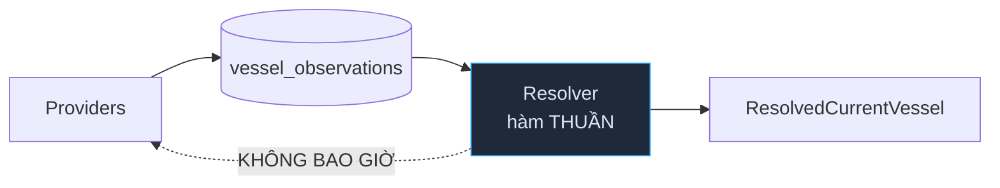
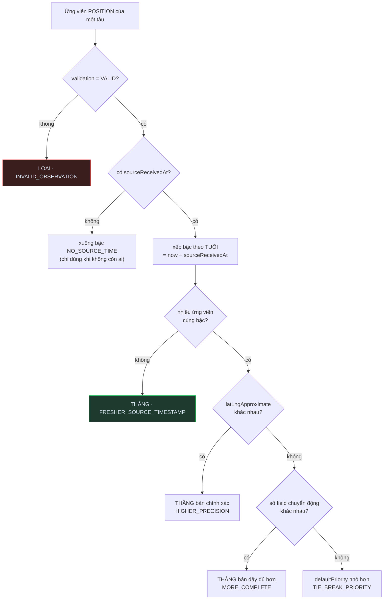

# RESOLVER_POLICY — Phase 8.1 (thiết kế, KHÔNG implement)

> **Câu hỏi duy nhất:** khi nhiều observation của cùng một tàu nói khác nhau, hệ thống dựa vào đâu để quyết định giá trị canonical hiện tại?
>
> P8.1 **không** viết resolver. Đây là tài liệu thiết kế, dựa trên **observation THẬT** đang nằm trong `vessel_observations` sau POC P6.4/P7.4.
> Tiền đề: [OBSERVATION_STORAGE.md](./OBSERVATION_STORAGE.md) · [CANONICAL_VESSEL_MODEL.md](./CANONICAL_VESSEL_MODEL.md) · [SOURCE_CAPABILITY_MATRIX.md](./SOURCE_CAPABILITY_MATRIX.md) · [SHIPINFO_POC.md](./sources/SHIPINFO_POC.md) · [SHIPFINDER_POC.md](./sources/SHIPFINDER_POC.md)

---

## A. Goals / Non-goals

### Goals

1. Từ `VesselObservation[]` của **một** tàu → một `ResolvedCurrentVessel` có **provenance từng field**.
2. Quy tắc **tất định** và **giải thích được**, không phải điểm số mờ.
3. Phân biệt đúng ShipFinder ~1 phút và ShipInfo ~14 giờ — **bằng lý do đúng**, không phải bằng thứ tự ưu tiên nguồn.
4. Không nguồn nào "thắng cả con tàu": quyết định theo **nhóm**, và trong nhiều nhóm là theo **field**.

### Non-goals (P8.1 **không** làm)

| | |
|---|---|
| ❌ Resolver production | Không `MultiSourceResolver.ts`, `FieldResolver.ts`, `ScoringEngine.ts` |
| ❌ Weighted scoring | `score = 0.4·freshness + 0.3·trust + …` — khó giải thích, dễ over-engineer |
| ❌ Canonical current storage | Không collection `current_vessels` |
| ❌ Sửa observation | Kho vẫn **append-only**; kẻ thua **không bị xoá** |
| ❌ Resolver gọi provider | Resolver **không chạm mạng**. Fallback thu thập là mối lo khác |
| ❌ Taxonomy loại tàu / thư viện quốc gia | Chỉ nêu hướng |
| ❌ Sửa legacy / Marine / FE | |

---

## B. Resolver input



```ts
resolve(observations: readonly VesselSourceObservation[], now: Date): ResolvedCurrentVessel
```

Hàm thuần: cùng đầu vào → cùng đầu ra. Không I/O, không đồng hồ ngầm (`now` tiêm vào). Việc **nạp** observation là của tầng gọi.

---

## C. Output concept

```ts
interface ResolvedField<T> {
  value: T;
  source: VesselSource;
  observationId: string;
  /** Mốc NGUỒN khai, nếu có. */
  observedAt: Date | null;
  /** Lúc bot lấy được. Luôn có. */
  fetchedAt: Date;
  reason: ResolutionReason;
  /** Nguồn đã bị loại và vì sao — phục vụ giải thích, không phục vụ logic. */
  rejected?: readonly { source: VesselSource; reason: ResolutionReason }[];
}

interface ResolvedCurrentVessel {
  mmsi: string;
  imo: ResolvedField<string> | null;
  identity: { name, callsign, vesselType, flag, ... };   // mỗi field một ResolvedField
  position: ResolvedPosition | null;                      // NGUYÊN KHỐI, xem §D
  particulars: { length, beam, draught, builtYear, ... }; // mỗi field một ResolvedField
  voyage: { destination, eta, ... };
  resolvedAt: Date;
}
```

Điểm cốt lõi: **không có `value` trần**. Mọi giá trị đều mang theo "ai nói, lúc nào, vì sao thắng". Đây là thứ [CURRENT_DATA_FLOW.md §8](./CURRENT_DATA_FLOW.md) chỉ ra là legacy không bao giờ trả lời được.

---

## D. POSITION policy

### D.0 Quyết định: NGUYÊN KHỐI (atomic), không trộn field

| | Option A · atomic | Option B · trộn field |
|---|---|---|
| Mô tả | `lat/lng/speed/course/heading/navStatus` **cùng một observation** | Mỗi field lấy nguồn tốt nhất |
| Lợi | Ảnh chụp **có thật** | Lấp được field thiếu |
| Hại | Mất field mà nguồn thắng không có | **Tạo ảnh chụp KHÔNG BAO GIỜ TỒN TẠI** |

**Chọn Option A.** Bằng chứng thật (MMSI 636018086):

```
shipfinder  @16:39:41Z   lat 33.749683  course 0.9   heading 58   navStatus "Moored"
shipinfo    @2026-08-13T20:11:07Z (14.49h trước)   lat 33.74833   course null   heading null
```

Trộn ở đây thì `heading` chỉ có ở nguồn thắng nên vô hại — nhưng luật phải đúng cho trường hợp xấu: ghép `lat/lng` lúc 16:39 với `heading` lúc 02:00 tạo ra một con tàu **chưa từng ở trạng thái đó**. Tàu đang quay thì heading 14 giờ trước là dữ liệu sai, không phải dữ liệu thiếu.

> Field thiếu ở nhóm POSITION cứ để thiếu. Nhóm khác (identity/particulars) mới trộn field.

### D.1 Thứ tự quyết định



**Thứ tự này KHÔNG phải mặc định copy từ đâu** — nó suy ra từ đo đạc thật: chênh lệch giữa hai nguồn là **14 giờ** (bậc), còn chênh lệch độ chính xác chỉ ~150 m. Tuổi áp đảo mọi tiêu chí khác, nên tuổi đứng trước.

### D.2 `sourceReceivedAt` — luật cứng

Độ tươi vị trí đo bằng **`sourceReceivedAt`**, **không bao giờ** bằng `fetchedAt`.

```
shipinfo:  fetchedAt = 10:40:13Z  (vừa crawl xong)
           sourceReceivedAt = 2026-08-13T20:11:07Z  → thật ra CŨ 14.49 GIỜ
```

Dùng `fetchedAt` thì bản ghi này trông "vừa mới" và sẽ thắng — sai hoàn toàn. Đây chính là lý do `SourceMetadata` tách hai mốc từ A1.

### D.3 Thiếu `sourceReceivedAt` — quyết định rõ ràng

**Không** coi `sourceReceivedAt = fetchedAt`. Thay vào đó: ứng viên thiếu mốc nguồn rơi xuống **bậc riêng `NO_SOURCE_TIME`, thấp hơn mọi bậc có mốc thật**, kể cả bậc `EXPIRED`.

Lý do: không biết tuổi ≠ tuổi bằng 0. Một vị trí không rõ tuổi có thể cũ 5 phút hoặc 5 ngày; xếp nó ngang "vừa mới" là bịa.

Chỉ được chọn khi **không còn ứng viên nào** có mốc nguồn — và khi đó `reason = ONLY_AVAILABLE_VALUE`, `observedAt = null`. Người đọc canonical thấy `observedAt = null` là biết ngay "tuổi không xác định".

⚠️ Điều này ảnh hưởng trực tiếp tới **VesselFinder**: `VesselFinderProvider` đặt `sourceReceivedAt = null` cho **mọi** vị trí (mp2 không kèm timestamp, `lrpd` là chuỗi tương đối). Nghĩa là khi VesselFinder bắt đầu ghi observation, vị trí của nó **luôn** ở bậc thấp nhất. Đó là kết luận đúng theo dữ liệu, không phải thiên vị — và là lý do rất mạnh để phase sau tìm cách parse `lrpd`.

### D.4 Bậc độ tươi — lấy từ hành vi nguồn thật, không bịa số

| Bậc | Ngưỡng | Vì sao con số này |
|---|---|---|
| `LIVE` | ≤ **30 phút** | ShipFinder đo được 1–37 phút; đây là bậc duy nhất nó với tới |
| `RECENT` | ≤ **6 giờ** | Đúng `SCAN_INTERVAL_MS` mặc định (6h) — chu kỳ quét của VesselFinder |
| `STALE` | ≤ **24 giờ** | Đúng `POSITION_STALE_AFTER_MS` (24h) mà `/positions` **đã** dùng để lọc |
| `EXPIRED` | > 24 giờ | Vượt ngưỡng hệ thống đã coi là hết hạn |
| `NO_SOURCE_TIME` | không có mốc | §D.3 |

Ba trong bốn ngưỡng **tái dùng hằng số đã tồn tại trong hệ thống** thay vì phát minh số mới. ShipInfo 14.49h rơi vào `STALE`; ShipFinder 0.02h rơi vào `LIVE` — cách nhau **hai bậc**, đúng như mong muốn.

Ngưỡng phải là **config** (`ResolverPolicyConfig`), không phải số rải trong code — cùng bài học với `SourceRuntimeConfig` ở P4.

### D.5 Độ chính xác toạ độ — chỉ so trong CÙNG bậc

`latLngApproximate` chỉ được xét khi hai ứng viên **cùng bậc độ tươi**.

Lý do: VesselFinder HTML cho toạ độ làm tròn **~111 km**; ShipFinder cho toạ độ chính xác. Nhưng một vị trí chính xác **2 ngày tuổi** vô dụng hơn một vị trí làm tròn **2 phút tuổi** — tàu chạy 12 knot đi được ~1 000 km trong 2 ngày, sai số 111 km vẫn nhỏ hơn nhiều.

> `approximate = false` **không** phải luật thắng tuyệt đối. Tuổi trước, độ chính xác sau.

### D.6 Đầy đủ field chuyển động

Chỉ là tiêu chí thứ ba, đếm số field không null trong `{speed, course, heading, navStatus}`. Bằng chứng: ShipFinder có 4/4, ShipInfo có 1/4 (chỉ speed). Nhưng tiêu chí này **không bao giờ** được vượt qua tuổi — một bản ghi đủ field nhưng cũ 14h vẫn thua.

---

## E. IDENTITY policy — theo FIELD

Identity ít nhạy thời gian, nhưng **không bất biến**: tàu bị **đổi tên**, đổi cờ, đổi chủ.

### E.1 Bằng chứng thật — ba loại "khác nhau" hoàn toàn khác bản chất

MMSI 636018086:
```
shipfinder  name "AGIA DOXA"   callsign "D5OC7"  vesselType "Cargo ship"     flag {LBR, null}
shipinfo    name "Agia Doxa"   callsign "D5OC7"  vesselType "Bulk Carrier"   flag {LR, "Liberia"}
```
MMSI 367452710:
```
shipfinder  name "AMERICAN WEST"       vesselType "Passenger ship"  flag {USA, null}
shipinfo    name "Queen Of The West"   vesselType "Passenger Ship"  flag {US, "USA"}
```

| Loại | Ví dụ | Có phải xung đột? |
|---|---|---|
| **Khác cách viết** | `"AGIA DOXA"` vs `"Agia Doxa"` · `"Passenger ship"` vs `"Passenger Ship"` | ❌ **KHÔNG** — phải chuẩn hoá trước khi so |
| **Khác biểu diễn** | `LBR` vs `LR` · `USA` vs `US` | ❌ **KHÔNG** — cùng quốc gia, xem §E.3 |
| **Khác thật** | `"AMERICAN WEST"` vs `"Queen Of The West"` (cùng callsign `WDF4506`) | ✅ **CÓ** — tàu đã đổi tên |
| **Khác độ chi tiết** | `"Cargo ship"` vs `"Bulk Carrier"` | ⚠️ Không phải xung đột nhị phân — xem §E.4 |

**Bài học lớn nhất của P8.1**: phần lớn "xung đột" quan sát được **không phải xung đột**. Resolver mà so chuỗi thô sẽ báo động giả liên tục và chọn bừa. **Chuẩn hoá phải xảy ra TRƯỚC khi so sánh.**

### E.2 Thứ tự cho field identity

```
1. loại INVALID
2. loại giá trị rỗng/null            → ONLY_AVAILABLE_VALUE nếu chỉ còn một
3. chuẩn hoá rồi so:
     bằng nhau  → chọn bản có fetchedAt mới hơn, reason = SOURCES_AGREE
     khác nhau  → 4
4. field có luật riêng? (vesselType §E.4, flag §E.3) → theo luật đó
5. còn lại: fetchedAt mới hơn thắng   → NEWER_FETCH
6. hoà                                → TIE_BREAK_PRIORITY
```

`fetchedAt` — **không** phải `sourceReceivedAt` — là mốc đúng cho identity, vì hai nguồn đều để `sourceReceivedAt = null` cho nhóm này (đã xác nhận trên dữ liệu thật), và vì "lần gần nhất ta *nhìn thấy* tên tàu" chính là thứ ta muốn khi tàu đổi tên.

⚠️ `NEWER_FETCH` chỉ áp dụng **sau khi chuẩn hoá cho thấy khác thật**. Không bao giờ là luật đầu tiên.

### E.3 Cờ quốc gia — chuẩn hoá TRƯỚC resolver

Hiện trạng lộn xộn có thật:

| Nguồn | `flag.code` | `flag.name` |
|---|---|---|
| ShipInfo | `"LR"` (ISO-2) | `"Liberia"` |
| ShipFinder | `"LBR"` (ISO-3) | `null` |
| ShipInfo (tàu US) | `"US"` (ISO-2) | `"USA"` |
| ShipFinder (tàu US) | `"USA"` (ISO-3) | `null` |

Chú ý bẫy: ShipFinder `code = "USA"` **trùng chuỗi** với ShipInfo `name = "USA"` nhưng nằm ở field khác. So thô là sai cả hai chiều.

**Hướng: chuẩn hoá ở tầng MAPPER, không phải trong resolver.**
- Canonical quy định `VesselFlag.code` là **ISO 3166-1 alpha-2**.
- Mapper của nguồn cho ISO-3 tự quy đổi (bảng tra tất định ~250 dòng, không phải "thư viện quốc gia", không phải AI).
- Resolver chỉ thấy dữ liệu đã cùng hệ → `LR` vs `LR`, hết xung đột.

Lý do đặt ở mapper: đây là **đặc thù của nguồn**, giống hệt việc ShipFinder đổi DDM→decimal. Nhét vào resolver là bắt resolver biết chi tiết từng nguồn — đúng thứ kiến trúc P3 dựng ra để tránh.

`flag.name` thì trộn field bình thường: lấy từ nguồn nào có (hiện chỉ ShipInfo).

> **`LR ≠ LBR` KHÔNG được tính là xung đột.** Nếu P8.2 chạy trước khi chuẩn hoá xong, resolver phải coi hai giá trị này là "không so sánh được" và dùng luật `ONLY_AVAILABLE_VALUE`/`TIE_BREAK_PRIORITY`, **không** báo conflict.

### E.4 Loại tàu — độ chi tiết, không phải đúng/sai

`"Bulk Carrier"` (ShipInfo) là **loại con** của `"Cargo ship"` (ShipFinder). Cả hai đều đúng. Chọn `"Cargo ship"` là **mất thông tin**, không phải sai thông tin.

Xây taxonomy AIS đầy đủ là một phase riêng. Luật tối giản cho P8.2:

> **Ưu tiên theo FIELD, khai trong config**: `vesselType` ưu tiên `SHIPINFO` hơn `SHIPFINDER`, kèm bằng chứng ("ShipInfo cho nhãn cụ thể hơn trên 2/2 tàu đối chiếu").

Một dòng config, không phải rule engine. Khi có taxonomy thật thì thay luật này, không phải viết lại resolver.

Cần **chuẩn hoá cách viết trước**: `"Passenger ship"` và `"Passenger Ship"` phải được coi là **bằng nhau** (so sánh casefold), nếu không luật ưu tiên sẽ chạy vô ích trên một xung đột không tồn tại.

---

## F. PARTICULARS policy — TRỘN FIELD, dứt khoát

Bằng chứng thật (MMSI 636018086, cả hai đều `VALID`):

```
shipfinder   length 179   beam 29   draught 5.9   builtYear null   deadweight null
shipinfo     length null  beam null draught null  builtYear 2010   deadweight 33261
```

**Bù trừ hoàn hảo, không một field nào đè lên nhau.** Chọn nguyên khối là **vứt bỏ một nửa dữ liệu đang có**. Đây là chứng cứ mạnh nhất cho trộn field.

Canonical mong muốn:

| Field | Nguồn | Vì sao |
|---|---|---|
| `length` | ShipFinder | ShipInfo là `UNSUPPORTED` (đảo không nhất quán, mapper cố ý không map) |
| `beam` | ShipFinder | như trên |
| `draught` | ShipFinder | ShipInfo `UNSUPPORTED` (0/1073 điểm) |
| `builtYear` | ShipInfo | ShipFinder `CANDIDATE` (sau API ký chữ ký) |
| `deadweight` | ShipInfo | như trên |
| `grossTonnage` | — | Cả hai đều không có |

### F.1 Độ tin cậy theo field — TÁI DÙNG capability matrix, không tạo bảng thứ hai

Dự án **đã có** bảng "nguồn nào cấp được field nào ở mức nào": `SOURCE_CAPABILITY_MATRIX`. Nó đã mã hoá đúng thứ resolver cần:

```
CONFIRMED   → ứng viên hạng nhất
CANDIDATE   → chỉ dùng khi không có CONFIRMED
UNSUPPORTED → KHÔNG BAO GIỜ là ứng viên
```

`shipinfo.length = UNSUPPORTED` nên ShipInfo **không được** đưa `length` ra tranh, kể cả nếu một ngày nào đó mapper vô tình map nhầm. Đây là lưới an toàn miễn phí.

> **Không tạo bảng field-trust thứ hai.** Hai bảng nói cùng một chuyện sẽ lệch nhau, đúng như bài học `htmlDrift` vs mapper ở audit A0.

### F.2 Thứ tự cho field particulars

```
1. loại INVALID
2. loại nguồn có capability = UNSUPPORTED cho field đó
3. loại null
4. chỉ còn một             → ONLY_AVAILABLE_VALUE      ← chiếm hầu hết ca hiện nay
5. nhiều ứng viên, giá trị bằng nhau (trong dung sai)  → SOURCES_AGREE
6. khác nhau: CONFIRMED thắng CANDIDATE                → HIGHER_FIELD_QUALITY
7. cùng hạng: fetchedAt mới hơn                        → NEWER_FETCH
8. hoà                                                  → TIE_BREAK_PRIORITY
```

### F.3 Xung đột số — khái niệm dung sai

Tương lai có thể gặp `ShipFinder length = 179` vs `VesselFinder length = 180`.

`179` vs `180` **không phải xung đột nghiêm trọng** — làm tròn khác nhau, hoặc LOA vs LBP. Đề xuất **khái niệm** (không phải engine thống kê):

```
|a − b| / max(a,b) ≤ tolerance(field)   → coi là SOURCES_AGREE, chọn theo hạng capability
                                        → vượt ngưỡng mới là xung đột thật, ghi vào rejected[]
```

Dung sai gợi ý: kích thước 1 %, tấn 2 %, `builtYear` **0** (năm đóng lệch 1 là sai thật). Con số phải nằm trong config kèm lý do, và **chỉ dùng để phân loại** — không dùng để lấy trung bình. **Không bao giờ tính trung bình hai nguồn**: `(179+180)/2 = 179.5` là con số **chưa nguồn nào từng nói**.

---

## G. VOYAGE policy — theo FIELD, thang thời gian riêng

Hiện chỉ ShipFinder có: `destination = "LONG BEACH, US"`, `eta = null`, cảng = null. ShipInfo không có nhóm voyage.

Voyage đổi **nhanh hơn** particulars (mỗi chuyến) nhưng **chậm hơn** position (mỗi vài giây). Nên:

- **Không** dùng bậc độ tươi của POSITION. Một destination 6 giờ tuổi vẫn hoàn toàn dùng được; một vị trí 6 giờ tuổi thì không.
- `sourceReceivedAt` cho voyage hiện **luôn null** ở cả hai nguồn (đã xác nhận trên dữ liệu thật) → buộc dùng `fetchedAt`, và phải **ghi rõ** đó là "lúc ta nhìn thấy", không phải "lúc tàu khai".
- Ngưỡng riêng đề xuất: voyage cũ hơn **7 ngày** thì không còn là "hiện tại" (một chuyến biển điển hình). Config riêng, không dùng chung với position.
- Trộn field: `destination` và `eta` tách nhau — ShipFinder có destination mà **không** có eta hợp lệ, gộp nguyên khối sẽ kéo theo `eta = null` một cách vô nghĩa.

---

## H. Field-level vs group-level — bảng quyết định

| Nhóm | Mức | Tiêu chí chính | Thứ hai | Tie-break | Lý do |
|---|---|---|---|---|---|
| **POSITION** | **NGUYÊN KHỐI** | bậc độ tươi theo `sourceReceivedAt` | độ chính xác toạ độ → đầy đủ chuyển động | `defaultPriority` | Trộn tạo ảnh chụp không có thật (§D.0) |
| **IDENTITY** | **FIELD** | có giá trị + hợp lệ | luật riêng theo field (type/flag) → `fetchedAt` | `defaultPriority` | Mỗi field đổi độc lập; tàu đổi tên nhưng không đổi callsign |
| **PARTICULARS** | **FIELD** | hạng capability (`CONFIRMED` > `CANDIDATE`) | `fetchedAt` | `defaultPriority` | Bù trừ hoàn hảo giữa hai nguồn (§F) |
| **VOYAGE** | **FIELD** | có giá trị + hợp lệ | `fetchedAt` (thang riêng) | `defaultPriority` | `destination` và `eta` độc lập |

Chi tiết từng field:

| Field | Tiêu chí chính | Thứ hai | Tie-break | Mức |
|---|---|---|---|---|
| `position.*` | bậc `sourceReceivedAt` | approximate → completeness | priority | nguyên khối |
| `name` | non-null + hợp lệ | `fetchedAt` mới hơn (**sau** khi casefold thấy khác thật) | priority | field |
| `callsign` | non-null | `fetchedAt` | priority | field |
| `imo` | non-null + hợp lệ checksum | thoả thuận giữa nguồn | priority | field |
| `vesselType` | non-null | **ưu tiên nguồn theo config** (ShipInfo) | `fetchedAt` | field |
| `flag.code` | non-null, **đã chuẩn hoá ISO-2** | `fetchedAt` | priority | field |
| `flag.name` | non-null | `fetchedAt` | priority | field |
| `length` / `beam` / `draught` | capability `CONFIRMED` | `fetchedAt` | priority | field |
| `builtYear` / `deadweight` | capability `CONFIRMED` | `fetchedAt` | priority | field |
| `destination` | non-null | `fetchedAt` (ngưỡng voyage) | priority | field |
| `eta` | non-null + là `Date` hợp lệ | `fetchedAt` | priority | field |

---

## I. Provenance

Bắt buộc, không phải tuỳ chọn. Canonical **không được** chứa `length = 179` trần.

```ts
length: {
  value: 179,
  source: "shipfinder",
  observationId: "6a7f450a521d474c8df814eb",
  observedAt: null,                        // particulars không có mốc nguồn
  fetchedAt: 2026-08-14T16:40:41.985Z,
  reason: "ONLY_AVAILABLE_VALUE",
  rejected: [{ source: "shipinfo", reason: "FIELD_UNSUPPORTED_BY_SOURCE" }]
}
```

`observationId` cho phép truy ngược về **đúng bản ghi gốc** trong `vessel_observations` — kho append-only nên bản ghi đó còn nguyên vĩnh viễn, kể cả khi nó thua ở lần resolve sau.

---

## J. Explainability — tập mã đóng, nhỏ

Mã lý do, **không** phải câu văn lưu DB:

| Mã | Nghĩa |
|---|---|
| `ONLY_AVAILABLE_VALUE` | Chỉ một ứng viên hợp lệ |
| `SOURCES_AGREE` | Nhiều nguồn, cùng giá trị sau chuẩn hoá/dung sai |
| `FRESHER_SOURCE_TIMESTAMP` | `sourceReceivedAt` mới hơn (position) |
| `NEWER_FETCH` | `fetchedAt` mới hơn (static/voyage) |
| `HIGHER_FIELD_QUALITY` | Hạng capability cao hơn |
| `HIGHER_PRECISION` | Toạ độ chính xác thắng toạ độ làm tròn, **cùng bậc tuổi** |
| `MORE_COMPLETE` | Nhiều field chuyển động hơn, cùng bậc |
| `SOURCE_FIELD_PREFERENCE` | Luật ưu tiên theo field trong config (VD `vesselType`) |
| `TIE_BREAK_PRIORITY` | Hoà mọi tiêu chí, dùng `defaultPriority` |

Mã loại (dùng trong `rejected[]`): `INVALID_OBSERVATION` · `NO_SOURCE_TIMESTAMP` · `STALER_TIMESTAMP` · `FIELD_UNSUPPORTED_BY_SOURCE` · `NULL_VALUE`.

**14 mã, dừng ở đó.** Diễn giải sang tiếng người là việc của tầng hiển thị.

Ví dụ đầu ra thật:

```
POSITION → shipfinder
  reason: FRESHER_SOURCE_TIMESTAMP
  rejected: [{ shipinfo, STALER_TIMESTAMP }]   # 14.49h vs 0.02h — cách 2 bậc
```

---

## K. Tie-break

Chỉ chạy khi **mọi** tiêu chí trước đó hoà. Thứ tự: `defaultPriority` nhỏ hơn → nếu vẫn bằng, `source` sắp chữ cái (để kết quả tất định, không phụ thuộc thứ tự đọc từ DB).

---

## L. Vai trò của `defaultPriority`

> **Chỉ là tie-break cuối cùng. Không quyết định gì khi có tiêu chí khác phân định được.**

Bằng chứng bắt buộc phải như vậy:

```
shipinfo    defaultPriority = 45   position 14.49 GIỜ tuổi
shipfinder  defaultPriority = 55   position 0.02 giờ tuổi
```

ShipInfo có **priority tốt hơn**. Nếu priority quyết định, resolver sẽ chọn vị trí **cũ 14 giờ** thay vì vị trí **1 phút** — sai hiển nhiên.

Đây cũng chính là lý do P7.4 **cố ý không đổi** priority của ShipFinder xuống thấp hơn ShipInfo: đổi số là mã hoá lén một quyết định resolver vào bảng capability. Có test khoá điều này.

**P8.1 không đổi con số nào.**

---

## M. Yêu cầu truy vấn repository

### M.1 Khoảng trống ĐÃ CHỨNG MINH

Chạy thật trên `MongoVesselObservationRepository` với MMSI 636018086:

```
findLatestByVesselAndType(key, PARTICULARS)
  → shipfinder { length: 179, builtYear: null }      ⚠️ builtYear=2010 của ShipInfo BIẾN MẤT

findRecentByVessel(key, { type: PARTICULARS, limit: 1 })
  → [shipfinder]                                      ⚠️ mất luôn ShipInfo

findRecentByVessel(key, { type: PARTICULARS })        # không limit
  → [shipfinder, shipinfo]                            ✅ đủ, nhưng...
```

`findLatestByVesselAndType` **không dùng được** cho resolver: nó trả *bản mới nhất bất kể nguồn*, nên trộn field particulars là bất khả thi. Và `findRecentByVessel` không limit thì mặc định lấy 100 bản trộn lẫn mọi nguồn — một nguồn crawl dày sẽ **đẩy nguồn khác ra khỏi cửa sổ**.

### M.2 Method tối thiểu cần bổ sung ở P8.2

```ts
/** Bản ghi mới nhất của MỖI nguồn cho một (tàu, nhóm). Đúng thứ resolver cần. */
findLatestPerSourceByVesselAndType(
  key: VesselObservationKey,
  type: VesselObservationType,
  options?: { since?: Date; includeInvalid?: boolean }
): Promise<readonly VesselSourceObservation[]>;
```

Số bản ghi trả về bị chặn tự nhiên bởi **số nguồn** (hiện 3), không phải bởi `limit` tuỳ tiện. Mongo làm bằng một `aggregate` `$sort` + `$group` theo `source` lấy `$first` — index `{mmsi:1, type:1, fetchedAt:-1}` **đã có sẵn** phục vụ đúng truy vấn này.

Tuỳ chọn thêm (chỉ khi cần): `findLatestPerSourceByVessel(key)` trả cả 4 nhóm trong một lần gọi, để resolve một tàu chỉ tốn 1 round-trip.

**P8.1 không sửa repository.**

### M.3 Cửa sổ ứng viên

Không nạp toàn bộ lịch sử. Đề xuất **theo nhóm**, vì tốc độ đổi khác nhau:

| Nhóm | `since` gợi ý | Lý do |
|---|---|---|
| POSITION | 24 giờ | Trùng `POSITION_STALE_AFTER_MS`; cũ hơn thì bậc `EXPIRED` cũng vô dụng |
| VOYAGE | 7 ngày | Một chuyến biển |
| IDENTITY / PARTICULARS | 90 ngày | Gần như bất biến; cửa sổ rộng để không mất nguồn crawl thưa |

Kết hợp "mới nhất mỗi nguồn" + `since` thì số ứng viên mỗi lần resolve là **≤ số nguồn**, không phụ thuộc kho lớn cỡ nào.

---

## N. Ví dụ thật — chạy tay theo policy

Dữ liệu lấy nguyên từ `vessel_observations` (POC P6.4/P7.4).

### N.1 POSITION · MMSI 636018086

```
shipfinder   VALID   sourceReceivedAt 2026-08-14T16:39:41Z   tuổi 0.02h   LIVE
             lat 33.749683  lng -118.208917  speed 0  course 0.9  heading 58  navStatus "Moored"
             approximate=false   motion 4/4

shipinfo     VALID   sourceReceivedAt 2026-08-13T20:11:07Z   tuổi 14.49h  STALE
             lat 33.74833   lng -118.20833   speed 0  course null heading null navStatus null
             approximate=false   motion 1/4
```

→ **ShipFinder thắng**, `reason = FRESHER_SOURCE_TIMESTAMP` (cách **hai bậc**: LIVE vs STALE).

Không bao giờ được ghi lý do là *"ShipFinder priority cao hơn"* — thực tế priority của ShipFinder còn **tệ hơn** (55 vs 45). Thắng vì **tuổi**.

Chú ý: cả hai `approximate=false` và cả hai `speed=0` → hai tiêu chí phụ **không** được dùng tới. Đúng thứ tự.

### N.2 IDENTITY · MMSI 636018086

| Field | ShipFinder | ShipInfo | Kết quả |
|---|---|---|---|
| `callsign` | `D5OC7` | `D5OC7` | `D5OC7` · `SOURCES_AGREE` |
| `name` | `AGIA DOXA` | `Agia Doxa` | **casefold bằng nhau** → `SOURCES_AGREE`, lấy bản `fetchedAt` mới hơn (ShipFinder) |
| `vesselType` | `Cargo ship` | `Bulk Carrier` | **`Bulk Carrier`** · `SOURCE_FIELD_PREFERENCE` (cụ thể hơn) |
| `flag.code` | `LBR` | `LR` | Sau chuẩn hoá ISO-2 → cả hai là `LR` · `SOURCES_AGREE` |
| `flag.name` | `null` | `Liberia` | `Liberia` · `ONLY_AVAILABLE_VALUE` |

Kết quả trộn field **tốt hơn cả hai nguồn đơn lẻ**: giữ được nhãn cụ thể của ShipInfo **và** tên nước, đồng thời không bị `flag.name = null` của ShipFinder ghi đè.

### N.3 IDENTITY · MMSI 367452710 — xung đột THẬT

```
shipfinder  name "AMERICAN WEST"      fetchedAt 16:41:14Z
shipinfo    name "Queen Of The West"  fetchedAt 10:40:39Z
callsign hai bên đều "WDF4506"
```

Casefold vẫn khác → **xung đột thật**, tàu đã đổi tên. → **`AMERICAN WEST`**, `reason = NEWER_FETCH`, `rejected = [{shipinfo, STALER_TIMESTAMP}]`.

Đây là ca chứng minh vì sao identity **không** được dùng luật "nguồn nào cũng như nhau, giữ giá trị cũ": tên tàu **thay đổi thật** và ta phải theo kịp. Đồng thời `callsign` giống nhau xác nhận vẫn là một con tàu — không phải lỗi khoá.

`vesselType`: `"Passenger ship"` vs `"Passenger Ship"` → casefold bằng nhau, **không** phải xung đột. Luật ưu tiên `vesselType` không cần chạy.

### N.4 PARTICULARS · MMSI 636018086 — provenance mong muốn

| Field | Giá trị | Nguồn | Lý do |
|---|---|---|---|
| `length` | 179 | shipfinder | `ONLY_AVAILABLE_VALUE` (ShipInfo `UNSUPPORTED`) |
| `beam` | 29 | shipfinder | như trên |
| `draught` | 5.9 | shipfinder | như trên |
| `builtYear` | 2010 | shipinfo | `ONLY_AVAILABLE_VALUE` (ShipFinder `CANDIDATE`, chưa lấy được) |
| `deadweight` | 33261 | shipinfo | như trên |
| `grossTonnage` | — | — | không nguồn nào có |

**Không nguồn nào tự mình cho được bộ này.** Đây là giá trị mà multi-source tạo ra, và là lý do particulars bắt buộc trộn field.

### N.5 VOYAGE · MMSI 636018086

Chỉ ShipFinder: `destination = "LONG BEACH, US"` · `ONLY_AVAILABLE_VALUE`.
`eta = null` ở nguồn duy nhất → canonical `eta` để **null**, **không** bịa. `observedAt = null`, `fetchedAt = 16:40:41Z`.

---

## O. Phạm vi đề xuất cho P8.2

Theo thứ tự, mỗi bước độc lập:

| # | Việc | Ghi chú |
|---|---|---|
| 1 | `findLatestPerSourceByVesselAndType` cho cả 3 repository | Điều kiện tiên quyết (§M.1). Index đã có |
| 2 | Chuẩn hoá cờ ISO-3 → ISO-2 **trong ShipFinderMapper** | Xoá một lớp xung đột giả trước khi resolver ra đời |
| 3 | `ResolverPolicyConfig` | Ngưỡng bậc + dung sai + ưu tiên field. Không magic number |
| 4 | `ResolvedField<T>` + `ResolutionReason` | Kiểu thuần, không logic |
| 5 | Resolver **thuần** cho **một** nhóm — bắt đầu bằng **POSITION** | Rõ nhất, có bằng chứng chắc nhất, ít field nhất |
| 6 | Test trên chính observation thật ở §N | Fixture từ dữ liệu đã đo, không bịa |
| 7 | Mở rộng sang PARTICULARS (trộn field) | Ca giá trị cao nhất |
| 8 | IDENTITY (cần casefold + cờ đã chuẩn hoá) | Phụ thuộc bước 2 |
| 9 | VOYAGE | Đơn giản nhất, làm sau cùng |

**P8.2 vẫn KHÔNG làm**: lưu canonical vào Mongo · đụng legacy collection · resolver gọi provider · fallback thu thập · Marine/FE.

---

## Phụ lục · Cách tái lập bằng chứng

```js
// Nhóm nào của tàu nào có nhiều hơn một nguồn
db.vessel_observations.aggregate([
  { $group: { _id: { mmsi: "$mmsi", type: "$type" },
              sources: { $addToSet: "$source" }, n: { $sum: 1 } } },
  { $match: { "sources.1": { $exists: true } } }
])

// Đối chiếu POSITION của một tàu
db.vessel_observations.find({ mmsi: "636018086", type: "POSITION" })
  .sort({ fetchedAt: -1 })
```

Toàn bộ số liệu trong tài liệu này lấy từ `vessel_observations` sau POC P6.4/P7.4 — không có con số nào là giả định.
