# Bản chạy thử ShipFinder — giai đoạn 7 (P7.1 → P7.4)

> Kết quả **triển khai**. Bằng chứng khảo sát nằm riêng ở [SHIPFINDER_AUDIT.md](./SHIPFINDER_AUDIT.md) — hai thứ cố ý không trộn nhau.
> ShipFinder là **nguồn thứ ba** có implementation thật, sau VesselFinder và ShipInfo.
> Đây là **POC gọi tay**, không phải crawler production.

Liên quan: [SHIPINFO_POC.md](./SHIPINFO_POC.md) · [PROVIDER_ARCHITECTURE.md](../PROVIDER_ARCHITECTURE.md) · [CRAWL_RUNTIME.md](../CRAWL_RUNTIME.md) · [OBSERVATION_STORAGE.md](../OBSERVATION_STORAGE.md) · [SOURCE_CAPABILITY_MATRIX.md](../SOURCE_CAPABILITY_MATRIX.md)

---

## 1. Bốn bước

| Phase | Làm gì | Kết quả |
|---|---|---|
| **P7.1** Audit | Khảo sát `www.shipfinder.com` thật, 4 tàu, ~30 request | Xác định: dữ liệu nằm trong **HTML server-render**; API JSON bị **ký chữ ký**; vị trí tươi theo phút; toạ độ DDM; múi giờ không khai báo |
| **P7.2** Raw | `ShipFinderClient` + `ShipFinderParser` + raw DTO | Bóc theo **neo `id="ais-*"`**, giữ nguyên biểu diễn nguồn |
| **P7.3** Canonical | `ShipFinderMapper` + `ShipFinderProvider` | DDM→decimal, bóc đơn vị, sentinel→null, `ProviderResult` (P3) |
| **P7.4** Integration | Runtime P4 + Observation P5 + CLI POC | Observation thật trong `vessel_observations` |

## 2. Đường ống cuối cùng

```mermaid
graph LR
  ID["MMSI"] --> UC["CollectVesselObservations"]
  UC --> REG["ProviderRegistry (P3)"]
  REG --> EX["SourceRequestExecutor (P4)<br/>cooldown · limiter · timeout · retry · health"]
  EX --> PV["ShipFinderProvider"]
  PV --> CL["ShipFinderClient"] --> HTTP["HttpClient"] --> WEB["shipfinder.com<br/>/ship/detail/mmsi/{mmsi}"]
  WEB --> PA["ShipFinderParser<br/>neo id ais-*"] --> MP["ShipFinderMapper<br/>DDM→decimal, đơn vị, sentinel"]
  MP --> PR["ProviderResult"]
  PR --> REC["ObservationRecorder (P5)<br/>validate · fingerprint · dedupe"]
  REC --> DB[("vessel_observations")]

  style EX fill:#1e2a3a,stroke:#2fa8ff,color:#dbe7f2
  style REC fill:#1e3a2f,stroke:#22c55e,color:#dbe7f2
```



`CollectVesselObservations` **không sửa một dòng nào** cho ShipFinder — use case chung nhận `source` rồi tra registry. Không có `if (source === SHIPFINDER)` ở đâu cả.

## 3. Cấu hình lúc chạy

```ts
[VesselSource.SHIPFINDER]: {
  maxConcurrency: 1,
  minDelayMs: 3000,  maxDelayMs: 8000,      // jitter, giữ y như ShipInfo
  timeoutMs: 15_000,                        // trang 59 KB, nhẹ hơn ShipInfo 5 lần
  maxRetries: 1,
  initialBackoffMs: 5000, maxBackoffMs: 30_000,
  consecutiveFailuresBeforeCooldown: 3,
  cooldownMs: 15 * 60 * 1000,
}
```

Khác ShipInfo đúng **một** con số: `timeoutMs` 15s thay vì 20s, vì trang chi tiết ShipFinder chỉ ~59 KB còn ShipInfo ~290 KB. Nhịp nghỉ giữ nguyên dù audit không gặp rate-limit — vì **cố ý không dò ngưỡng**.

`HttpClient` của ShipFinder lấy `timeoutMs` **từ chính runtime config** để hai chỗ không trôi khỏi nhau.

## 4. Quyết định về múi giờ

**Đây là quyết định quan trọng nhất của P7.4.**

ShipFinder trả `Last update = "2026-08-14 23:45:34"` — **không khai báo múi giờ ở bất kỳ đâu**, và **không có mỏ neo tự khai** như `vesselSeoContext.updated_utc` của ShipInfo để suy offset mỗi lần parse.

Giải pháp: **offset là tham số không có mặc định, đi từ env qua composition root.**

```
SHIPFINDER_SOURCE_UTC_OFFSET_MINUTES=480    # UTC+8
```

| Nơi | Vai trò |
|---|---|
| `ShipFinderMapper` | Nhận `sourceUtcOffsetMinutes`, **không hardcode con số nào** |
| `ShipFinderProvider` | Truyền tiếp, **không có giá trị mặc định** |
| `config/index.ts` | Đọc env, `optionalNum` → `undefined` khi chưa khai |
| `container.ts` | Nối env vào provider |

**Không khai → provider không phát nhóm position.** Identity/particulars/voyage vẫn ghi bình thường. Đã kiểm bằng cả test lẫn POC live.

Ba căn cứ của P7.1 cho +8 (ghi trong code, không phải trong đầu ai):
1. Lập luận bất khả thi: trang ghi `23:47:00` khi đồng hồ audit là `15:47:25Z` — nếu là UTC thì "cập nhật lần cuối" nằm 8 giờ ở **tương lai**.
2. Hai lần tải cách 2m28s làm mốc trang tiến đúng 3m00s → cùng nhịp đồng hồ, khác một hằng số.
3. Shipxy là nhà vận hành Trung Quốc; CST = UTC+8, không có giờ mùa hè.

> ⚠️ **ShipFinder không tuyên bố múi giờ. UTC+8 là GIẢ ĐỊNH VẬN HÀNH dựa trên bằng chứng gián tiếp P7.1, không phải hợp đồng của nguồn.** Người triển khai khai giá trị này là đang ký tên vào giả định đó.

**Lưới an toàn**: mốc sau khi quy đổi mà rơi vào **tương lai** (quá 5 phút lệch đồng hồ) → từ chối, không phát position. Offset khai sai lộ ra ngay thay vì âm thầm lệch hàng giờ.

**Không bao giờ** lấy `fetchedAt` làm `receivedAt`.

## 5. Ánh xạ lỗi

| Tình huống | Category P4 | Retry? | Health |
|---|---|---|---|
| Mọi ô là `"-"` (HTTP 200) | `NOT_FOUND` | ❌ | `notFoundCount++`, **không** degrade |
| `ShipFinderParseError` (mất neo) | `PARSE_ERROR` | ❌ | `parseErrorCount++` → DEGRADED |
| HTTP 403 | `BLOCKED` | ❌ | → cooldown sau 3 lần |
| HTTP 429 | `RATE_LIMITED` | ❌ | → cooldown sau 3 lần |
| HTTP 5xx | `SERVER_ERROR` | ✅ 1 lần | |
| Lỗi mạng | `NETWORK_ERROR` | ✅ 1 lần | |
| Quá hạn | `TIMEOUT` | ✅ 1 lần | |
| Định danh IMO | ném **trước khi chạm mạng** | ❌ | không đụng health |

Mắt xích thêm ở P7.4: **`ShipFinderProvider` dịch `ShipFinderParseError` → `parseError()` của P4** (giống hệt ShipInfo). Không dịch thì nó rơi vào `UNKNOWN` và `parseErrorCount` không bao giờ tăng — mất tín hiệu nguồn đổi cấu trúc. Lỗi gốc giữ trong `cause`.

`PARSE_ERROR` **không bao giờ** thành `NOT_FOUND`.

## 6. Sức khoẻ nguồn

Dùng nguyên 4 state của P4. Đã kiểm bằng test: NOT_FOUND không tăng chuỗi hỏng · parser drift → DEGRADED · ShipFinder cooldown **không** chặn ShipInfo/VesselFinder (ba bộ runtime tách rời).

## 7. Kết quả POC live

`npm run shipfinder:poc -- --mmsi=636018086` (với `SHIPFINDER_SOURCE_UTC_OFFSET_MINUTES=480`)

```
ℹ️  Múi giờ nguồn: UTC+8h (giả định vận hành).
✅ Ghi 4 observation:
   • SAVED  id=6a7f450a521d474c8df814e9  fp=22b17ab7ed0d6d90…
   • SAVED  id=6a7f450a521d474c8df814ea  fp=9e1841b75d62908c…
   • SAVED  id=6a7f450a521d474c8df814eb  fp=b810dc88ac269fbf…
   • SAVED  id=6a7f450a521d474c8df814ec  fp=8f8dcdc42d78b0dc…
🩺 Sức khoẻ nguồn: HEALTHY  ok=1 notFound=0 fail=0 latency≈263ms
```

MongoDB `vessel_observations` sau 3 tàu:

| source / type | số bản ghi |
|---|---|
| `shipfinder` / IDENTITY | 3 |
| `shipfinder` / PARTICULARS | 3 |
| `shipfinder` / VOYAGE | 3 |
| `shipfinder` / POSITION | **2** |

POSITION chỉ có 2 vì tàu thứ ba chạy **không khai offset** — đúng như thiết kế.

Một bản ghi POSITION thật:

```
validation: VALID · parser: shipfinder-ssr-anchors-v1
fetchedAt        : 2026-08-14T16:41:04.287Z
sourceReceivedAt : 2026-08-14T16:35:01.000Z    ← cách nhau 6.1 PHÚT
data: { lat: 19.225417, lng: -96.167117, speed: 0, course: 304.1,
        heading: 349, navStatus: { code: null, text: "Moored" } }
```

- `lat/lng` là **decimal degrees** — DDM `19-13.525 N` đã được đổi.
- `heading: 349` và `navStatus.text` — **ShipInfo không cho hai field này**.

PARTICULARS: `{ length: 67, beam: 16, draught: 2.5, builtYear: null, deadweight: null, grossTonnage: null }`
VOYAGE: `{ destination: "RICHLAND, WA.", eta: null, currentPort: null }`
IDENTITY: `{ name: "AMERICAN WEST", callsign: "WDF4506", vesselType: "Passenger ship", flag: { code: "USA", name: null } }`

**Dedupe live**: chạy lại đúng tàu đó → cả 4 bản ghi `SKIPPED_DUPLICATE`, kho không phình.

## 8. Không có write nào vào collection legacy

| Collection | Số doc | `source: shipfinder` |
|---|---|---|
| `vessels` | 1 (từ 2026-07-02) | **0** |
| `vesselpositions` | 3 (đều `vesselfinder`) | **0** |
| `latestpositions` | 0 | **0** |

ShipFinder **không ghi một byte nào** vào đó. Crawler VesselFinder cũ chạy y nguyên.

## 9. Bảng năng lực nguồn

**17 field CONFIRMED** — nhiều nhất trong các nguồn crawl:
`mmsi` `imo` `name` `callsign` `flag` `vesselType` `lat` `lng` `speed` `course` **`heading`** **`navStatus`** `positionReceivedAt` `length` `beam` **`draught`** `destination`

**7 CANDIDATE** — nguồn CÓ nhưng đường ta dùng chưa lấy được:
- `eta` — thiếu năm (`"07-29 07:01"`), canonical `eta` là `Date` nên mapper cố ý không map
- `grossTonnage` / `deadweight` / `builtYear` — sau `/ship/GetIHSData`, API ký chữ ký
- `currentPort` / `nextPort` / `lastPort` — Port Call đòi đăng nhập, Ship Event trả tiền

**Operations**: `searchByMmsi ✅` · `searchByImo ❌` (404) · `searchByName ❌` (ký chữ ký) · `position ✅` · `particulars ✅` · `voyage ✅` · `areaScan ❌`

`enabled = false`: mới có POC gọi tay, chưa ingestion tự động.

⚠️ **`defaultPriority` giữ 55, thấp hơn ShipInfo (45)** dù vị trí tươi hơn nhiều. Đổi thứ tự ưu tiên chính là mã hoá "ShipFinder thắng ShipInfo" — việc của resolver, **chưa tồn tại**.

## 10. ShipInfo vs ShipFinder — chỉ ghi nhận, KHÔNG chấm điểm

| | ShipInfo | ShipFinder |
|---|---|---|
| Tuổi vị trí (đo thật) | **~14 giờ** (khoá có chủ ý) | **~6 phút** |
| `heading` | ❌ 0/1073 điểm | ✅ |
| `navStatus` | ❌ không có khoá | ✅ (text) |
| `draught` | ❌ 0/1073 điểm | ✅ |
| `destination` | ❌ 0/1073 điểm | ✅ |
| `length` / `beam` | ⛔ **đảo không nhất quán** → không map | ✅ đúng chiều |
| `builtYear` / `deadweight` | ✅ | ❌ (sau API ký chữ ký) |
| `vesselType` | `Bulk Carrier` (**mịn hơn**) | `Cargo ship` |
| `flag` | `LR` + tên nước | `LBR`, không tên |
| Lookup | MMSI **+ IMO** | **chỉ MMSI** |
| Track history | ✅ ~270 điểm công khai | 🔒 khoá |
| Mốc thời gian | tự suy offset từ `updated_utc` | ⚠️ **giả định vận hành** |
| Transport | JSON nhúng (parse sạch hơn) | HTML server-render |

Hai nguồn **bổ sung** nhau, không thay thế. Đây chính là tình huống resolver sinh ra để xử lý.

## 11. Ranh giới cố ý KHÔNG vượt

| Hạng mục | Trạng thái |
|---|---|
| Resolver / merge / source scoring / field winner | ❌ **chưa có.** Mongo giờ có observation của **ba** nguồn và **không dòng code nào** so sánh chúng |
| Fallback (ShipFinder hụt → ShipInfo) | ❌ không |
| MyShipTracking | ❌ không |
| AISStream | ❌ bot không mở connection; Marine giữ nguyên |
| Bulk crawl / sitemap 780k / scheduler / cron | ❌ CLI chỉ nhận **một** MMSI |
| API ký chữ ký `/Ship/*` | ❌ không gọi cái nào, không tái tạo chữ ký |
| Port Call / Ship Event (login/premium) | ❌ không đụng |
| Ghi legacy collections | ❌ không |
| Sửa ShipInfo / VesselFinder | ❌ không |

## 12. Cách chạy

```bash
# Cần khai giả định múi giờ thì mới có nhóm POSITION
export SHIPFINDER_SOURCE_UTC_OFFSET_MINUTES=480

npm run shipfinder:poc -- --mmsi=636018086            # identity+particulars+voyage+position
npm run shipfinder:poc -- --mmsi=636018086 --position # chỉ nhóm position
npm run shipfinder:smoke -- --mmsi=636018086          # client+parser, không ghi DB
```

Truyền `--imo` → từ chối kèm giải thích (ShipFinder không tra được bằng IMO).
Không `MONGODB_URI` → observation chỉ nằm trong RAM rồi mất; CLI cảnh báo rõ.
Không khai offset → CLI cảnh báo và bỏ nhóm POSITION.
