# Bản chạy thử ShipInfo — giai đoạn 6 (P6.1 → P6.4)

> Kết quả **triển khai**. Bằng chứng khảo sát nằm riêng ở [SHIPINFO_AUDIT.md](./SHIPINFO_AUDIT.md) — hai thứ cố ý không trộn nhau.
> ShipInfo là **nguồn thứ hai** có implementation thật, sau VesselFinder.
> Đây là **POC gọi tay**, không phải crawler production.

Liên quan: [PROVIDER_ARCHITECTURE.md](../PROVIDER_ARCHITECTURE.md) · [CRAWL_RUNTIME.md](../CRAWL_RUNTIME.md) · [OBSERVATION_STORAGE.md](../OBSERVATION_STORAGE.md) · [SOURCE_CAPABILITY_MATRIX.md](../SOURCE_CAPABILITY_MATRIX.md)

---

## 1. Bốn bước

| Phase | Làm gì | Kết quả |
|---|---|---|
| **P6.1** Audit | Khảo sát `shipinfo.net` thật, 5 tàu, ~25 request | Xác định cơ chế: JSON nhúng trong HTML. Phát hiện trễ 14h, `length`/`width` đảo, timezone ẩn, `/api/` bị robots cấm |
| **P6.2** Raw | `ShipInfoClient` + `ShipInfoParser` + raw DTO | Bóc `var IMOs` / `var vesselSeoContext`, giữ **nguyên** biểu diễn nguồn |
| **P6.3** Canonical | `ShipInfoMapper` + `ShipInfoProvider` | RAW → canonical model P1 → `ProviderResult` (P3) |
| **P6.4** Integration | Runtime P4 + Observation P5 + CLI POC | Observation thật trong `vessel_observations` |

## 2. Đường ống cuối cùng

```mermaid
graph LR
  ID["VesselIdentifier<br/>IMO / MMSI"] --> UC["CollectVesselObservations"]
  UC --> REG["ProviderRegistry (P3)"]
  REG --> EX["SourceRequestExecutor (P4)<br/>cooldown · limiter · timeout · retry · health"]
  EX --> PV["ShipInfoProvider"]
  PV --> CL["ShipInfoClient"] --> HTTP["HttpClient"] --> WEB["shipinfo.net<br/>/find_vessel_..."]
  WEB --> PA["ShipInfoParser<br/>raw DTO"] --> MP["ShipInfoMapper<br/>canonical"]
  MP --> PR["ProviderResult"]
  PR --> REC["ObservationRecorder (P5)<br/>validate · fingerprint · dedupe"]
  REC --> DB[("vessel_observations")]

  style EX fill:#1e2a3a,stroke:#2fa8ff,color:#dbe7f2
  style REC fill:#1e3a2f,stroke:#22c55e,color:#dbe7f2
```



Một `CollectVesselObservations` **không biết ShipInfo là gì** — nó nhận `source`, tra provider trong registry, chạy qua executor của đúng nguồn đó. Thêm nguồn sau này không phải sửa use case.

## 3. Cấu hình lúc chạy

```ts
[VesselSource.SHIPINFO]: {
  maxConcurrency: 1,
  minDelayMs: 3000,  maxDelayMs: 8000,      // jitter, chậm hơn mặc định
  timeoutMs: 20_000,                        // trang 250–295 KB, PHP mỏng
  maxRetries: 1,                            // trang nặng, thử lại ít lợi
  initialBackoffMs: 5000, maxBackoffMs: 30_000,
  consecutiveFailuresBeforeCooldown: 3,
  cooldownMs: 15 * 60 * 1000,               // gấp 3 mặc định
}
```

Mỗi con số bám vào đo đạc P6.1, không copy mẫu. Mục tiêu là **crawl lịch sự**, không phải thông lượng.

⚠️ `HttpClient` của ShipInfo được dựng với `timeoutMs` lấy **từ chính config này**. Dùng chung client 10s của legacy thì timeout 20s không bao giờ có hiệu lực — `AbortSignal` bên trong `HttpClient` bắn trước.

## 4. Ánh xạ lỗi

| Tình huống | Category P4 | Retry? | Health |
|---|---|---|---|
| Provider trả `null` (kể cả PHP fatal + HTTP 200) | `NOT_FOUND` | ❌ | `notFoundCount++`, **không** degrade |
| `ShipInfoParseError` (JSON nhúng hỏng) | `PARSE_ERROR` | ❌ | `parseErrorCount++` → DEGRADED |
| HTTP 403 | `BLOCKED` | ❌ | → cooldown sau 3 lần |
| HTTP 429 | `RATE_LIMITED` | ❌ | → cooldown sau 3 lần |
| HTTP 5xx | `SERVER_ERROR` | ✅ 1 lần | |
| Lỗi mạng | `NETWORK_ERROR` | ✅ 1 lần | |
| Quá hạn | `TIMEOUT` | ✅ 1 lần | |

Hai mắt xích được thêm ở P6.4 để chuỗi này chạy đúng:

1. **`ShipInfoProvider` dịch `ShipInfoParseError` → `parseError()` của P4.** Không dịch thì nó rơi vào `UNKNOWN` và `parseErrorCount` không bao giờ tăng — mất luôn tín hiệu nguồn đổi định dạng. Lỗi gốc giữ trong `cause`.
2. **`CollectVesselObservations` ném `notFoundError()` khi provider trả `null`.** Nhờ vậy P4 đếm vào `notFoundCount` thay vì `successCount`, mà **không** tăng chuỗi hỏng. Tra 500 MMSI lạ không khoá được một nguồn khoẻ.

`PARSE_ERROR` **không bao giờ** bị chuyển thành `NOT_FOUND` — nuốt nó sẽ âm thầm xoá dữ liệu đang có khi resolver xuất hiện.

## 5. Sức khoẻ nguồn

Dùng nguyên `HEALTHY / DEGRADED / COOLDOWN / DISABLED` của P4, không tạo state riêng.

Đã kiểm bằng test: 10 lần NOT_FOUND liên tiếp → vẫn `HEALTHY`, `notFoundCount = 10`, `failureCount = 0`. 3 lần 403 → `COOLDOWN`, request thứ 4 **fail fast trước khi gọi provider**. ShipInfo cooldown **không** chặn VesselFinder — hai bộ runtime tách rời.

## 6. Bản quan sát

`ProviderDetailsResult` → `providerResultToObservation` (P5, **generic sẵn**, không viết mapper riêng) → tối đa 3 observation. Không có `ShipInfoObservationMapper`.

**Không tạo `VOYAGE`**: `destination`/`eta` null ở 0/1073 điểm → provider không phát nhóm voyage → recorder không có gì để ghi. Không tạo observation rỗng.

`sourceReceivedAt` của nhóm POSITION là **mốc thật của nguồn** (suy từ `updated_utc`), không phải giờ ghi Mongo, không phải `fetchedAt`. Nhóm IDENTITY/PARTICULARS có `sourceReceivedAt = null` — lý lịch không mang mốc thời gian.

## 7. Kết quả POC live

`npm run shipinfo:poc -- --imo=9467976`

```
✅ Ghi 3 observation:
   • SAVED  id=6a7ef08d311b00bbac1ef26f  fp=5e4da927ea80e728…
   • SAVED  id=6a7ef08d311b00bbac1ef270  fp=d6788ada0407250b…
   • SAVED  id=6a7ef08d311b00bbac1ef271  fp=a282cdb034887a82…
🩺 Sức khoẻ nguồn: HEALTHY  ok=1 notFound=0 fail=0 latency≈2251ms
```

MongoDB `vessel_observations` sau 2 tàu (IMO 9467976, MMSI 367452710):

| source / type | số bản ghi |
|---|---|
| `shipinfo` / IDENTITY | 2 |
| `shipinfo` / PARTICULARS | 2 |
| `shipinfo` / POSITION | 2 |
| `shipinfo` / VOYAGE | **0** |

Một bản ghi POSITION thật:

```
validation: VALID · parser: shipinfo-embedded-json-v1
fetchedAt        : 2026-08-14T10:40:13.307Z
sourceReceivedAt : 2026-08-13T20:11:07.000Z    ← cách nhau ~14.5 giờ
data: { lat: 33.74833, lng: -118.20833, speed: 0, course: null, heading: null, navStatus: null }
```

`course: null` ở đây chính là sentinel `"-1"` của nguồn bị mapper loại — bắt được trên **dữ liệu thật**, không chỉ trong fixture.

IDENTITY: `{ name: "Agia Doxa", callsign: "D5OC7", vesselType: "Bulk Carrier", flag: { code: "LR", name: "Liberia" } }`
PARTICULARS: `{ builtYear: 2010, deadweight: 33261, length: null, beam: null, draught: null, grossTonnage: null }`

**Dedupe live**: chạy lại đúng tàu đó → cả 3 bản ghi `SKIPPED_DUPLICATE`, kho không phình. Vân tay P5 loại `fetchedAt`/`receivedAt` nên hai lần crawl cách nhau vài phút không sinh rác.

## 8. Không có write nào vào collection legacy

Kiểm tra sau POC:

| Collection | Số doc | `source: shipinfo` |
|---|---|---|
| `vessels` | 1 (từ 2026-07-02) | **0** |
| `vesselpositions` | 3 (đều `source: vesselfinder`, 2026-07-02) | **0** |
| `latestpositions` | 0 | **0** |

Toàn bộ dữ liệu legacy có từ trước, 6 tuần trước POC. ShipInfo **không ghi một byte nào** vào đó. Crawler VesselFinder cũ chạy y nguyên, không migrate sang P4, không sửa last-write-wins.

## 9. Giới hạn còn lại của ShipInfo

1. **Vị trí trễ ~14 giờ có chủ ý** (`fresh_locked: true`, `position_delay_hours: 14`). Không sửa được bằng kỹ thuật. ShipInfo **không phải** nguồn vị trí thời gian thực.
2. **`length` / `beam` không dùng được** — nguồn đảo không nhất quán. UNSUPPORTED vì *dữ liệu sai*, không phải *thiếu dữ liệu*.
3. **Mốc thời gian phụ thuộc `vesselSeoContext.updated_utc`.** Không có mỏ neo đó → không suy được offset → **không phát ra vị trí**. Thà thiếu còn hơn lệch 1–2 giờ.
4. **Offset +2h nhiều khả năng là giờ mùa hè.** Code tự suy mỗi lần parse nên chịu được đổi mùa, nhưng nên xác nhận lại bằng dữ liệu mùa đông (sau tháng 10).
5. **Không tìm theo tên** — endpoint duy nhất nằm dưới `/api/` mà `robots.txt` cấm.
6. **Không quét vùng** — nguồn không có truy vấn theo bbox.
7. **~270 điểm track/tàu bị bỏ.** Canonical chưa có nhóm nào chứa lịch sử; chỉ lấy điểm dùng được mới nhất.
8. **Server PHP mỏng** — input xấu → fatal error kèm HTTP 200.

## 10. Ranh giới cố ý KHÔNG vượt

| Hạng mục | Trạng thái |
|---|---|
| Resolver / merge / source scoring / field winner | ❌ **chưa có.** Mongo giờ có observation của **cả hai** nguồn nhưng **không** có dòng code nào so sánh chúng |
| MyShipTracking fallback | ❌ không |
| AISStream | ❌ bot **không** mở connection thứ hai; Marine giữ nguyên |
| Bulk crawl / scheduler / cron | ❌ CLI chỉ nhận **một** định danh mỗi lần |
| Endpoint `/api/*` | ❌ không gọi cái nào |
| Ghi legacy collections | ❌ không |
| Sửa Marine / FE | ❌ không |
| Migrate VesselFinder sang P4 | ❌ không thuộc POC này |

## 11. Cách chạy

```bash
npm run shipinfo:poc -- --imo=9467976            # identity + particulars + position
npm run shipinfo:poc -- --mmsi=636018086         # tra theo MMSI
npm run shipinfo:poc -- --imo=9467976 --position # chỉ nhóm position
npm run shipinfo:smoke                           # client + parser, không ghi DB
```

Không có `MONGODB_URI` → observation chỉ nằm trong RAM rồi mất; CLI cảnh báo rõ.
Truyền cả `--imo` lẫn `--mmsi` → từ chối. Không truyền gì → in hướng dẫn rồi thoát.
